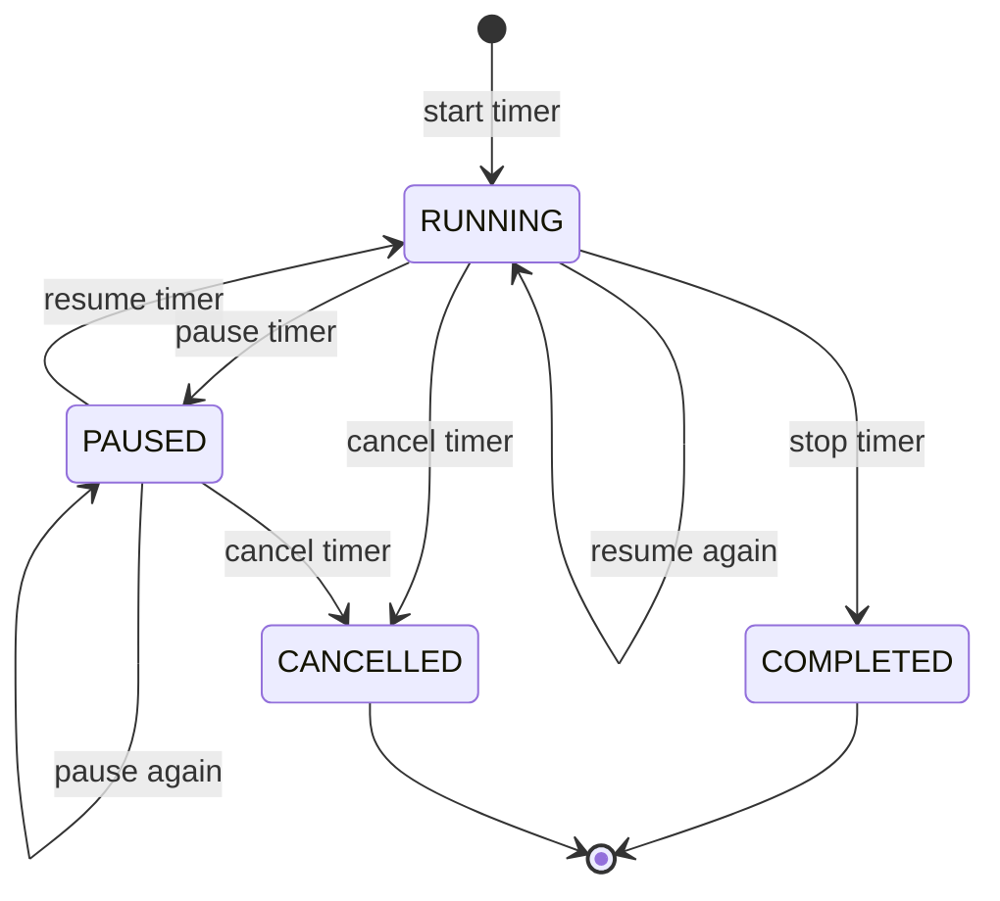
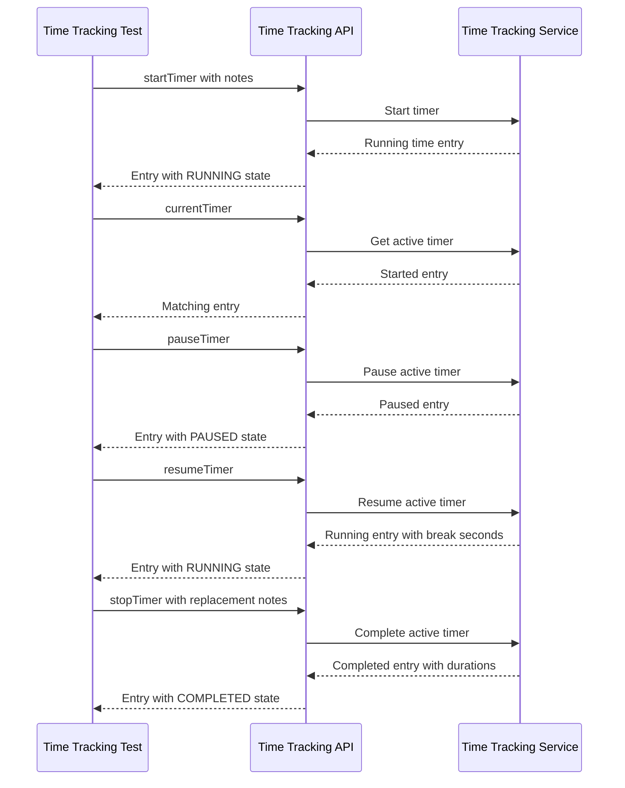
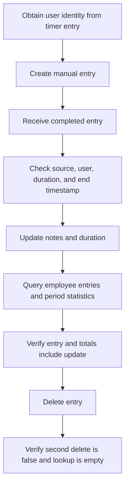
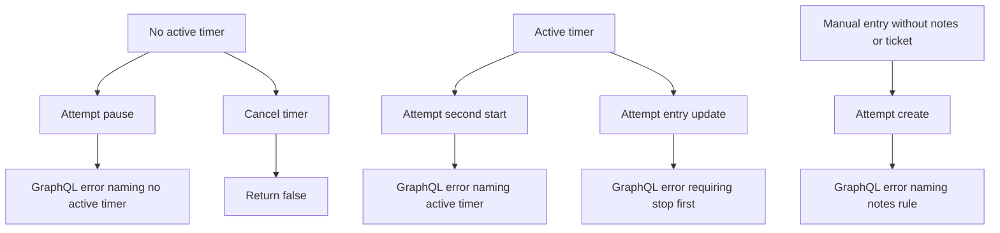

# Time Tracking Workflows

Time Tracking Workflows documents the end-to-end contract exercised by `TimeTrackingTest`. The test runs against the platform GraphQL surface and verifies that a technician can record time either with a live timer or as a completed manual entry, query the resulting entries and employee aggregates, and safely clean up test data. The implementation is supplied by the OpenFrame OSS Library artifact `com.openframe.oss:openframe-test-service-core` and is run by this repository's test service.

The source is [`TimeTrackingTest.java`](https://github.com/flamingo-stack/openframe-oss-lib/blob/16e7c1cbd9664e7d10ec5ebca7d53c9bd314decf/openframe-test-service-core/src/main/java/com/openframe/test/tests/TimeTrackingTest.java). This module is an executable API-contract test, not the server-side implementation of time-entry persistence or GraphQL resolvers.

## Scope and Guarantees

The workflow covers the following externally observable behavior:

- A caller has at most one active timer.
- Timer states progress from `RUNNING` to `PAUSED` and back to `RUNNING`, then to `COMPLETED` when stopped.
- Pausing or resuming an already-paused or already-running timer is idempotent.
- Worked duration excludes paused time, while break duration is retained and the two approximately reconstruct elapsed wall-clock time.
- Stopping a timer can replace the notes provided when it started.
- A manual entry is immediately `COMPLETED`, has source `MANUAL`, and derives its end timestamp from its start timestamp plus duration.
- Completed entries can be listed, fetched, updated, and deleted. Active timers cannot be edited.
- Employee-scoped entry lists and aggregate statistics include a matching manual entry in the requested time range.
- Manual entries require either notes or a ticket. The intended positive-duration validation is represented by a disabled test because the current GraphQL error mapping does not expose the validation failure correctly.

All data created by the test is tagged with a generated run-specific note prefix. Cleanup cancels any active timer and deletes recorded entry identifiers on a best-effort basis so that failures do not mask the original assertion.

## Architecture and Dependencies

The test uses `TimeTrackingApi` as its GraphQL client facade. It exchanges timer and entry input models with the GraphQL API and receives `TimeEntry`, paginated entry results, error payloads, and `EmployeeTimeStats`. The underlying persistence and resolver implementation is outside this module's supplied code, so this documentation describes the verified client-facing contract rather than internal storage details.

```mermaid
flowchart LR
    TestRunner["JUnit Time Tracking Test"] -->|"invokes"| ApiFacade["Time Tracking API facade"]
    ApiFacade -->|"GraphQL requests"| GraphqlApi["OpenFrame GraphQL API"]
    GraphqlApi -->|"timer and entry operations"| TimeDomain["Time tracking domain"]
    TimeDomain -->|"stores and reads"| EntryStore["Time entry persistence"]
    GraphqlApi -->|"entries, stats, errors"| ApiFacade
    ApiFacade -->|"asserted results"| TestRunner
```

### Primary API Operations

| Workflow area | Operations exercised | Verified result |
|---|---|---|
| Timer lifecycle | `startTimer`, `currentTimer`, `pauseTimer`, `resumeTimer`, `stopTimer` | State, timestamps, notes, duration, and break time follow the timer contract. |
| Timer safety | `cancelTimer`, error-attempt helpers for pause, start, and update | Missing or duplicate active timers are rejected, cancellation reports whether it acted, and running entries cannot be edited. |
| Manual entry lifecycle | `createTimeEntry`, `updateTimeEntry`, `deleteTimeEntry`, `getTimeEntry` | Completed manual entries can be created, partially edited, fetched, and deleted. |
| Query and reporting | `myTimeEntries`, `employeeTimeEntries`, `employeeTimeStats` | Entries appear in appropriate caller and employee views; period statistics include the manual entry. |
| Validation | error-attempt helper for create | Missing notes and ticket content is rejected; zero duration is an intended but currently disabled contract check. |

## Timer State Model

Timer state is server-owned. The test deliberately waits between transitions because duration and break calculations use server time and whole-second values. The pauses are not arbitrary delays: they provide enough elapsed time to assert that paused time is captured separately from worked time.

`CANCELLED` is a conceptual cleanup outcome shown for clarity: the test verifies that a cancelled active timer is no longer returned by `currentTimer` or `getTimeEntry`.

## Timer Lifecycle Interaction

The happy-path scenario starts a timer with notes, verifies its identity and running state, pauses and resumes it, then stops it with replacement notes. The test checks that `durationSeconds + breakSeconds` is within one second of wall-clock elapsed time to accommodate timestamp truncation.

## Manual Entry Workflow

A manual entry uses the user identity returned by the timer test. The raw user identifier is retained for response comparison, while its Relay-form global identifier is supplied to the manual-entry input and employee filter. If timer setup failed to provide that identity, later manual-entry cases are skipped rather than reporting misleading failures.

The partial-update assertion is important: changing notes and duration changes the derived end timestamp, but preserves the original start timestamp. The employee filter bounds the time interval around the entry and includes the target employee's global identifier.

## Guard and Validation Paths

The negative-path test makes these rules explicit:

The disabled zero-duration case preserves the desired API contract: a non-positive `durationSeconds` should return a GraphQL validation error that identifies the positive-duration requirement. It remains disabled because the documented server behavior currently surfaces a generic unexpected-error response instead of the validation message. Maintain the stronger expected assertion when the API error handler is corrected.

## Data and Time Semantics

| Field or concept | Timer behavior | Manual behavior |
|---|---|---|
| Source | `TIMER` | `MANUAL` |
| Initial state | `RUNNING` | `COMPLETED` |
| Start timestamp | Assigned when the timer starts | Supplied by caller |
| End timestamp | Assigned when the timer stops | Derived from start plus duration |
| Duration | Worked time only | Supplied duration |
| Break duration | Accumulates while paused | Not exercised by this workflow |
| Notes | Supplied at start and may be replaced at stop | Required unless a ticket is supplied, then editable |

The workflow uses UTC dates for the caller's daily-entry lookup. It builds an inclusive day window from the current UTC date through the following day, avoiding dependence on the host's local time zone.

## Test Isolation and Maintenance Notes

- `@BeforeAll` cancels any previous active timer before the suite begins. This prevents the single-active-timer guard from making the lifecycle case fail due to an earlier interrupted run.
- `@AfterAll` repeats timer cancellation and deletes every tracked entry identifier. Both cleanup paths intentionally ignore runtime failures to preserve the primary failure signal.
- The class uses ordered tests. The lifecycle case must run first because it establishes the user identity used by manual-entry cases.
- Preserve the real-time waits unless the server contract changes. Replacing them with very short waits makes whole-second timer assertions flaky.
- Keep assertions focused on public outcomes: state strings, timestamps, sources, errors, queried entries, and aggregate totals. The test should not assume a specific database or resolver implementation.
- When adding a new created entry, add its identifier to the cleanup collection immediately after creation.

## System Position

Time Tracking Workflows is part of the tenant's integration-test service. It validates the GraphQL time-tracking experience alongside ticket workflows, while persistence support is provided by the OpenFrame OSS Library's Mongo synchronization artifact through its time-entry repository contracts. The test does not directly call that repository; it observes the service through the same API boundary used by a client.
