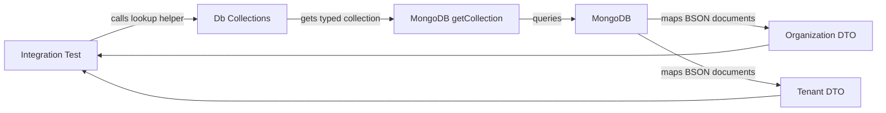
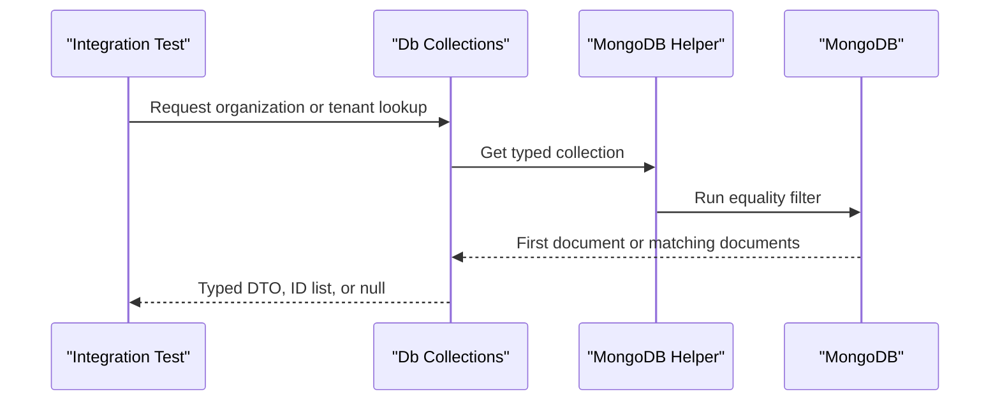

# Db Collections

Db Collections is a small test-support data-access module provided by the `com.openframe.oss:openframe-test-service-core` library. It gives integration tests typed, read-only lookup helpers for the MongoDB `organizations` and `tenants` collections. The tenant repository runs this library as part of its OpenFrame test service.

The module intentionally contains no persistence lifecycle or business logic. It centralizes collection names, BSON filters, and conversion of query results into test DTOs so test code can locate seeded or newly created records without duplicating MongoDB driver calls.

## Source and Scope

The implementation lives in the OpenFrame OSS Library rather than this repository:

- [Organizations Collection source](https://github.com/flamingo-stack/openframe-oss-lib/blob/16e7c1cbd9664e7d10ec5ebca7d53c9bd314decf/openframe-test-service-core/src/main/java/com/openframe/test/data/db/collections/OrganizationsCollection.java)
- [Tenants Collection source](https://github.com/flamingo-stack/openframe-oss-lib/blob/16e7c1cbd9664e7d10ec5ebca7d53c9bd314decf/openframe-test-service-core/src/main/java/com/openframe/test/data/db/collections/TenantsCollection.java)

## Architecture

Each helper obtains a typed MongoDB collection through the shared `MongoDB.getCollection` utility, applies a MongoDB equality filter, and returns the first matching DTO or, for organization IDs, a collected list.

## Collection Helpers

### Organizations Collection

`OrganizationsCollection` works with the `organizations` collection and the test `Organization` DTO. The DTO represents identifiers, organization metadata, contact information, lifecycle timestamps, status, and the `isDefault` designation.

| Helper | Query | Result | Use in tests |
|---|---|---|---|
| `findOrganization(String id)` | `_id` equals a newly constructed MongoDB `ObjectId` | First matching organization or `null` | Verify a known organization by its MongoDB identifier. |
| `findOrganization(boolean deleted, boolean isDefault)` | `deleted` and `isDefault` both equal the supplied values | First matching organization or `null` | Locate an organization matching lifecycle and default-organization criteria. |
| `findOrganizationIds(boolean deleted)` | `deleted` equals the supplied value | IDs of all matching organizations | Compare a set of active or deleted organization records. |

The identifier lookup assumes that `id` is valid input for `ObjectId`. Tests should provide an ObjectId-compatible value before calling it. The boolean lookup uses persisted fields directly; the `deleted` field is a database query field even though it is not declared in the supplied test DTO.

### Tenants Collection

`TenantsCollection` targets the `tenants` collection and maps results to the test `Tenant` DTO. The DTO includes its identifier, tenant name and domain, owner ID, status, plan, HubSpot identifier, and creation and update timestamps.

| Helper | Query | Result | Use in tests |
|---|---|---|---|
| `findTenantByDomain(String domain)` | `domain` equals the supplied value | First matching tenant or `null` | Resolve a tenant using its domain, the module's domain-specific convenience lookup. |
| `findTenant(String field, String value)` | The supplied field equals the supplied value | First matching tenant or `null` | Perform a generic single-field tenant lookup in tests. |

`findTenantByDomain` delegates to `findTenant("domain", domain)`, keeping the common domain lookup aligned with the generic filter implementation.

## Query Flow

## Usage Considerations

- These helpers are test infrastructure. Their static methods are optimized for concise assertions and fixture inspection rather than for production repository abstractions.
- All single-record lookups use the MongoDB driver's `first()` behavior. If more than one document matches, callers receive only the first returned record.
- The generic tenant lookup accepts a field name at runtime. Keep field names constrained to known tenant document fields in test code to avoid accidental dependence on an unintended schema field.
- `findOrganizationIds` loads matching `Organization` DTOs and then maps them to their `id` values, preserving the helper's typed collection mapping.
