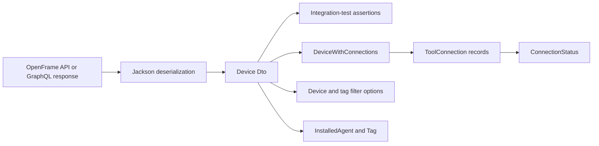
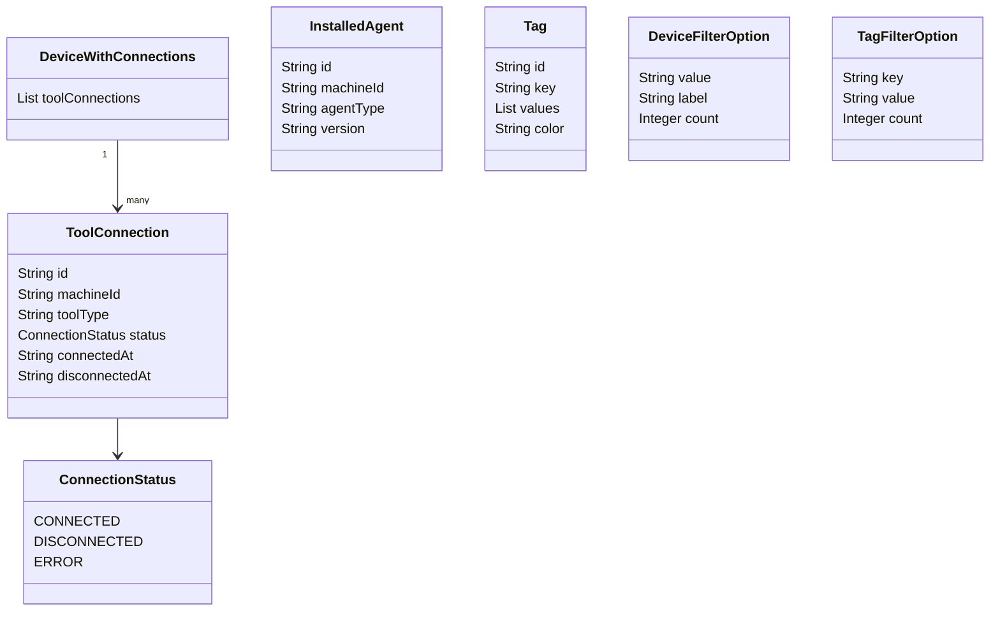
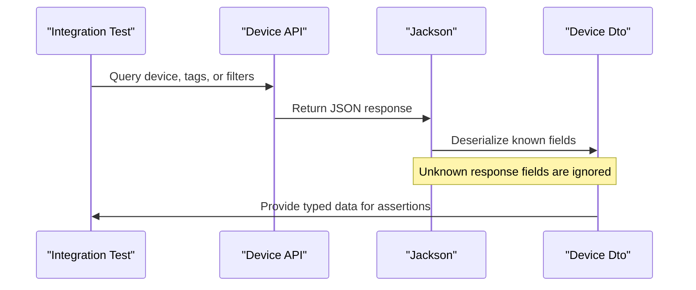

# Device Dto

Device Dto is a small set of Java data-transfer objects used by the OpenFrame test service when it deserializes device-oriented API and GraphQL responses. It is supplied by the `com.openframe.oss:openframe-test-service-core` library and runs in this repository's OpenFrame test service. The types provide a tolerant test-side view of device categories, installed agents, tool connectivity, tags, and filter facets rather than a persistence model or API implementation.

## Purpose and boundaries

The module has three responsibilities:

- Represent device and connectivity data returned to integration tests.
- Represent filter choices and their result counts for device and tag filtering assertions.
- Remain compatible with additive server-side response changes by ignoring unrecognized JSON properties.

All object DTOs use Lombok to generate accessors, constructors, equality, and builders. Their `JsonIgnoreProperties(ignoreUnknown = true)` annotation lets an older test client deserialize a response that contains fields it does not yet model. The two enumerations deliberately constrain values that tests can assert: connection state and device category.

This module does not make requests, select GraphQL fields, persist data, or determine connectivity. Those concerns belong to the test runner and API-facing test code. It only describes their deserialized payloads.

## Architecture

`DeviceWithConnections` is the aggregation point for tool connectivity: it contains a list of `ToolConnection` records. Each record has identifiers, tool metadata, lifecycle timestamps, and a `ConnectionStatus`. `ToolConnection` is defined in the same library package, although it is outside this module's supplied core component list.

## Component reference

| Component | Role | Key data |
| --- | --- | --- |
| [ConnectionStatus](https://github.com/flamingo-stack/openframe-oss-lib/blob/16e7c1cbd9664e7d10ec5ebca7d53c9bd314decf/openframe-test-service-core/src/main/java/com/openframe/test/data/dto/device/ConnectionStatus.java) | Connectivity-state enumeration for a tool connection. | `CONNECTED`, `DISCONNECTED`, `ERROR` |
| [DeviceType](https://github.com/flamingo-stack/openframe-oss-lib/blob/16e7c1cbd9664e7d10ec5ebca7d53c9bd314decf/openframe-test-service-core/src/main/java/com/openframe/test/data/dto/device/DeviceType.java) | Device-category enumeration. | Desktop, laptop, server, mobile device, tablet, network device, IoT device, virtual machine, container host, other |
| [DeviceWithConnections](https://github.com/flamingo-stack/openframe-oss-lib/blob/16e7c1cbd9664e7d10ec5ebca7d53c9bd314decf/openframe-test-service-core/src/main/java/com/openframe/test/data/dto/device/DeviceWithConnections.java) | Device response projection focused on integrated-tool connections. | `toolConnections` |
| [InstalledAgent](https://github.com/flamingo-stack/openframe-oss-lib/blob/16e7c1cbd9664e7d10ec5ebca7d53c9bd314decf/openframe-test-service-core/src/main/java/com/openframe/test/data/dto/device/InstalledAgent.java) | Installed agent inventory record. | Agent and machine IDs, type, version, creation and update timestamps |
| [Tag](https://github.com/flamingo-stack/openframe-oss-lib/blob/16e7c1cbd9664e7d10ec5ebca7d53c9bd314decf/openframe-test-service-core/src/main/java/com/openframe/test/data/dto/device/Tag.java) | Structured device tag returned by the API. | ID, key, values, description, color, creation timestamp |
| [DeviceFilterOption](https://github.com/flamingo-stack/openframe-oss-lib/blob/16e7c1cbd9664e7d10ec5ebca7d53c9bd314decf/openframe-test-service-core/src/main/java/com/openframe/test/data/dto/device/DeviceFilterOption.java) | Displayable device-filter facet. | Value, label, count |
| [TagFilterOption](https://github.com/flamingo-stack/openframe-oss-lib/blob/16e7c1cbd9664e7d10ec5ebca7d53c9bd314decf/openframe-test-service-core/src/main/java/com/openframe/test/data/dto/device/TagFilterOption.java) | Tag-filter facet. | Key, value, count |

## Data relationships

### Device and tool connectivity

`DeviceWithConnections` intentionally carries only `toolConnections`; it should not be treated as a full device record. A `ToolConnection` links a machine to a tool through `machineId`, `toolType`, and `agentToolId`, records connection timestamps, and exposes a status from `ConnectionStatus`.

The `ToolConnection.vulnerabilitiesUpdatedAt` field is present in the DTO but is not currently selected by the device query. The library's source notes that selecting it against tenant APIs that predate the corresponding schema field causes GraphQL validation to reject the entire query. Keep this field unasserted unless the relevant tenant API schema is known to support it.

### Agent inventory

`InstalledAgent` identifies the installed agent and its owning machine, then exposes its agent type, version, and lifecycle timestamps. It is appropriate for assertions about registration or agent-version visibility, but it does not encode installation state transitions.

### Tags and filtering

`Tag` models a tag as a `key` plus a list of `values`, not as one flattened name. This distinction is important when constructing test expectations: a tag can associate one key with multiple values. `DeviceFilterOption` supplies a selectable value, human-facing label, and count; `TagFilterOption` instead preserves the tag key and value separately. Counts are nullable `Integer` values, so test code should only assert a count when the queried response is expected to provide one.

## Typical response flow

## Maintenance guidance

- Add fields conservatively when server responses evolve. Unknown-field tolerance supports forward compatibility, but tests cannot inspect data that the DTO does not declare.
- Preserve the tag key-to-values shape. Replacing it with a single name changes the API contract represented by tests.
- Update enum values only when the associated service contract adds a supported state or device type.
- Treat timestamps as strings in this module; parsing and time-zone semantics are outside its current contract.
- When changing connection assertions, verify the GraphQL selection and tenant schema together, especially for fields that may be deployed at different library versions.
