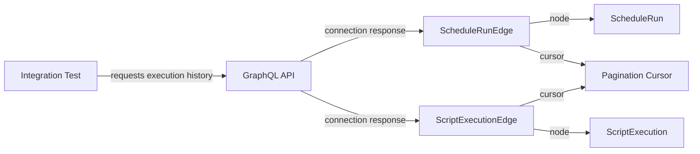
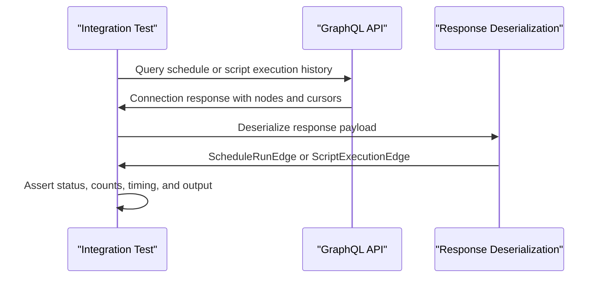

# Execution Dto

Execution Dto supplies test-side Java data-transfer objects for deserializing GraphQL execution and schedule-history responses. It is implemented by the `com.openframe.oss:openframe-test-service-core` library (version `7.0.11`), which this repository runs as part of its OpenFrame test service. The objects deliberately model response data rather than execute work: they make end-to-end tests able to assert dispatch progress, per-device script outcomes, and cursor-based pagination.

## Scope

The module contains three response-shaping types:

- [`ScheduleRun`](https://github.com/flamingo-stack/openframe-oss-lib/blob/16e7c1cbd9664e7d10ec5ebca7d53c9bd314decf/openframe-test-service-core/src/main/java/com/openframe/test/data/dto/execution/ScheduleRun.java) represents one firing of a schedule across its assigned devices.
- [`ScheduleRunEdge`](https://github.com/flamingo-stack/openframe-oss-lib/blob/16e7c1cbd9664e7d10ec5ebca7d53c9bd314decf/openframe-test-service-core/src/main/java/com/openframe/test/data/dto/execution/ScheduleRunEdge.java) wraps a schedule-run node and the cursor used by a GraphQL connection.
- [`ScriptExecutionEdge`](https://github.com/flamingo-stack/openframe-oss-lib/blob/16e7c1cbd9664e7d10ec5ebca7d53c9bd314decf/openframe-test-service-core/src/main/java/com/openframe/test/data/dto/execution/ScriptExecutionEdge.java) wraps a per-machine `ScriptExecution` record and its pagination cursor.

## Architecture

The edge types follow the GraphQL connection convention: `node` retains the domain response while `cursor` identifies that item’s position for a subsequent page request. `ScheduleRun` is an aggregate view of one schedule dispatch; `ScriptExecution` is its device-level execution detail.

## Component Responsibilities

### ScheduleRun

`ScheduleRun` captures the lifecycle and aggregate response state for one schedule fire:

| Field group | Fields | Test purpose |
|---|---|---|
| Identity and linkage | `id`, `executionId`, `scheduleId` | Correlate the run with its execution and schedule. |
| Lifecycle | `status`, `dispatchedAt`, `finishedAt` | Assert that dispatch occurred and that the run reaches an expected terminal or in-progress state. |
| Aggregate progress | `totalMachineCount`, `respondedMachineCount` | Verify the number of targets and recorded device responses. |

The timestamps are represented as strings, preserving the API response format for assertions without imposing a client-side time parser.

### ScheduleRunEdge

`ScheduleRunEdge` is a minimal connection element containing:

- `node`: the associated `ScheduleRun`.
- `cursor`: the opaque pagination position associated with that node.

Tests can inspect `node` for execution state and retain `cursor` when validating traversal of paginated schedule-run history.

### ScriptExecutionEdge

`ScriptExecutionEdge` applies the same connection shape to `ScriptExecution`. The referenced execution record includes identifiers, script and schedule associations, state timestamps, the target machine, requested privilege level, process output, error details, exit code, and timeout status. This supports assertions for both successful and failed device-level script activity without embedding those fields again in the edge.

## Data Flow

## Serialization and Construction

All three types use the same interoperability pattern:

- `@JsonIgnoreProperties(ignoreUnknown = true)` accepts forward-compatible API responses by ignoring fields that the test model does not currently declare.
- Lombok `@Data` generates accessors and value-oriented methods used by test assertions.
- Lombok `@Builder`, `@NoArgsConstructor`, and `@AllArgsConstructor` support both JSON deserialization and concise fixture construction.

## Maintenance Notes

Keep these classes aligned with the GraphQL response fragments consumed by test code. Add a field when tests need to observe a newly exposed response value, but preserve tolerance for unknown fields so server-side schema additions do not break existing response deserialization. Changes to the paging contract should update both edge types consistently because each is a GraphQL connection element.
