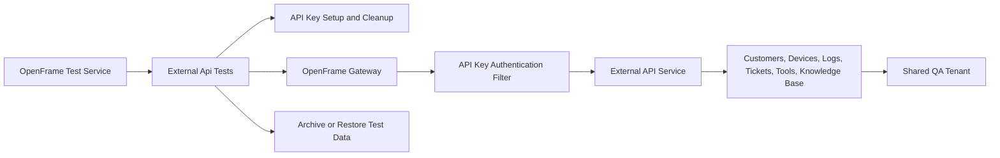
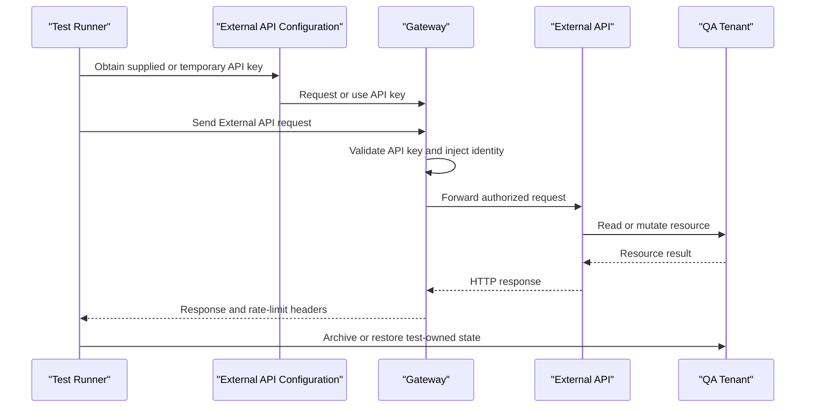

# External Api Tests

External Api Tests is the integration suite that verifies the public, API-key-protected External API against a live tenant. It is implemented by the `openframe-test-service-core` library from OpenFrame OSS Library and run by this repository's OpenFrame test service. The suite covers authentication, customers, devices, knowledge base content, logs, pagination, tickets, and integrated tools.

The tests use Rest Assured to call the External API surface and AssertJ to verify HTTP status codes, response shapes, state transitions, validation failures, and cleanup behavior. Every concrete class is gated by `ExternalApiConfig.canObtainApiKey`; a run without usable credentials is skipped rather than reported as a cascade of assertion failures.

## Scope and Contract

The suite is a consumer-contract test layer rather than a unit-test layer. It verifies the behavior exposed to API-key clients:

- The gateway accepts a valid `X-API-Key`, rejects missing, empty, malformed, and unknown keys, and does not trust caller-supplied identity headers.
- Resource endpoints return expected models, enforce validation, and preserve lifecycle invariants.
- List endpoints apply documented limits and cursors consistently.
- API responses include rate-limit information where the gateway contract requires it.
- Tests isolate their changes: they create their own customers, tickets, knowledge-base records, tags, and attachments; changes to pre-existing devices are restored.

## Architecture Overview

The request path is deliberately end-to-end: the tests exercise the gateway's key gate and routing as well as the External API service controllers. This makes authentication, rate limiting, principal propagation, and serialized HTTP contracts observable from the same boundary used by integrations.

## Test Execution Model

A caller may provide a key through the runner or `TEST_EXTERNAL_API_KEY`. Otherwise, the shared base class provisions a key through the administrative API-key endpoint, and `ExternalApiKeyExtension` removes the temporary key when the run completes. A supplied key is never deleted.

## Safety and Isolation

`ExternalApiBaseTest` maintains a class-level list of created customer identifiers and archives them in best-effort teardown. The customer, ticket, and knowledge-base suites are ordered because later checks use fixtures created by earlier checks. Dependent tests use assumptions to skip cleanly when fixture creation failed.

Device cases operate on tenant-owned devices because the External API cannot create them. The nickname test stores the original value and restores it in a `finally` block. The terminal device-status operation is explicitly tagged `destructive` and is not part of the default suite.

Log tests are read-only and accept an empty tenant. They also accommodate the fact that the log query path is backed by Pinot and can expose service-specific availability behavior.

## External API Coverage

| Area | Primary responsibility | Contract examples |
| --- | --- | --- |
| Authentication | Verify the gateway API-key boundary | Valid and invalid keys, spoofed identity headers, rate-limit headers |
| Customers | Exercise the customer lifecycle | Create, read, list, update, archive, restore, and validation |
| Devices and tools | Verify operational inventory APIs | Device reads and filters, reversible nickname update, tool filters |
| Knowledge base | Exercise hierarchical content management | Folders, articles, tags, publication state, attachments, and deletion rules |
| Logs | Validate observability queries | Listing, filters, composite-key details, and error cases |
| Pagination | Assert shared cursor semantics | Limit bounds, malformed cursors, and past-end behavior |
| Tickets | Exercise ticket workflows as the key owner | CRUD-style operations, notes, assignment, transitions, and cleanup |

## Detailed Modules

- [Authentication and Shared Setup](external_api_tests/authentication_and_shared_setup/authentication_and_shared_setup.md) explains key provisioning, gateway authentication assertions, rate-limit checks, and shared cleanup.
- [Customers and Pagination](external_api_tests/customers_and_pagination/customers_and_pagination.md) documents customer lifecycle isolation and shared cursor-boundary coverage.
- [Devices, Logs, and Tools](external_api_tests/device_logs_and_tools/device_logs_and_tools.md) covers tenant-owned operational resources, including the opt-in destructive device case.
- [Knowledge Base Lifecycle](external_api_tests/knowledge_base_lifecycle/knowledge_base_lifecycle.md) describes ordered folder, article, tag, and attachment workflows.
- [Ticket Lifecycle](external_api_tests/ticket_lifecycle/ticket_lifecycle.md) details principal-aware ticket operations, transitions, and archival teardown.

## Source Components

The following OpenFrame OSS Library sources define this module:

- [External Api Auth Test](https://github.com/flamingo-stack/openframe-oss-lib/blob/16e7c1cbd9664e7d10ec5ebca7d53c9bd314decf/openframe-test-service-core/src/main/java/com/openframe/test/tests/external/ExternalApiAuthTest.java)
- [External Api Base Test](https://github.com/flamingo-stack/openframe-oss-lib/blob/16e7c1cbd9664e7d10ec5ebca7d53c9bd314decf/openframe-test-service-core/src/main/java/com/openframe/test/tests/external/ExternalApiBaseTest.java)
- [External Customers Test](https://github.com/flamingo-stack/openframe-oss-lib/blob/16e7c1cbd9664e7d10ec5ebca7d53c9bd314decf/openframe-test-service-core/src/main/java/com/openframe/test/tests/external/ExternalCustomersTest.java)
- [External Devices Test](https://github.com/flamingo-stack/openframe-oss-lib/blob/16e7c1cbd9664e7d10ec5ebca7d53c9bd314decf/openframe-test-service-core/src/main/java/com/openframe/test/tests/external/ExternalDevicesTest.java)
- [External Knowledge Base Test](https://github.com/flamingo-stack/openframe-oss-lib/blob/16e7c1cbd9664e7d10ec5ebca7d53c9bd314decf/openframe-test-service-core/src/main/java/com/openframe/test/tests/external/ExternalKnowledgeBaseTest.java)
- [External Logs Test](https://github.com/flamingo-stack/openframe-oss-lib/blob/16e7c1cbd9664e7d10ec5ebca7d53c9bd314decf/openframe-test-service-core/src/main/java/com/openframe/test/tests/external/ExternalLogsTest.java)
- [External Pagination Test](https://github.com/flamingo-stack/openframe-oss-lib/blob/16e7c1cbd9664e7d10ec5ebca7d53c9bd314decf/openframe-test-service-core/src/main/java/com/openframe/test/tests/external/ExternalPaginationTest.java)
- [External Tickets Test](https://github.com/flamingo-stack/openframe-oss-lib/blob/16e7c1cbd9664e7d10ec5ebca7d53c9bd314decf/openframe-test-service-core/src/main/java/com/openframe/test/tests/external/ExternalTicketsTest.java)
- [External Tools Test](https://github.com/flamingo-stack/openframe-oss-lib/blob/16e7c1cbd9664e7d10ec5ebca7d53c9bd314decf/openframe-test-service-core/src/main/java/com/openframe/test/tests/external/ExternalToolsTest.java)

## Service Context

The tenant deployment routes the gateway path `/api-docs/**` to `openframe-external-api`; External Api Tests access the External API through the gateway so that API-key enforcement is part of the assertion boundary. The External API implementation is supplied by the `com.openframe.oss:openframe-external-api-service-core` library at version `7.0.11`, while this module is supplied by `com.openframe.oss:openframe-test-service-core` at the same pinned version.
