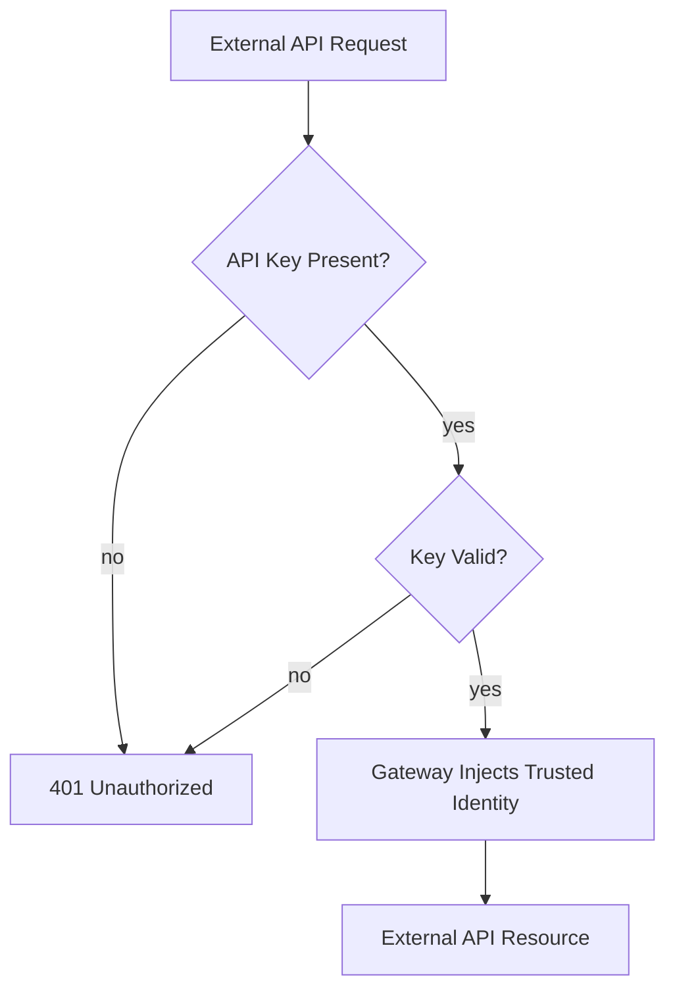

# Authentication and Shared Setup

[External Api Tests](../../external-api-tests.md) uses this layer to provision credentials, verify the gateway boundary, and make shared cleanup safe.

## Responsibilities

`ExternalApiBaseTest` extends the suite base class and installs `ExternalApiKeyExtension`. It exposes the common enabled condition, obtains and logs a masked API key, tracks created customers, and archives those customers in a best-effort teardown. A supplied key is retained; a temporary test key is removed by the extension.

`ExternalApiAuthTest` probes the inexpensive, unpaginated tools endpoint to isolate gateway behavior from a resource-specific workflow. It checks:

- a valid key produces `200`;
- absent, malformed, unknown, and empty keys produce `401` with `UNAUTHORIZED`;
- spoofed `X-User-Id` and `X-API-Key-Id` headers cannot bypass key validation; and
- minute, hour, and day rate-limit headers are positive and internally ordered.

## Execution Constraints

Every concrete class must carry `@EnabledIf` itself because JUnit does not inherit that annotation. The cleanup extension is inherited, so it remains on the shared base class. This arrangement prevents an incompletely configured test environment from being represented as unrelated functional failures.

## Source Components

- [External Api Base Test](https://github.com/flamingo-stack/openframe-oss-lib/blob/16e7c1cbd9664e7d10ec5ebca7d53c9bd314decf/openframe-test-service-core/src/main/java/com/openframe/test/tests/external/ExternalApiBaseTest.java)
- [External Api Auth Test](https://github.com/flamingo-stack/openframe-oss-lib/blob/16e7c1cbd9664e7d10ec5ebca7d53c9bd314decf/openframe-test-service-core/src/main/java/com/openframe/test/tests/external/ExternalApiAuthTest.java)
