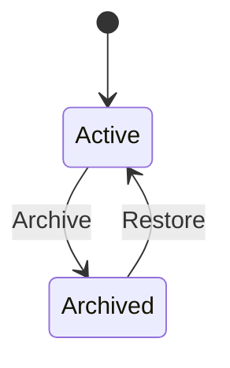

# Customers and Pagination

[External Api Tests](../../external-api-tests.md) verifies customer lifecycle behavior and the pagination contract that customers share with devices, tickets, and logs.

## Customer Lifecycle

`ExternalCustomersTest` creates an isolated customer and performs ordered read, list, update, archive, and restoration checks. It validates that the route identifier round-trips in the response, a new customer is active and not default, physical-address copying works when requested, and archived records are omitted from an active listing. It also confirms `404` for an unknown identifier and `400` for a missing name.

Customer teardown archives all records registered through `trackCustomer`. Archive is intentionally reversible, which makes it the least destructive cleanup supported by the public API.

## Pagination Contract

`ExternalPaginationTest` sends raw requests to customer, device, ticket, and log controllers so it can assert their HTTP statuses directly. It tests the common limit interval of `1` through `100`, response page size, rejection of malformed cursors, and the empty-page semantics of a well-formed cursor past the final result.

The cursor-advance test remains disabled because the implementation can mark exactly-full final pages as having a successor. It is retained as a regression test pending an API fix rather than weakening the intended cursor contract.

## Source Components

- [External Customers Test](https://github.com/flamingo-stack/openframe-oss-lib/blob/16e7c1cbd9664e7d10ec5ebca7d53c9bd314decf/openframe-test-service-core/src/main/java/com/openframe/test/tests/external/ExternalCustomersTest.java)
- [External Pagination Test](https://github.com/flamingo-stack/openframe-oss-lib/blob/16e7c1cbd9664e7d10ec5ebca7d53c9bd314decf/openframe-test-service-core/src/main/java/com/openframe/test/tests/external/ExternalPaginationTest.java)
