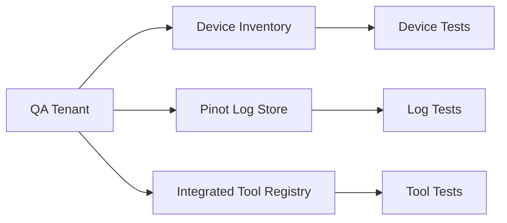

# Devices, Logs, and Tools

[External Api Tests](../../external-api-tests.md) covers tenant-owned operational data without creating or deleting live device records.

## Devices

`ExternalDevicesTest` verifies device listings, optional tag materialization, filter metadata, single-device reads, unknown-device handling, status filtering, and nickname persistence. It compares list and detail projections while excluding fields expected to change during a live agent check-in. The nickname is always restored in a `finally` block.

The only status-writing scenario is tagged `destructive`. It operates only on an already archived device because terminal status changes cannot be reversed through the External API.

## Logs

`ExternalLogsTest` validates list and filter response integrity, severity filtering, details lookup using the five-field composite key, missing-parameter validation, and unknown-event handling. An empty tenant is valid. Log queries use Pinot rather than Mongo, so availability failures on this path require service-aware diagnosis.

## Tools

`ExternalToolsTest` checks the read-only integrated-tool registry. It requires usable tool records, validates filter response contents, verifies `enabled=true` excludes disabled tools, and round-trips an advertised category through the list filter.

## Source Components

- [External Devices Test](https://github.com/flamingo-stack/openframe-oss-lib/blob/16e7c1cbd9664e7d10ec5ebca7d53c9bd314decf/openframe-test-service-core/src/main/java/com/openframe/test/tests/external/ExternalDevicesTest.java)
- [External Logs Test](https://github.com/flamingo-stack/openframe-oss-lib/blob/16e7c1cbd9664e7d10ec5ebca7d53c9bd314decf/openframe-test-service-core/src/main/java/com/openframe/test/tests/external/ExternalLogsTest.java)
- [External Tools Test](https://github.com/flamingo-stack/openframe-oss-lib/blob/16e7c1cbd9664e7d10ec5ebca7d53c9bd314decf/openframe-test-service-core/src/main/java/com/openframe/test/tests/external/ExternalToolsTest.java)
