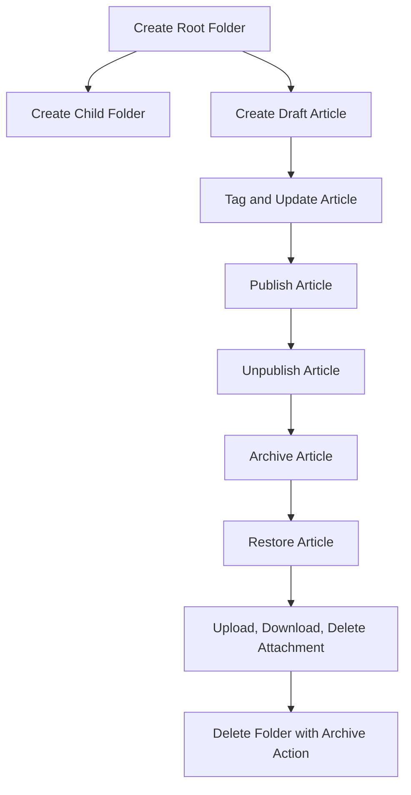

# Knowledge Base Lifecycle

[External Api Tests](../../external-api-tests.md) exercises the External API knowledge-base surface as an ordered lifecycle over records created by the suite.

## Covered Workflow

`ExternalKnowledgeBaseTest` creates a root folder, a child folder, and a draft article. It then verifies folder naming and listing, item listing and detail retrieval, moves, invalid cyclic moves, tag assignment and removal, article updates, publishing, unpublishing, archiving, restoration, attachment upload and download, and folder deletion behavior.

A tag is created through GraphQL because the External API cannot create tags. The suite converts its Relay identifier to the raw identifier accepted by the External API. Attachment upload and download verify bytes rather than only metadata.

## Cleanup Behavior

The suite uses `@AfterAll` to delete an outstanding attachment, delete a remaining root folder with the archive action, archive an active article, and delete its unique GraphQL-created tag. Each dependent stage checks that its fixture exists and skips with context when an earlier stage failed. This preserves the original failure signal while minimizing abandoned test records.

## Source Component

- [External Knowledge Base Test](https://github.com/flamingo-stack/openframe-oss-lib/blob/16e7c1cbd9664e7d10ec5ebca7d53c9bd314decf/openframe-test-service-core/src/main/java/com/openframe/test/tests/external/ExternalKnowledgeBaseTest.java)
