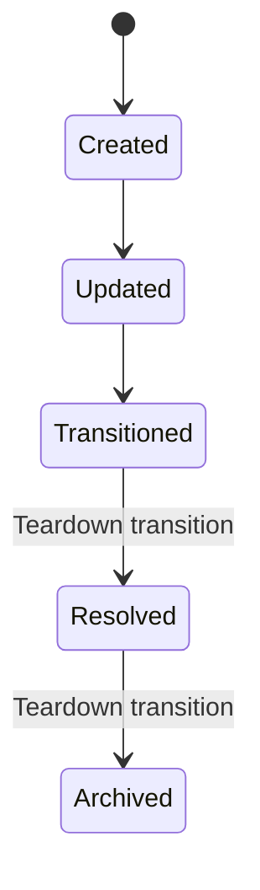

# Ticket Lifecycle

[External Api Tests](../../external-api-tests.md) verifies the largest External API resource surface: tickets and their user-attributed operations.

## Principal-Aware Operations

`ExternalTicketsTest` is distinct from the other resource suites because ticket operations resolve a principal from the gateway-generated `X-User-Id`. The tests therefore verify that an API key acts as its owner, particularly when it creates notes and the response exposes the note author.

The ordered workflow creates one ticket, reads and lists it, updates it, validates reference data, modifies tags and assignment, adds and updates a note, validates its visibility, deletes it, follows an advertised lifecycle transition, unlinks related device and customer records, and exercises invalid lookups and request validation.

## Cleanup and Transition Rules

The External API does not provide ticket deletion. Teardown finds tenant status definitions, moves the test-created ticket to a `RESOLVED` status, then to `ARCHIVED`. The two-step cleanup is required because a newly created ticket is not permitted to transition directly to archived status. Cleanup is best effort so it cannot hide the failure that caused teardown to run.

The test only asserts successful transition to a target advertised in `availableTransitions`; this treats the server response as the authoritative per-ticket transition policy.

## Source Component

- [External Tickets Test](https://github.com/flamingo-stack/openframe-oss-lib/blob/16e7c1cbd9664e7d10ec5ebca7d53c9bd314decf/openframe-test-service-core/src/main/java/com/openframe/test/tests/external/ExternalTicketsTest.java)
