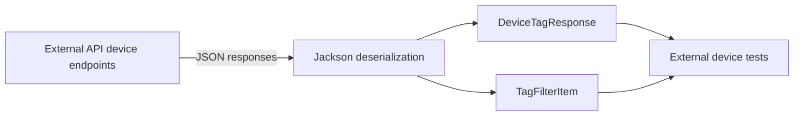
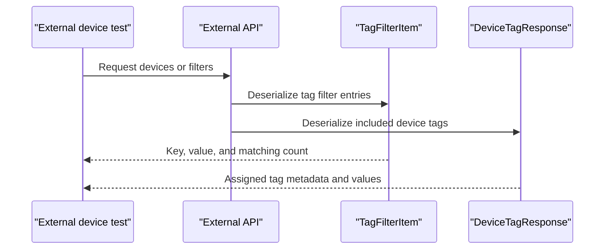

# External Device Dto

External Device Dto is a small test-facing representation of device-tag data returned by the OpenFrame External API. It belongs to the `openframe-test-service-core` library from the OpenFrame OSS Library and is assembled at runtime by this repository's OpenFrame test service. The two DTOs mirror the External API OpenAPI contract version 1.1.0, allowing external device tests to deserialize tag payloads without coupling test code to production controller classes.

## Purpose and Scope

The module models two related but distinct views of tags:

- `DeviceTagResponse` represents a tag assigned to one device, including tag definition metadata, its assigned values, and assignment audit fields.
- `TagFilterItem` represents one selectable tag key/value filter together with the count of matching devices.

Both types use Jackson's unknown-property tolerance. This makes tests forward-compatible with additive API response fields while retaining strongly typed access to the contract fields they assert.

## Architecture Overview

The production External API owns the response schema. The test library supplies structurally compatible DTOs that are used when external device tests call the API. The DTO module itself contains no endpoint logic, persistence, validation, or filtering algorithm.

## Components

### DeviceTagResponse

Source: [DeviceTagResponse.java](https://github.com/flamingo-stack/openframe-oss-lib/blob/16e7c1cbd9664e7d10ec5ebca7d53c9bd314decf/openframe-test-service-core/src/main/java/com/openframe/test/data/dto/external/device/DeviceTagResponse.java).

`DeviceTagResponse` is a mutable Lombok data object with a builder and no-argument and all-argument constructors. It describes a tag assignment in device-oriented API payloads.

| Field | Meaning |
|---|---|
| `tagId` | Identifier of the tag definition. |
| `key` | Tag key identifier, such as a classification name. |
| `description` | Human-readable description of the tag. |
| `color` | Display color supplied by the API. |
| `values` | Values assigned to the tag for the device. |
| `createdAt` | Assignment timestamp as an `Instant`. |
| `createdBy` | Identifier of the user that assigned the tag. |

The `values` collection is important: a single tag definition can carry multiple values on a device. Consumers should preserve it as a collection rather than assume a scalar tag value.

### TagFilterItem

Source: [TagFilterItem.java](https://github.com/flamingo-stack/openframe-oss-lib/blob/16e7c1cbd9664e7d10ec5ebca7d53c9bd314decf/openframe-test-service-core/src/main/java/com/openframe/test/data/dto/external/device/TagFilterItem.java).

`TagFilterItem` is a mutable Lombok data object with builder support. It carries the exact tag key/value pair that can be applied as a device filter and the API-provided number of devices matching that pair.

| Field | Meaning |
|---|---|
| `key` | Tag key used to identify the filter dimension. |
| `value` | Value within that tag key. |
| `count` | Number of devices represented by the filter item. |

`count` is an `Integer`, so consumers should tolerate an absent value when processing incomplete or evolving responses. A non-negative count represents an advertised filter option; it does not independently establish that a subsequent device query will return a stable result in a changing tenant.

## Contract Relationship

The production counterparts are defined in the OpenFrame External API service core. Their field sets align with the test models: the production `DeviceTagResponse` declares the tag definition, values, and audit fields, while the production `TagFilterItem` is a record containing `key`, `value`, and `count`.

## Test Usage

External device integration tests validate device listing, optional tag inclusion, filter discovery, device lookup, and device filtering. In particular, the device-list test path treats tag inclusion as opt-in: requesting tags materializes a tags collection, which may legitimately be empty. Filter tests treat the count as useful selection data and use a positive count when choosing a filter value.

Because these models are generated from the API contract, update them when the OpenAPI device-tag schema changes. Preserve the Jackson compatibility annotation unless the test suite intentionally needs strict rejection of unknown response fields.

## Maintenance Notes

- Keep field names and types synchronized with the External API contract.
- Retain `Instant` for `createdAt` so Jackson can represent an absolute assignment time.
- Preserve builder and constructor support when test fixtures need to create expected values.
- Avoid adding business rules to these DTOs; endpoint behavior is tested by the external-device test suite and implemented by the External API service.
