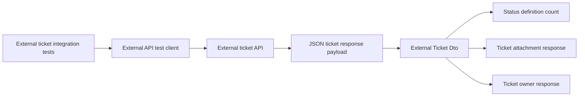
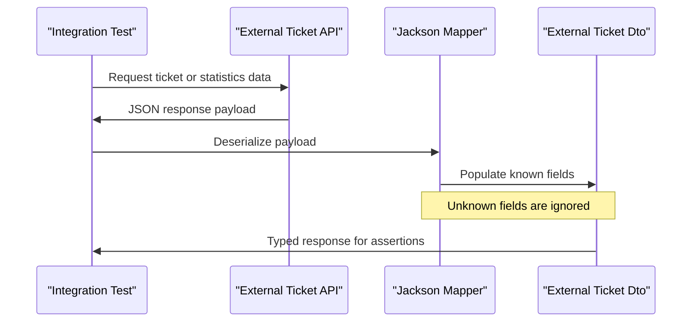

# External Ticket Dto

External Ticket Dto is a small set of Java data-transfer objects used by the OpenFrame integration-test service to deserialize ticket-related responses from the External API. It is supplied by the **OpenFrame OSS Library** artifact `com.openframe.oss:openframe-test-service-core` and is executed by this repository's OpenFrame test service. The classes mirror the External API OpenAPI contract version 1.1.0 and deliberately tolerate response fields introduced by newer server versions.

## Purpose and Scope

The module represents three response fragments used when validating the ticket API:

- a count associated with one lifecycle-status definition;
- metadata for an attachment belonging to a ticket; and
- the identity of a ticket owner.

These are test-side contract models, not persistence entities and not request payloads. Lombok generates their accessors, mutators, builders, and constructors. Jackson uses the no-argument constructor and setters during JSON deserialization.

## Architecture Overview

The External API exposes ticket operations below `/api/v1/tickets`. In particular, the ticket-statistics response contains lifecycle-status breakdowns, while a detailed ticket response can include attachment metadata and ticket ownership. The server-side `TicketController` resolves the caller, delegates ticket work to ticket services, and maps domain results to the public response contract. External Ticket Dto provides the corresponding test representations needed to assert those responses.

## Components

| Component | Responsibility | Source |
| --- | --- | --- |
| `StatusDefinitionCount` | Associates a deserialized ticket-status definition with its count in a statistics breakdown. | [StatusDefinitionCount.java](https://github.com/flamingo-stack/openframe-oss-lib/blob/16e7c1cbd9664e7d10ec5ebca7d53c9bd314decf/openframe-test-service-core/src/main/java/com/openframe/test/data/dto/external/ticket/StatusDefinitionCount.java) |
| `TicketAttachmentResponse` | Describes one ticket attachment without carrying the attachment content. | [TicketAttachmentResponse.java](https://github.com/flamingo-stack/openframe-oss-lib/blob/16e7c1cbd9664e7d10ec5ebca7d53c9bd314decf/openframe-test-service-core/src/main/java/com/openframe/test/data/dto/external/ticket/TicketAttachmentResponse.java) |
| `TicketOwnerResponse` | Identifies whether ownership belongs to a client device or an administrative user. | [TicketOwnerResponse.java](https://github.com/flamingo-stack/openframe-oss-lib/blob/16e7c1cbd9664e7d10ec5ebca7d53c9bd314decf/openframe-test-service-core/src/main/java/com/openframe/test/data/dto/external/ticket/TicketOwnerResponse.java) |

## Data Models

### Status Definition Count

`StatusDefinitionCount` contains:

| Field | Type | Meaning |
| --- | --- | --- |
| `status` | `TicketStatusResponse` | The lifecycle-status definition to which the count applies. |
| `count` | `Integer` | Number of tickets in that status. |

The status-breakdown collection can be empty when ticket lifecycle support is disabled. Tests should therefore assert that the collection is present when the endpoint contract requires it, and should treat a missing numeric count defensively when calculating totals. The external ticket integration suite verifies that each returned entry has a status and a non-negative count, and that the sum does not exceed the reported total ticket count.

### Ticket Attachment Response

`TicketAttachmentResponse` is attachment metadata only. It contains no binary content and supports assertions about identity, association, and upload details.

| Field | Type | Meaning |
| --- | --- | --- |
| `id` | `String` | Attachment identifier. |
| `ticketId` | `String` | Identifier of the ticket that owns the attachment. |
| `fileName` | `String` | Original attachment filename. |
| `contentType` | `String` | Attachment MIME type. |
| `fileSize` | `Long` | Attachment size in bytes. |
| `uploadedAt` | `Instant` | Upload time. |
| `uploadedBy` | `String` | Identifier of the uploader, which may be a user or a machine. |

### Ticket Owner Response

`TicketOwnerResponse` models ownership as a discriminator plus the relevant identifier.

| Field | Type | Meaning |
| --- | --- | --- |
| `type` | `String` | Owner category. Known contract values are `CLIENT` and `ADMIN`. |
| `machineId` | `String` | Owning device machine identifier for a `CLIENT` owner. |
| `userId` | `String` | Owning user identifier for an `ADMIN` owner. |

The test DTO intentionally stores `type` as `String`, rather than a Java enum. This forward-compatible choice means a newly introduced backend owner category can still deserialize, allowing the test suite to inspect the response rather than failing immediately during JSON parsing.

## Deserialization and Compatibility

Every model is annotated with `@JsonIgnoreProperties(ignoreUnknown = true)`. This makes the test client compatible with additive External API changes: fields added by a newer server are ignored until the test artifact is updated. It does not relax assertions on fields that the tests explicitly inspect.

## Relationship to the Ticket API

The module follows the API contract; it does not implement ticket behavior. When changing the external ticket endpoint, maintain the correspondence between:

1. the External API response DTO and OpenAPI description;
2. the test-service External Ticket Dto counterpart; and
3. assertions in the external ticket integration tests.

The response models support tests that create, retrieve, list, update, transition, assign, and archive tickets. Detailed reads are expected to materialize collections such as attachments, while ticket statistics supplies the per-status data represented by `StatusDefinitionCount`.

## Maintenance Notes

- Preserve `Instant` for `uploadedAt` so tests retain an absolute, timezone-independent timestamp.
- Keep attachment fields as metadata unless the External API contract explicitly returns binary content.
- If a new owner type is introduced, update behavioral assertions as necessary, but retain the string representation when forward-compatible deserialization remains desirable.
- Add fields only when the External API contract exposes them and tests need to inspect them; `ignoreUnknown` already accommodates unrelated additive fields.
