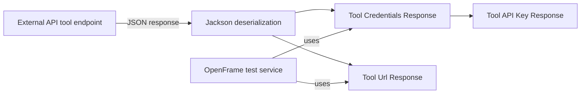
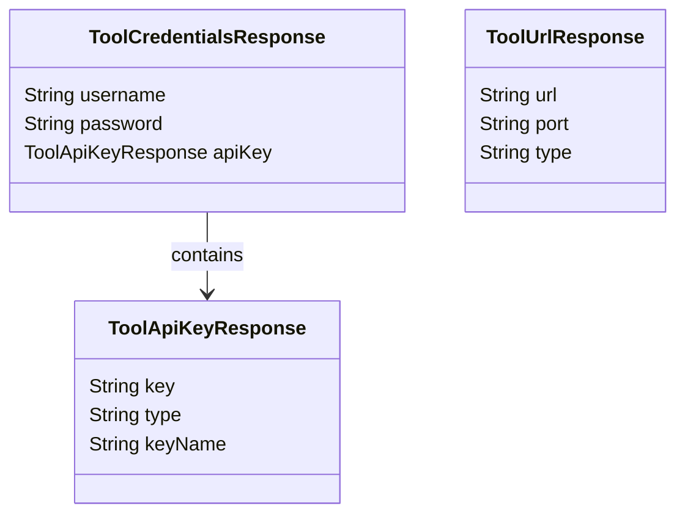
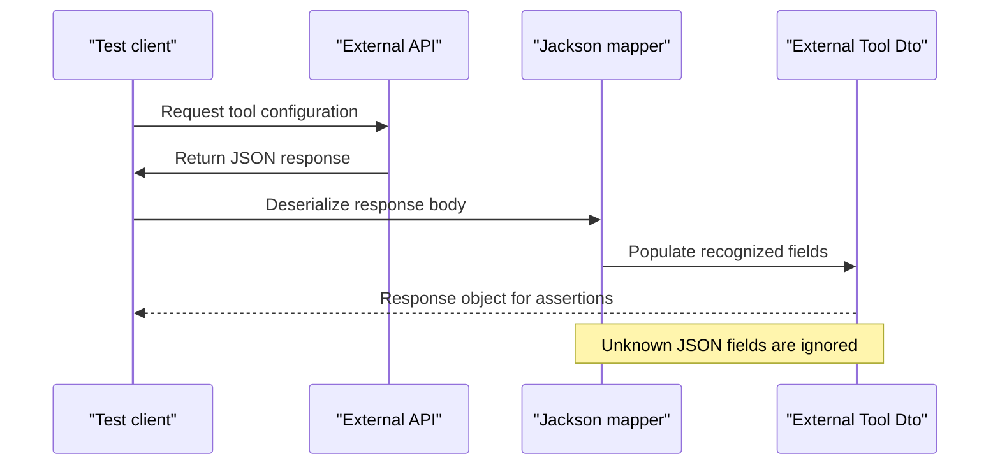

# External Tool Dto

External Tool Dto provides the small, JSON-deserializable response models used by the OpenFrame test service when it reads tool connection details from the External API. The models are supplied by the `com.openframe.oss:openframe-test-service-core` library and are generated from the External API OpenAPI contract exposed at `GET /api-docs`, version 1.1.0.

The module represents three complementary configuration facets:

- an API key, including its value, type, and display name;
- optional username and password credentials, with an associated API key; and
- a tool endpoint, including URL, port, and type.

All three classes use Jackson's ignore-unknown-properties behavior. This gives test clients forward-compatible deserialization when the API adds response fields, while retaining the fields that current test assertions use.

## Architecture

The models are boundary contracts rather than services: they do not perform authentication, network requests, secret storage, or validation. Those responsibilities remain with the caller and the External API. In particular, the presence of `password` and `key` fields means callers should treat populated instances as sensitive data and avoid serializing them to test output or logs.

## Component Responsibilities

| Component | Responsibility | JSON shape |
| --- | --- | --- |
| [`ToolApiKeyResponse`](https://github.com/flamingo-stack/openframe-oss-lib/blob/16e7c1cbd9664e7d10ec5ebca7d53c9bd314decf/openframe-test-service-core/src/main/java/com/openframe/test/data/dto/external/tool/ToolApiKeyResponse.java) | Represents a tool API-key configuration. | `key`, `type`, `keyName` |
| [`ToolCredentialsResponse`](https://github.com/flamingo-stack/openframe-oss-lib/blob/16e7c1cbd9664e7d10ec5ebca7d53c9bd314decf/openframe-test-service-core/src/main/java/com/openframe/test/data/dto/external/tool/ToolCredentialsResponse.java) | Carries username/password credentials and an optional nested API-key representation. | `username`, `password`, `apiKey` |
| [`ToolUrlResponse`](https://github.com/flamingo-stack/openframe-oss-lib/blob/16e7c1cbd9664e7d10ec5ebca7d53c9bd314decf/openframe-test-service-core/src/main/java/com/openframe/test/data/dto/external/tool/ToolUrlResponse.java) | Carries a tool endpoint configuration. | `url`, `port`, `type` |

## Data Model

### Tool Api Key Response

`ToolApiKeyResponse` is the nested API-key contract. Its fields preserve the key material and its descriptive metadata:

- `key` is the API-key value returned for the tool configuration.
- `type` identifies the API-key category or authentication scheme as supplied by the API.
- `keyName` holds the key's name.

The class uses Lombok `@Data`, `@Builder`, no-argument, and all-argument constructor annotations. Consequently, test code can either deserialize JSON or construct expected values through a builder.

### Tool Credentials Response

`ToolCredentialsResponse` aggregates username/password authentication and `ToolApiKeyResponse`. The nested object lets a response express API-key configuration alongside basic credential fields without flattening or duplicating key metadata.

Its JSON tolerance is important for contract tests: fields introduced by newer API versions do not prevent existing test clients from reading recognized credentials fields. Tolerance does not imply validation; tests that need to assert required credentials should explicitly inspect the fields relevant to their scenario.

### Tool Url Response

`ToolUrlResponse` provides the connection target for a tool:

- `url` is the endpoint address.
- `port` is represented as a string by the generated contract.
- `type` identifies the endpoint or connection type returned by the API.

Consumers should preserve the contract's string representation of `port` unless a specific test needs numeric interpretation. Parsing and connection behavior are intentionally outside this DTO.

## Deserialization and Test Flow

## Compatibility and Maintenance Notes

- These types mirror the External API contract at generation time. A contract change should be assessed for both JSON compatibility and the test expectations that construct or compare these DTOs.
- Adding a response field is non-breaking for current readers because each class is annotated with `@JsonIgnoreProperties(ignoreUnknown = true)`.
- Renaming, removing, or changing the meaning of one of the represented properties is potentially breaking for tests, even though unrelated added fields are ignored.
- Builders and generated accessor methods are supplied by Lombok. Changes to field names change the JSON property mapping and the generated builder/accessor API together.
- Treat `password` and `key` as secrets in diagnostics and fixtures. Mask them before emitting assertion failures or logs.

## Source Ownership

Although this repository assembles and runs the test-service artifact, the implementation documented here is maintained in the OpenFrame OSS Library at `com.openframe.oss:openframe-test-service-core`. The source links in the component table point to the library revision from which these DTOs are supplied.
