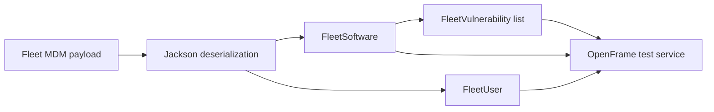
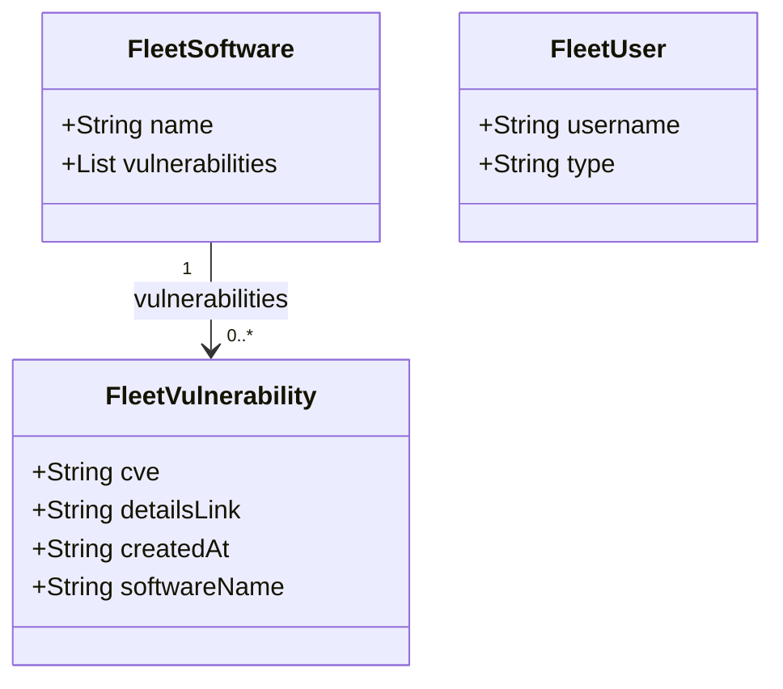
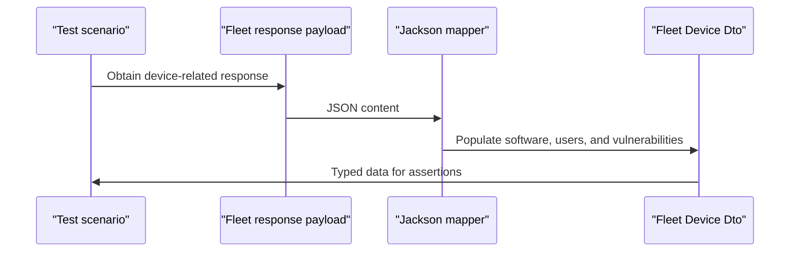

# Fleet Device Dto

Fleet Device Dto is a small test-data contract module supplied by the `com.openframe.oss:openframe-test-service-core` library. It models Fleet MDM-derived software, vulnerabilities, and local-user records used by the OpenFrame test service. The DTOs are deliberately tolerant of additional upstream fields, allowing tests to deserialize Fleet responses while asserting only the attributes relevant to a scenario.

The implementation is provided by the OpenFrame OSS Library at version `7.0.11`; this tenant repository runs it through its `openframe-test` service.

## Purpose and Scope

The module provides three Java DTOs in `com.openframe.test.data.dto.device.fleet`:

- `FleetSoftware` represents one software item and its associated vulnerability collection.
- `FleetVulnerability` represents the vulnerability fields returned for software.
- `FleetUser` represents a Fleet user account with its username and type.

These are transport and fixture models, not persistence entities or business services. Lombok generates their accessors, mutators, constructors, builders, and data-method implementations. Jackson deserializes payloads into the models.

## Architecture

The containment relationship is intentionally narrow: a software record owns zero or more vulnerability records. User records are independent and can be deserialized from a separate Fleet response.

## Component Reference

### FleetSoftware

[`FleetSoftware`](https://github.com/flamingo-stack/openframe-oss-lib/blob/16e7c1cbd9664e7d10ec5ebca7d53c9bd314decf/openframe-test-service-core/src/main/java/com/openframe/test/data/dto/device/fleet/FleetSoftware.java) is the aggregate model for Fleet software data.

| Field | Type | Meaning |
|---|---|---|
| `name` | `String` | Software name received from Fleet. |
| `vulnerabilities` | `List<FleetVulnerability>` | Vulnerabilities associated with that software item. |

It uses `@JsonIgnoreProperties(ignoreUnknown = true)`, so fields added by Fleet do not break existing test deserialization. `@Builder` supports concise construction of test fixtures.

### FleetVulnerability

[`FleetVulnerability`](https://github.com/flamingo-stack/openframe-oss-lib/blob/16e7c1cbd9664e7d10ec5ebca7d53c9bd314decf/openframe-test-service-core/src/main/java/com/openframe/test/data/dto/device/fleet/FleetVulnerability.java) describes a vulnerability reported against Fleet software.

| Field | JSON property | Meaning |
|---|---|---|
| `cve` | `cve` | Vulnerability identifier. |
| `detailsLink` | `details_link` | Link supplied by Fleet for vulnerability details. |
| `createdAt` | `created_at` | Creation timestamp as supplied by Fleet. |
| `softwareName` | `softwareName` | Name of the related software item. |

The two snake-case source properties are explicitly mapped with `@JsonProperty`. This keeps Java naming conventional without changing the upstream wire contract.

### FleetUser

[`FleetUser`](https://github.com/flamingo-stack/openframe-oss-lib/blob/16e7c1cbd9664e7d10ec5ebca7d53c9bd314decf/openframe-test-service-core/src/main/java/com/openframe/test/data/dto/device/fleet/FleetUser.java) carries the minimum account information needed in Fleet-oriented test data.

| Field | Type | Meaning |
|---|---|---|
| `username` | `String` | Fleet account username. |
| `type` | `String` | Fleet-provided account type. |

Like the other DTOs, it ignores unknown JSON properties and offers no validation or interpretation of upstream values. Test code should assert the desired semantics at the scenario level.

## Data Flow

## Compatibility Considerations

- Unknown JSON fields are ignored on all three DTOs, providing forward compatibility with expanded Fleet responses.
- `createdAt` remains a `String`; callers retain responsibility for parsing and validating timestamp format when a test requires it.
- `type`, `softwareName`, and other string values are passed through without normalization.
- `FleetSoftware.vulnerabilities` is a list and may be absent or empty depending on the source payload; tests should account for the response shape they exercise.

## Maintenance Guidance

When adding a field, preserve the external JSON property name with `@JsonProperty` whenever it differs from Java camel case. Keep the DTOs focused on test-facing payload shape rather than adding service behavior, persistence annotations, or domain rules. Changes to these classes can affect fixture construction and payload assertions in the OpenFrame test-service library.