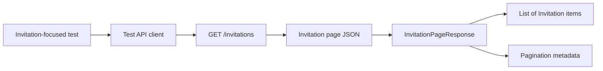
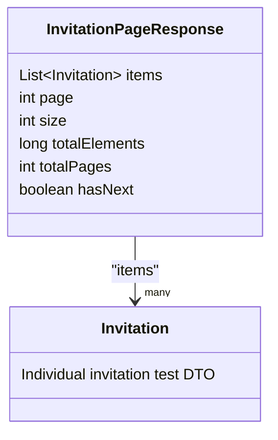
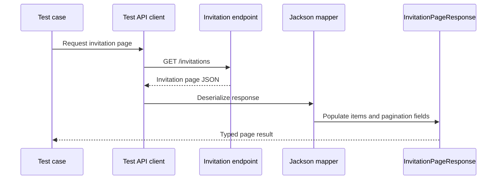
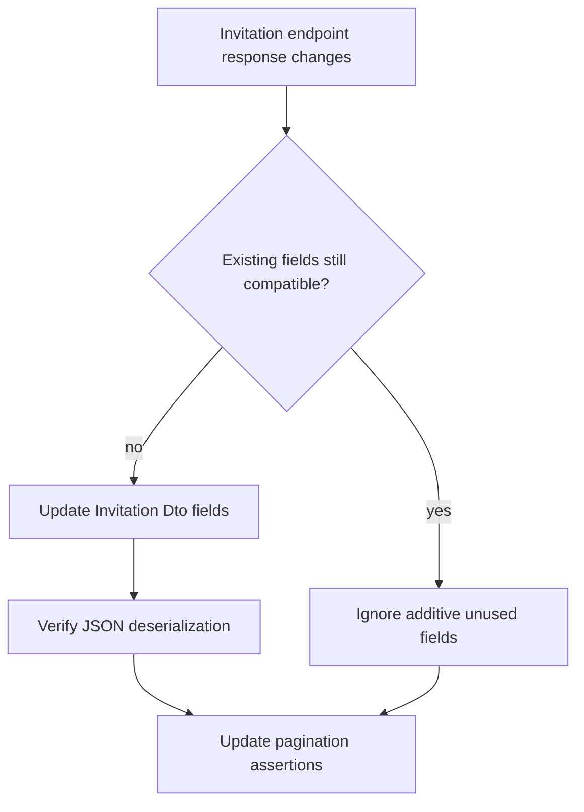

# Invitation Dto

The Invitation Dto module provides the test-suite representation of one paginated response returned by the tenant invitation-list endpoint. It is implemented by `InvitationPageResponse` in the OpenFrame OSS Library artifact `com.openframe.oss:openframe-test-service-core`, which this repository consumes at version `7.0.11`.

This is a deserialization boundary rather than an invitation-domain implementation: it models the page envelope used by tests, while the individual `Invitation` item type carries the per-invitation data. The supplied source documents the endpoint as `GET /invitations` and specifies that its page contains invitations that are neither accepted nor revoked.

**Source:** [InvitationPageResponse.java](https://github.com/flamingo-stack/openframe-oss-lib/blob/16e7c1cbd9664e7d10ec5ebca7d53c9bd314decf/openframe-test-service-core/src/main/java/com/openframe/test/data/dto/invitation/InvitationPageResponse.java)

## Responsibilities

- Represents one JSON page returned by the invitation-list request in integration and end-to-end tests.
- Preserves the invitation rows in `items` and the server-provided pagination metadata.
- Tolerates additional response properties so tests can remain compatible when the service adds fields that the test client does not need.
- Supports JSON deserialization and convenient test construction through Lombok-generated accessors, constructors, and a builder.

## Architecture and Scope



`InvitationPageResponse` belongs to the test-service-core library, not to a production controller. Its purpose is to give test code a stable typed view of the response envelope. It does not issue requests, validate invitation state transitions, or persist invitations.

The invitation-list behavior itself is implemented elsewhere in the platform. The module should therefore remain focused on the wire shape required by tests and should not duplicate service-side invitation rules.

## Response Contract

The class is annotated with `@JsonIgnoreProperties(ignoreUnknown = true)`. Jackson ignores JSON properties that are not declared in the class, allowing the test DTO to deserialize compatible server responses when new fields are introduced.

| Property | Java type | Meaning |
|---|---|---|
| `items` | `List<Invitation>` | Invitation records included in the current page. The item schema is represented by the neighboring `Invitation` test DTO and is not defined by this class. |
| `page` | `int` | Current page index returned by the endpoint. |
| `size` | `int` | Page size used for the response. |
| `totalElements` | `long` | Total number of matching invitation records across all pages. |
| `totalPages` | `int` | Number of pages available for the current result set. |
| `hasNext` | `boolean` | Whether a subsequent page is available. |

## Component Design

`InvitationPageResponse` is a mutable Lombok data carrier:

- `@Data` generates getters, setters, and standard value-oriented methods.
- `@NoArgsConstructor` allows Jackson to construct an empty instance before binding properties.
- `@AllArgsConstructor` supports explicit construction with every field.
- `@Builder` supports concise fixture setup in tests.



The `Invitation` declaration is intentionally shown only as an associated item DTO because its properties are outside the provided core component. Consumers should not infer item-level fields from the page wrapper.

## Request and Deserialization Flow



The module does not decide which invitations qualify for the list. The endpoint contract described in the source limits the returned collection to invitations that are neither accepted nor revoked. The DTO records the result and pagination state exposed by that response.

## Pagination Usage

A consumer can use the metadata to validate list behavior without hard-coding a fixed number of invitation records:

```java
InvitationPageResponse response = invitationApi.listInvitations();

assertThat(response.getItems()).isNotNull();
assertThat(response.getTotalElements()).isGreaterThanOrEqualTo(response.getItems().size());

if (response.isHasNext()) {
    assertThat(response.getPage()).isLessThan(response.getTotalPages());
}
```

This example illustrates DTO consumption only. The exact API-client method and assertion framework are application-specific and are not part of the module.

## Maintenance Guidance

When the invitation endpoint changes, keep the DTO aligned with response-envelope fields that tests need to inspect.



- Add a field only when test behavior needs to assert it.
- Preserve the no-argument constructor and Jackson unknown-property tolerance unless the API compatibility policy intentionally changes.
- Treat `items` and its element type separately: an envelope change belongs here, while an invitation-record change belongs in the `Invitation` test DTO.
- Use `totalElements`, `totalPages`, and `hasNext` together when testing pagination; no one field alone establishes complete navigation behavior.
