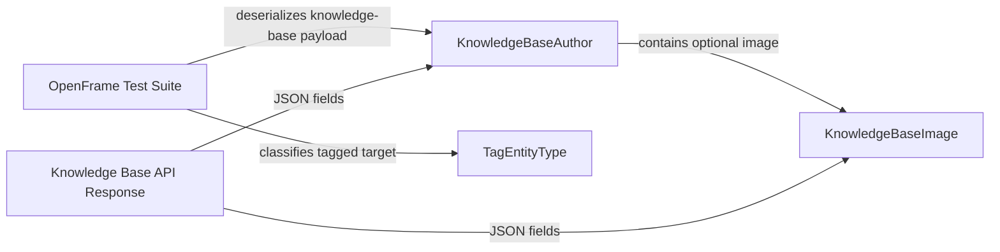
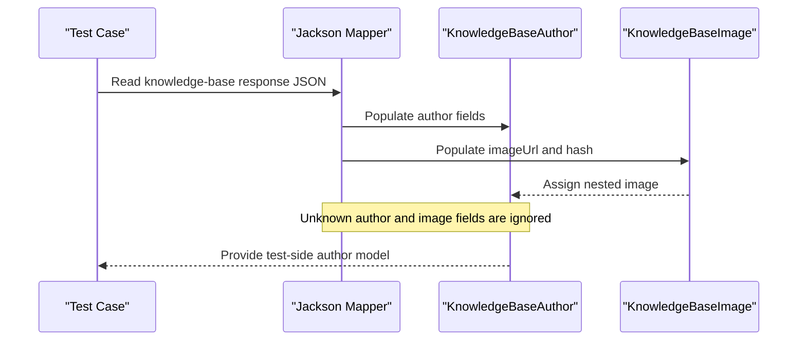

# Knowledgebase Dto

## Purpose

Knowledgebase Dto provides small, Jackson-compatible Java data-transfer objects used by the OpenFrame test service when it reads knowledge-base data. The module is supplied at runtime by the `com.openframe.oss:openframe-test-service-core` library, which this repository consumes at version `7.0.11`.

The types intentionally model only the author, author image, and tag target category needed by test-side payload handling:

- `KnowledgeBaseAuthor` represents an article author with identity, name, email, and optional image metadata.
- `KnowledgeBaseImage` represents an image reference as a URL plus a hash.
- `TagEntityType` constrains a tag target to a device, ticket, or knowledge article.

These classes are transport shapes, not persistence entities or API controllers. They allow tests to deserialize knowledge-base responses without coupling to every field returned by the service.

## Architecture Overview

### Design Characteristics

| Concern | Implementation |
|---|---|
| JSON compatibility | `KnowledgeBaseAuthor` and `KnowledgeBaseImage` use `JsonIgnoreProperties(ignoreUnknown = true)`, allowing responses to add unmodeled fields without breaking deserialization. |
| Construction | Lombok generates no-argument and all-argument constructors, accessors, mutators, builders, and common data methods for both DTO classes. |
| Nested data | An author can carry a nested `KnowledgeBaseImage`, keeping image metadata associated with its author rather than duplicating URL and hash fields. |
| Closed classification | `TagEntityType` is an enum with the supported target categories, avoiding free-form tag target strings in test data. |

## Components

### KnowledgeBaseAuthor

[KnowledgeBaseAuthor source](https://github.com/flamingo-stack/openframe-oss-lib/blob/16e7c1cbd9664e7d10ec5ebca7d53c9bd314decf/openframe-test-service-core/src/main/java/com/openframe/test/data/dto/knowledgebase/KnowledgeBaseAuthor.java)

`KnowledgeBaseAuthor` is the aggregate DTO for author details. Its fields are:

| Field | Type | Meaning |
|---|---|---|
| `id` | `String` | Author identifier supplied by the payload. |
| `firstName` | `String` | Author given name. |
| `lastName` | `String` | Author family name. |
| `email` | `String` | Author email address. |
| `image` | `KnowledgeBaseImage` | Optional nested image metadata. |

The builder is useful when a test needs to construct only the author properties relevant to a scenario. Unknown JSON properties are ignored, so tests remain compatible with API responses that have additional author fields.

### KnowledgeBaseImage

[KnowledgeBaseImage source](https://github.com/flamingo-stack/openframe-oss-lib/blob/16e7c1cbd9664e7d10ec5ebca7d53c9bd314decf/openframe-test-service-core/src/main/java/com/openframe/test/data/dto/knowledgebase/KnowledgeBaseImage.java)

`KnowledgeBaseImage` holds the two image attributes exposed to the test model:

| Field | Type | Meaning |
|---|---|---|
| `imageUrl` | `String` | Location of the image resource. |
| `hash` | `String` | Hash value accompanying the image reference. |

It follows the same builder, constructor, and unknown-property policy as `KnowledgeBaseAuthor`. The module does not interpret or validate the URL or hash; it preserves the values supplied by the response.

### TagEntityType

[TagEntityType source](https://github.com/flamingo-stack/openframe-oss-lib/blob/16e7c1cbd9664e7d10ec5ebca7d53c9bd314decf/openframe-test-service-core/src/main/java/com/openframe/test/data/dto/knowledgebase/TagEntityType.java)

`TagEntityType` defines the permitted tag target categories:

| Enum value | Target |
|---|---|
| `DEVICE` | A managed device. |
| `TICKET` | A support ticket. |
| `KNOWLEDGE_ARTICLE` | A knowledge-base article. |

Because this is an enum, tests can compare and construct supported categories without relying on inconsistent string values.

## Data Flow

## Maintenance Notes

- Add a field only when a test needs to observe it. The unknown-property behavior already tolerates fields that are irrelevant to the test model.
- Keep the nested image relationship in `KnowledgeBaseAuthor` aligned with the response shape expected by test consumers.
- Extend `TagEntityType` only when the corresponding API contract introduces a supported tag target category; enum values become part of test assumptions.
- These DTOs reside in the OpenFrame OSS Library source tree and are assembled into this repository through the `openframe-test-service-core` dependency. Changes to their implementation belong in that library.
