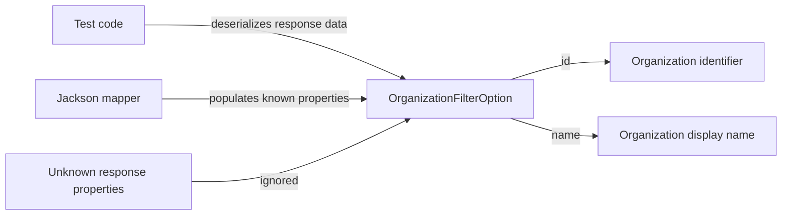
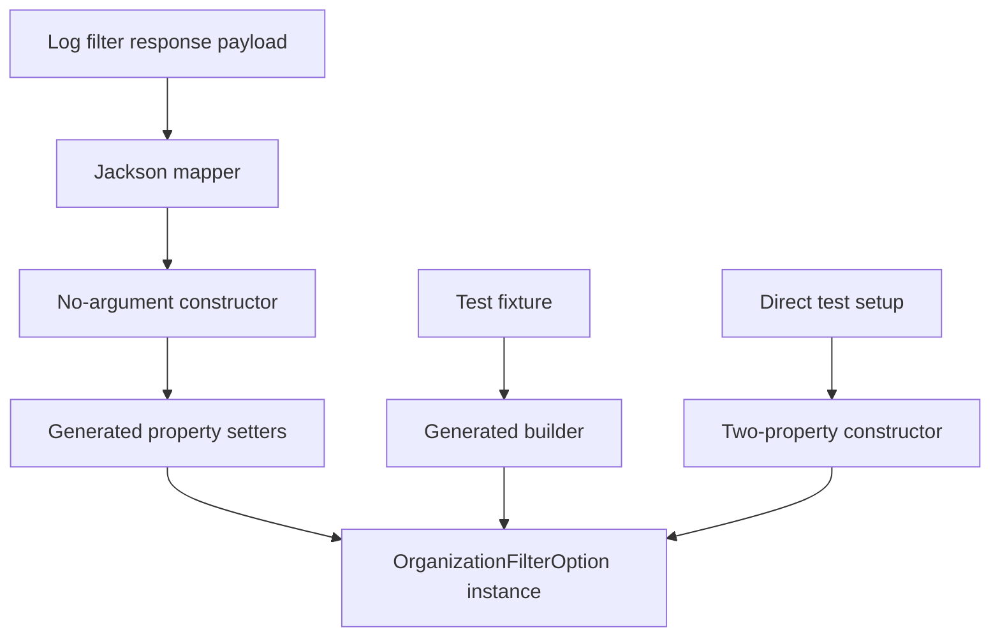
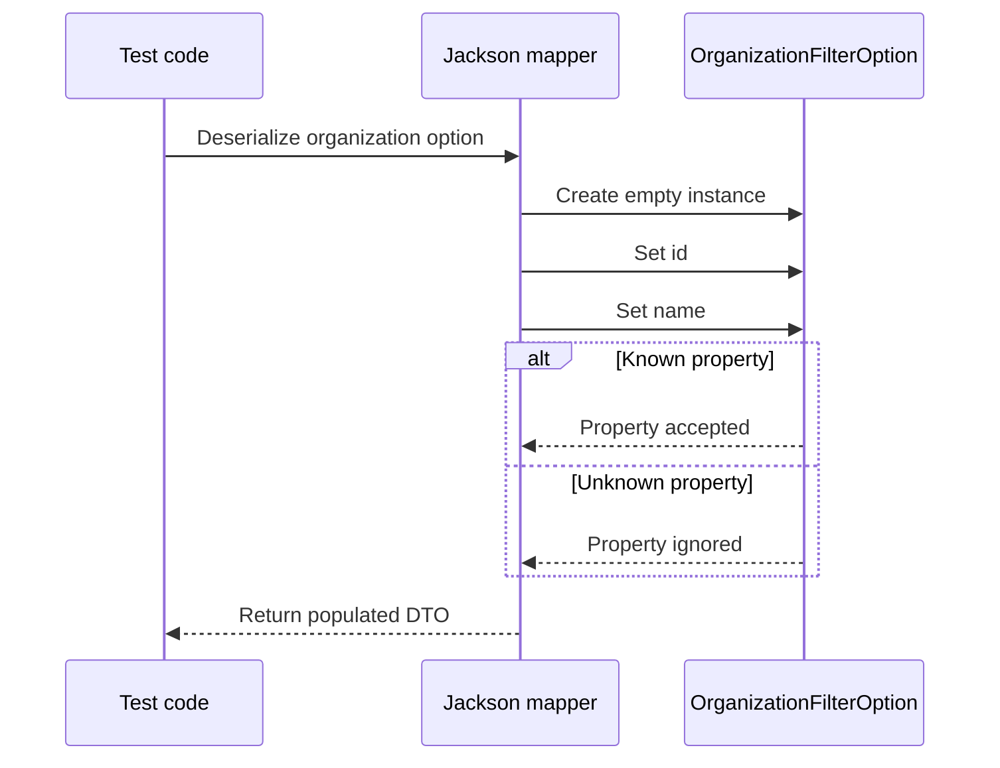
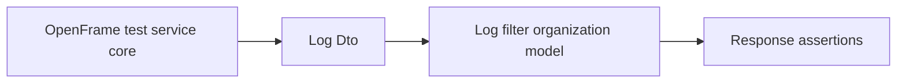

# Log Dto

Log Dto is the test-side data-transfer object for an organization option presented in log-related filtering. It belongs to the OpenFrame test service core supplied by the `com.openframe.oss:openframe-test-service-core` library, version `7.0.11`, which this repository consumes. The module intentionally contains no filtering, persistence, or transport logic: it defines a small deserialization-friendly value shape with an organization identifier and display name.

The implementation is provided by the OpenFrame OSS Library: [OrganizationFilterOption source](https://github.com/flamingo-stack/openframe-oss-lib/blob/16e7c1cbd9664e7d10ec5ebca7d53c9bd314decf/openframe-test-service-core/src/main/java/com/openframe/test/data/dto/log/OrganizationFilterOption.java).

## Purpose and Scope

The `OrganizationFilterOption` type models one selectable organization in a log-filter response consumed by test code. Its two properties are:

| Property | Java type | Meaning |
|---|---|---|
| `id` | `String` | Identifier of the organization represented by the option. |
| `name` | `String` | Human-readable organization name. |

Because this is a test DTO, it is a boundary model rather than a domain entity. It does not validate identifiers, fetch logs, apply a filter, or define an API route. Those responsibilities remain with the relevant API and test workflow layers.

## Architecture



The module is deliberately narrow. Test code owns its request and assertion flow, while Jackson maps response data into the DTO. The DTO preserves only the organization fields required by this model and ignores additional properties to tolerate compatible response expansion.

## Component Design

`OrganizationFilterOption` is a mutable Java bean enhanced by Lombok and Jackson annotations.

| Facility | Role | Maintainer impact |
|---|---|---|
| `@Data` | Generates accessors and common value methods. | Callers can read and update `id` and `name` through generated methods. |
| `@Builder` | Generates a builder. | Tests can construct concise expected values without a long constructor call. |
| `@NoArgsConstructor` | Generates a no-argument constructor. | Supports bean-style construction and mapping frameworks. |
| `@AllArgsConstructor` | Generates a constructor containing both properties. | Supports direct fixture construction. |
| `@JsonIgnoreProperties(ignoreUnknown = true)` | Ignores unmodeled response fields during deserialization. | Adding fields upstream does not by itself break existing tests using this type. |

### Construction Paths



The source does not add custom constructors, methods, normalization, or validation. Lombok generates the constructors, builder, getters, setters, and value methods during compilation.

## Deserialization Flow

The following flow describes how the annotation configuration affects an incoming object. It is scoped to the DTO and makes no assumption about a particular endpoint or serialization container.



## Data Contract Considerations

- Both properties are `String` values and the class itself imposes no required-field, format, uniqueness, or nullability rules.
- Unknown fields are ignored only while deserializing this DTO. This does not make unknown fields available to test assertions.
- Renaming or removing `id` or `name` changes the JSON property convention inferred by Jackson and can break consumers expecting the current shape.
- Adding a property is backward-compatible for existing deserialization paths, but tests must opt in to asserting that new property.

A representative object shape is:

```json
{
  "id": "organization-123",
  "name": "Example Organization"
}
```

## Maintenance Guidance

When evolving Log Dto:

1. Preserve `id` and `name` when the corresponding response fields remain part of the test contract.
2. Add explicit Jackson annotations only when the wire name must differ from the Java property name.
3. Keep the type focused on response representation; place filtering behavior and API access in the appropriate test or service layer.
4. Update fixtures and assertions together when adding a new modeled property.
5. Consider whether ignoring unknown fields remains desirable if strict schema detection becomes a test requirement.

## System Placement



Log Dto is packaged in the OpenFrame test service core library rather than implemented in this repository. The tenant repository assembles that library into its service ecosystem; the DTO supplies the model used by tests at the log-filter response boundary.
