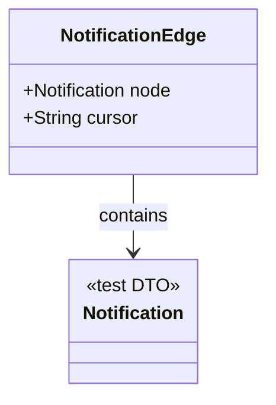
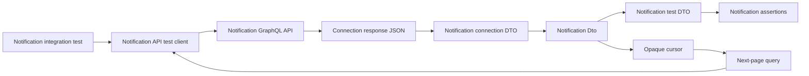
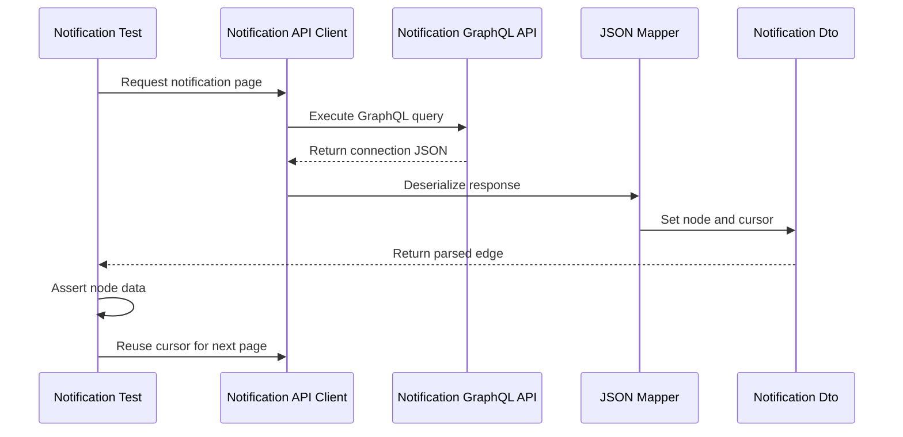

# Notification Dto

Notification Dto is the test-side transport model for one item in a cursor-paginated notification result. It is implemented by `NotificationEdge` in the OpenFrame OSS Library's `com.openframe.oss:openframe-test-service-core` artifact, version `7.0.11`, which this repository consumes. The component is executed by this repository's OpenFrame test service rather than defined in the tenant source tree.

The source model pairs a deserialized notification payload (`node`) with its opaque pagination position (`cursor`). It lets integration tests inspect both the returned notification and the cursor required to continue a paginated GraphQL query.

## Source and Scope

- **Source component:** [`NotificationEdge`](https://github.com/flamingo-stack/openframe-oss-lib/blob/16e7c1cbd9664e7d10ec5ebca7d53c9bd314decf/openframe-test-service-core/src/main/java/com/openframe/test/data/dto/notification/NotificationEdge.java)
- **Java package:** `com.openframe.test.data.dto.notification`
- **Owning library:** OpenFrame OSS Library
- **Runtime role:** DTO used by the OpenFrame test-service-core notification test client and notification tests.

Notification Dto does not create, persist, mark read, or dispatch notifications. It represents the edge shape returned to test code. Notification lifecycle behavior belongs to the notification API, its data fetchers and services, persistence repositories, and notification infrastructure.

## Data Contract

`NotificationEdge` is a mutable Java data class with two properties:

| Property | Java type | Meaning | Test usage |
|---|---|---|---|
| `node` | `Notification` | The notification object returned for this edge. | Assert notification fields and behavior exposed by the API. |
| `cursor` | `String` | Opaque cursor associated with this position in the result set. | Request the subsequent page or verify pagination progression. |

The model is annotated with Lombok `@Data`, `@Builder`, `@NoArgsConstructor`, and `@AllArgsConstructor`. Consequently, tests and JSON tooling can use a no-argument constructor, a complete constructor, builder-style construction, and generated accessors, mutators, equality, hash-code, and string conversion.

`@JsonIgnoreProperties(ignoreUnknown = true)` makes client-side deserialization forward-compatible: extra properties in a notification-edge response are ignored instead of causing a test DTO binding failure. This tolerance applies to fields of the edge itself; it does not change how the nested `Notification` model handles unknown fields.

## Architecture

Notification Dto occupies the boundary between GraphQL response JSON and Java-based integration assertions. The response is conceptually a connection: a collection of edges, where each edge combines a domain item with cursor metadata. The broader test library contains notification query and API client helpers, a notification connection DTO, and notification-focused tests; Notification Dto is the per-item element in that arrangement.

### Component Relationships

| Component | Relationship to Notification Dto |
|---|---|
| `Notification` test DTO | Is stored in `node` and represents the returned notification data. |
| `NotificationConnection` test DTO | Groups notification edges and connection-level pagination information. |
| `NotificationQueries` | Defines notification GraphQL operations whose edge selections map into this DTO shape. |
| `NotificationApi` | Sends notification operations and deserializes their responses for tests. |
| `NotificationsTest` | Exercises notification behavior and consumes the test-library API and DTOs. |
| Notification API data fetcher | Produces notification query results in the service layer; it is outside this DTO's implementation boundary. |

## Deserialization and Pagination Flow

The DTO has no operational methods: its role begins after the API returns JSON and ends when the test evaluates the resulting objects. The following process describes its expected use in a cursor-based test flow.

## Implementation Behavior

### JSON Compatibility

A response can include newly introduced edge-level fields without breaking the DTO mapping because unknown fields are ignored. This makes tests resilient to additive API evolution while preserving checks for fields the DTO explicitly models.

### Cursor Handling

Treat `cursor` as an opaque server-generated value. Notification Dto neither interprets nor transforms it. A test should carry the exact returned string into the next query's pagination argument, rather than deriving ordering or identifiers from it.

### Construction Options

The generated Lombok API supports two practical test patterns:

- Deserialize API responses through Jackson using the no-argument constructor and property setters.
- Construct expected values with the builder or all-arguments constructor when an isolated test needs an edge fixture.

For fixtures, keep the `node` and `cursor` internally consistent with the GraphQL connection scenario being tested. The cursor is pagination metadata, not a notification attribute.

## Maintenance Guidance

When changing Notification Dto, preserve the contract between GraphQL selection output and the Java test model:

1. Keep `node` aligned with the notification object returned by the notification query.
2. Keep `cursor` as a string unless the wire contract changes.
3. Retain the no-argument construction path and Jackson property binding support for API-response deserialization.
4. Consider whether additive server fields should remain ignored. Removing unknown-property tolerance can turn non-breaking API additions into test-client failures.
5. Update the notification query selection and tests together whenever a new DTO field is introduced; a DTO field cannot be populated if the query does not request it.

## Boundaries and Dependencies

Notification Dto depends only on the test-library `Notification` model and Jackson/Lombok annotations. It has no database, broker, HTTP, or application-service dependency of its own. It is therefore a low-level compatibility boundary: changes primarily affect response parsing, fixture construction, equality assertions, and pagination tests.

The tenant repository packages and runs the library as part of its testing capabilities. The authoritative implementation remains in the OpenFrame OSS Library source linked above.