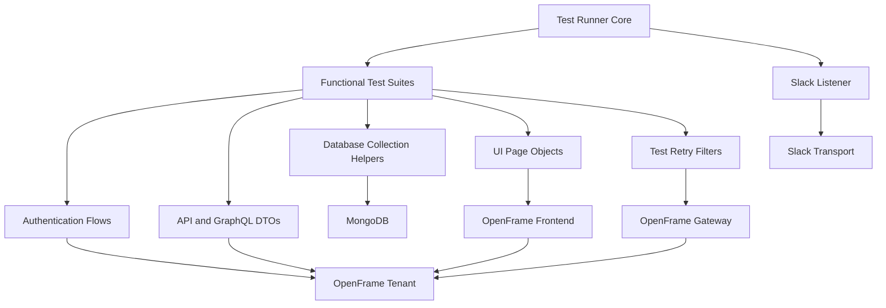
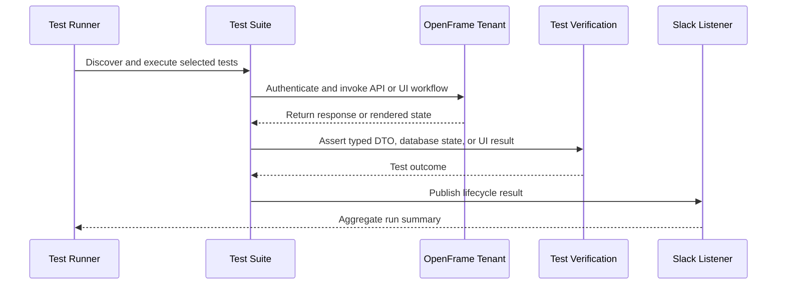

# Openframe Test Service Core

Openframe Test Service Core is the shared integration and end-to-end testing library used by the OpenFrame test service. It provides reusable authentication flows, API-response DTOs, database lookup helpers, UI page objects, retry filters, test execution infrastructure, reporting integrations, and domain-focused test suites.

The module is supplied by the upstream dependency `com.openframe.oss:openframe-test-service-core` at version `7.0.11`. In this repository, the test-service artifact is published as `com.openframe:openframe-test`.

## Purpose

Openframe Test Service Core standardizes how automated tests interact with a deployed OpenFrame tenant:

- Authenticate users through OSS and SaaS-compatible flows.
- Execute JUnit test plans and report results.
- Call platform and External API endpoints with typed request and response models.
- Inspect test fixture data through MongoDB collection helpers.
- Drive browser-based workflows through Playwright page objects.
- Test tenant features including devices, scripts, software, tickets, remote access, onboarding, notifications, AI assistants, and external integrations.
- Improve test reliability through bounded rate-limit and transient-gateway retry handling.

## Architecture

The module is a test-facing integration layer. It does not implement the production API, authorization server, frontend, database, or managed-device runtime. Instead, it provides the contracts and orchestration needed to verify those systems through their deployed interfaces.

## Test Execution Flow

## Core Component Areas

| Area | Responsibilities | Core documentation |
|---|---|---|
| Authentication | Drives deployment-specific login redirect flows and extracts test authentication cookies. | Auth Flow |
| Test infrastructure | Discovers, filters, lists, and executes JUnit Platform test plans. | Test Runner Core |
| Reliability helpers | Applies narrow retries for gateway rate limits and safe transient gateway failures. | Test Helpers |
| Reporting | Aggregates JUnit outcomes and sends reports through Slack or logs. | Slack Listener |
| Database access | Provides typed MongoDB lookup helpers for organizations and tenants. | Db Collections |
| UI automation | Encapsulates Playwright interactions for authentication, devices, remote access, monitoring, and scripts. | Ui Pages and Ui Login Flow |
| API contracts | Defines test-side DTOs for device, ticket, script, schedule, software, knowledge-base, notification, and External API responses. | DTO component documentation |
| Core tenant coverage | Tests tenant administration, devices, logs, scripts, policies, remote access, tickets, time tracking, software, and onboarding. | Core Tests |
| AI coverage | Validates Fae client-assistant and Mingo administrator-assistant behavior through independent assertions. | Ai Tests |
| External API coverage | Verifies API-key authentication and public API contracts for customers, devices, logs, tools, knowledge base, tickets, and pagination. | External Api Tests |
| Fixture lifecycle | Creates and removes a shared administrator fixture for dependent test phases. | Admin Tests |

## Key Components

### Authentication and execution

- `IAuthFlow` defines the shared login workflow contract.
- `AuthFlowOSS` and `AuthFlowSAAS` implement OSS and SaaS redirect behavior.
- `TestRunner` manages JUnit discovery and execution.
- `TestRunnerConfig` configures the target package and execution listeners.
- `Test` exposes discovered leaf-test metadata.

### Test integration support

- `OrganizationsCollection` and `TenantsCollection` provide MongoDB test-data lookups.
- `RateLimitRetryFilter` handles gateway `429` responses with paced retry behavior.
- `TransientGatewayRetryFilter` retries safe requests after transient `502` or `504` gateway failures.
- `SlackListener` aggregates JUnit outcomes.
- `SlackClient` sends reports through a Slack bot, webhook, or application logs.

### UI automation

The page-object layer includes:

- `AuthMethodPage` and `SsoLoginPage` for browser authentication.
- `DevicesPage`, `DeviceDetailsPage`, and `NewDevicePage` for device lifecycle workflows.
- `RemoteDesktopPage`, `RemoteShellPage`, and `FileManagerPage` for remote access.
- `MonitoringPage` for monitoring policies and queries.
- `ScriptsPage` and `RunScriptPage` for script management and execution.
- `UILoginFlow` for the end-to-end browser login workflow.

### Test suites

The suite classes are organized by test concern:

- **Core Tests** cover platform workflows and tenant features.
- **Ai Tests** cover Fae and Mingo assistant behavior.
- **External Api Tests** cover the API-key-protected External API.
- **Admin Tests** establish the shared administrator fixture lifecycle.

## Component Documentation References

Use the following component documentation for focused implementation details:

- **Auth Flow** for OSS and SaaS authentication redirect sequences.
- **Test Runner Core** for JUnit discovery, tags, listeners, and parallel class execution.
- **Test Helpers** for rate-limit pacing and transient gateway retry boundaries.
- **Slack Listener** for test-result aggregation and delivery behavior.
- **Ui Pages** for Playwright page-object responsibilities and synchronization practices.
- **Ui Login Flow** for the browser-based OpenFrame SSO workflow.
- **Core Tests** for functional tenant coverage areas.
- **Ai Tests** for Fae and Mingo acceptance coverage.
- **External Api Tests** for public External API contract coverage.
- **Db Collections** for MongoDB-backed fixture inspection.
- **Device Dto**, **Ticket Dto**, **Script Dto**, **Schedule Dto**, **Software Dto**, and **External Tool Dto** for test-side API response contracts.

## Source Layout

The module source is maintained in the OpenFrame OSS Library under:

`openframe-oss-lib/openframe-test-service-core/src/main/java/com/openframe/test`

Its main packages separate concerns by role:

- `api.auth` for authentication-flow helpers.
- `data.db.collections` for MongoDB test lookups.
- `data.dto` for typed API and GraphQL response contracts.
- `helpers` for Rest Assured retry filters.
- `listener` for JUnit result reporting.
- `pages` for Playwright page objects.
- `runner` for JUnit Platform execution support.
- `tests` for functional, AI, and External API suites.