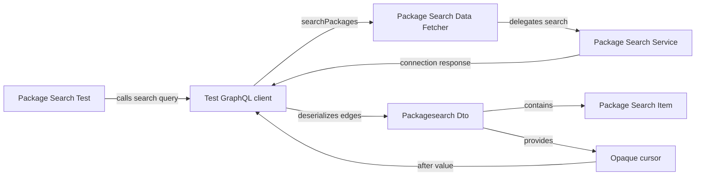
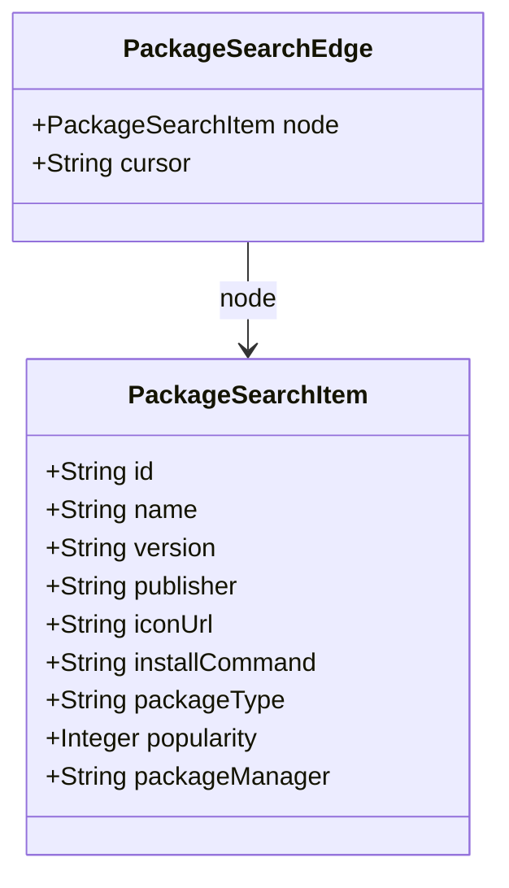
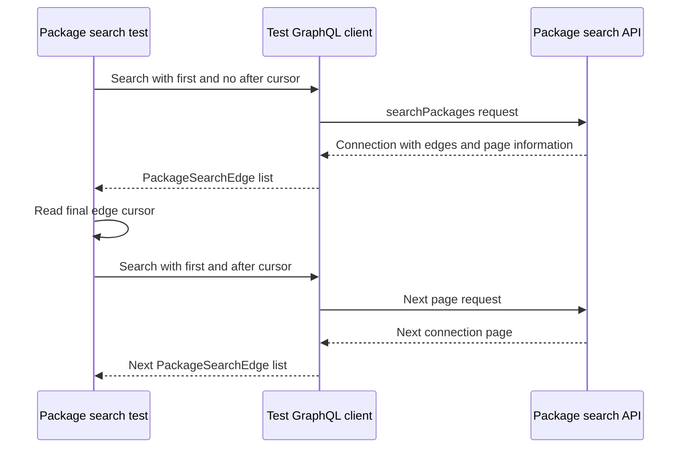
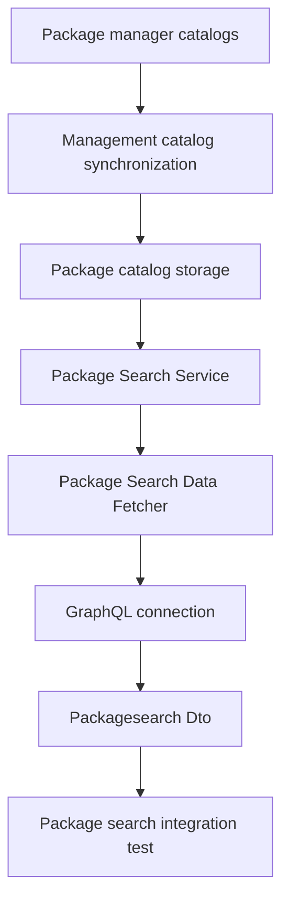

# Packagesearch Dto

Packagesearch Dto is the test-side GraphQL representation of one cursor-addressable package-search result. It is supplied by the `openframe-test-service-core` library from OpenFrame OSS Library and is used by package-search integration tests to deserialize an edge returned by the API. Its only explicit component, `PackageSearchEdge`, pairs a package result with the opaque cursor required to continue pagination.

The implementation is available in [the OpenFrame OSS Library source](https://github.com/flamingo-stack/openframe-oss-lib/blob/16e7c1cbd9664e7d10ec5ebca7d53c9bd314decf/openframe-test-service-core/src/main/java/com/openframe/test/data/dto/packagesearch/PackageSearchEdge.java).

## Responsibility and Boundaries

`PackageSearchEdge` is a transport object, not a search implementation. It does not call package registries, validate package-manager choices, generate cursors, or calculate pagination metadata. Those responsibilities are separated across the runtime API and its test support:

- The API-side `PackageSearchDataFetcher` accepts GraphQL pagination arguments and delegates search execution to `PackageSearchService`.
- The API returns a counted connection whose edges contain a package item and cursor.
- Packagesearch Dto deserializes each returned edge for test assertions.
- Package-search tests use the cursor from the final edge as the next request's `after` value and verify ordering, page boundaries, and result-specific attributes.



## Component Model

### Package Search Edge

`PackageSearchEdge` contains two properties:

| Property | Type | Meaning | Test use |
|---|---|---|---|
| `node` | `PackageSearchItem` | The package result at this position in the connection. | Assert package identity and manager-specific result fields. |
| `cursor` | `String` | The opaque pagination position for this edge. | Pass the final edge cursor back as `after` to retrieve the next page. |

The associated test-side item DTO carries `id`, `name`, `version`, `publisher`, `iconUrl`, `installCommand`, `packageType`, `popularity`, and `packageManager`. Consumers should treat those properties as response data whose availability differs by package manager, rather than assuming every field is present for every result.



## Serialization Contract

The class is annotated with `JsonIgnoreProperties(ignoreUnknown = true)`. This makes test deserialization forward-compatible with additive GraphQL response fields: unknown fields are ignored instead of causing a mapping failure. It does not relax expectations for the declared `node` or `cursor` properties, so tests that need reliable pagination should explicitly assert their expected cursor behavior.

Lombok supplies the no-argument constructor, all-argument constructor, getters, setters, equality helpers, builder, and textual representation. The DTO therefore supports both Jackson population and concise fixture creation:

```java
PackageSearchEdge edge = PackageSearchEdge.builder()
        .node(item)
        .cursor(cursor)
        .build();
```

## Pagination Flow

The edge is part of a GraphQL connection, alongside page information and the filtered result count. Packagesearch Dto models only the per-result edge; the containing connection DTO owns `edges`, `nodes`, `pageInfo`, and `filteredCount`.



A pagination test should preserve the cursor exactly as returned. Cursors are transport tokens, so callers should not parse, derive, or compare their internal structure. The expected behavioral checks are that the first page exposes its final edge cursor through page information, the follow-up page reports that it has a previous page, and concatenating pages neither skips nor repeats package entries.

## Package-Manager Field Expectations

The package-search integration coverage establishes the following response-level distinctions that are relevant when inspecting `node`:

| Package manager | Expected characteristics in search results |
|---|---|
| Homebrew | Has `packageType` of `FORMULA` or `CASK`, an install command, and popularity. Publisher and icon URL are absent. The package type is part of identity for opening details. |
| Winget | Has publisher information and an exact-ID install command. Package type and popularity are absent. |
| Chocolatey | The current deployment test configuration expects searches and detail lookups to be rejected because the manager is disabled. |

These are test assertions, not default values synthesized by Packagesearch Dto. The edge merely exposes the data returned by the API.

## Maintainer Guidance

- Keep the property names aligned with the GraphQL edge shape. Renaming `node` or `cursor` changes the JSON binding contract.
- Preserve the no-argument construction path for Jackson-based test clients.
- Retain unknown-property tolerance when API schemas can evolve independently of the test library.
- Do not encode pagination policy in this DTO. Page-size limits, directional arguments, and count calculation belong to the API connection and search service.
- When adding fields to the associated item DTO, add assertions only where the applicable package manager guarantees the field.

## System Placement

Packagesearch Dto is delivered by the `com.openframe.oss:openframe-test-service-core` library, version `7.0.11`, which this repository consumes. It supports the package-search integration tests rather than a production request handler. The production path uses the API service core's package-search data fetcher and package-manager clients, while catalog synchronization and persistence are handled elsewhere in the platform.


