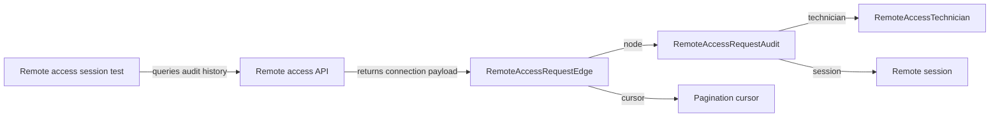
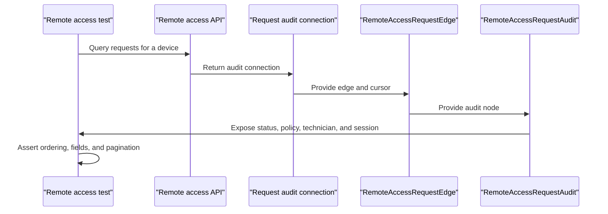

# Remoteaccess Dto

Remoteaccess Dto supplies the small Java data-transfer-object layer used by the OpenFrame test service when it reads remote-access request audit history. It is implemented in the `com.openframe.oss:openframe-test-service-core` library, version `7.0.11`, which this repository consumes. The module models a cursor-based audit row and the technician identity embedded in that row or in a remote session.

The implementation is provided by the OpenFrame OSS Library rather than by a source file in this repository:

- [RemoteAccessRequestEdge source](https://github.com/flamingo-stack/openframe-oss-lib/blob/16e7c1cbd9664e7d10ec5ebca7d53c9bd314decf/openframe-test-service-core/src/main/java/com/openframe/test/data/dto/remoteaccess/RemoteAccessRequestEdge.java)
- [RemoteAccessTechnician source](https://github.com/flamingo-stack/openframe-oss-lib/blob/16e7c1cbd9664e7d10ec5ebca7d53c9bd314decf/openframe-test-service-core/src/main/java/com/openframe/test/data/dto/remoteaccess/RemoteAccessTechnician.java)

## Purpose and scope

The DTOs allow test code to deserialize GraphQL-style connection results without coupling assertions to transport JSON. `RemoteAccessRequestEdge` represents one entry in a paginated request-audit connection. Its `node` is a `RemoteAccessRequestAudit`, while its `cursor` is the opaque pagination position returned with that entry. `RemoteAccessTechnician` is the compact identity representation nested in audit and session records.

The module is intentionally a model-only boundary:

- It does not issue remote-access requests, modify policies, or manage sessions.
- It carries values emitted by the remote-access API so end-to-end tests can inspect them.
- It tolerates additive API fields during JSON binding through `@JsonIgnoreProperties(ignoreUnknown = true)`.

## Architecture overview

`RemoteAccessRequestAudit` and the remote-session model are neighboring DTOs that provide the edge payload. The audit model contains request identity, device identity, session kind, current status, resolved access mode, policy and decision metadata, reason, lifecycle timestamps, technician, and an optional linked session.

## Components

### Remote Access Request Edge

`RemoteAccessRequestEdge` is the connection-edge DTO.

| Property | Type | Responsibility |
|---|---|---|
| `node` | `RemoteAccessRequestAudit` | Holds the audit record for one remote-access request. |
| `cursor` | `String` | Holds the cursor associated with that result for connection pagination. |

The class uses Lombok `@Data`, `@Builder`, `@NoArgsConstructor`, and `@AllArgsConstructor`. Consequently it supports Jackson deserialization, fluent test-fixture construction, generated accessors, and value-oriented utility methods.

### Remote Access Technician

`RemoteAccessTechnician` is the embedded technician projection.

| Property | Type | Responsibility |
|---|---|---|
| `id` | `String` | Identifies the technician associated with the audit row or session. |
| `name` | `String` | Supplies the technician display name. |

Like the edge type, it uses Lombok for constructors, accessors, a builder, and standard value methods. Unknown JSON properties are ignored, preserving compatibility when the API expands the technician payload.

## Data flow

The remote-access session test demonstrates the module's read path. After it creates and resolves a request, it queries request audit history for a device. The returned connection is traversed through its nodes and edges: tests find a record by `requestId`, validate the resolved request state and technician identity, and verify that every edge provides a nonblank cursor.

## Remote-access behavior represented by the DTOs

Although these classes do not implement business rules, their enclosing test flow establishes what the serialized audit data must expose:

1. A request audit row identifies the request and device and reports the request's current status.
2. The row retains the resolved access mode and the policy scope from which that mode was chosen.
3. The decision source distinguishes policy, user, and technician decisions when a request is settled.
4. The audit row retains the technician identity and links to the session opened by an approved request when one exists.
5. Audit entries are read newest first, and edge cursors support page traversal.

The test flow covers policy modes including approval-required, silent access, and deny access. It also verifies lifecycle outcomes such as approval, revocation, session termination, and expiration. These semantics are asserted by the remote-access test suite; they are not encoded in `RemoteAccessRequestEdge` or `RemoteAccessTechnician` themselves.

## Integration context

The module is part of the test-service DTO catalog. It is consumed at runtime by this repository's `openframe-test` service through the OpenFrame OSS Library. The related remote-access tests use it to validate API responses after exercising the platform's remote-access policies and sessions.

Keep this DTO layer forward-compatible when updating the test client:

- Preserve the no-argument constructor required for JSON binding.
- Preserve `@JsonIgnoreProperties(ignoreUnknown = true)` unless the API contract is intentionally made strict.
- Treat `cursor` as an opaque value; tests should assert its availability rather than infer its format.
- Keep the technician projection minimal unless a test requires another stable API field.
