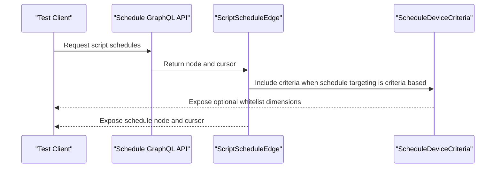

# Schedule Dto

Schedule Dto is a small test-support contract module from the `openframe-test-service-core` library. It models schedule selection criteria and a cursor-bearing schedule result. Test code can deserialize these objects from GraphQL responses without being coupled to transport-specific parsing.

The implementation is supplied by the OpenFrame OSS Library artifact `com.openframe.oss:openframe-test-service-core`, which this repository uses at version `7.0.11`.

## Purpose and Scope

The module represents two distinct parts of schedule-oriented test data:

- **Device criteria** — `ScheduleDeviceCriteria` captures the persisted device-selection rule for a criteria-based schedule.
- **Connection edge** — `ScriptScheduleEdge` represents one script-schedule node and its pagination cursor.

Both types use Lombok to provide data accessors, builders, and no-argument and all-argument constructors. Their Jackson configuration ignores unrecognized fields, allowing test clients to tolerate additive response fields.

## Architecture Overview

The diagram shows the contract role of this module. `ScriptSchedule` is referenced by `ScriptScheduleEdge` but is defined outside the two components documented here. The criteria object describes schedule targeting, while the edge object preserves the cursor supplied by the connection-style response.

## Core Components

### Schedule Device Criteria

[`ScheduleDeviceCriteria`](https://github.com/flamingo-stack/openframe-oss-lib/blob/16e7c1cbd9664e7d10ec5ebca7d53c9bd314decf/openframe-test-service-core/src/main/java/com/openframe/test/data/dto/schedule/ScheduleDeviceCriteria.java) stores the whitelist dimensions of a criteria schedule:

| Field | Meaning |
|---|---|
| `organizationIds` | Organization identifiers accepted by the schedule rule. |
| `deviceTypes` | Device-type values accepted by the schedule rule. |
| `osTypes` | Operating-system-type values accepted by the schedule rule. |

Each list is optional. A `null` or empty list means that dimension places no restriction on matching devices. The criteria object itself is `null` for a specific-device schedule, distinguishing explicit device selection from criteria-based targeting.

### Script Schedule Edge

[`ScriptScheduleEdge`](https://github.com/flamingo-stack/openframe-oss-lib/blob/16e7c1cbd9664e7d10ec5ebca7d53c9bd314decf/openframe-test-service-core/src/main/java/com/openframe/test/data/dto/schedule/ScriptScheduleEdge.java) is the connection-edge DTO used when reading script schedules. It contains:

| Field | Meaning |
|---|---|
| `node` | The `ScriptSchedule` represented by this result entry. |
| `cursor` | The opaque cursor associated with that entry for subsequent connection paging. |

The edge intentionally carries no targeting or execution logic. It keeps the schedule payload and pagination position together for callers that traverse GraphQL-style connections.

## Data Flow

## Targeting Semantics

Criteria dimensions compose as independent optional filters:

1. When a dimension list is absent or empty, it does not filter devices.
2. When a dimension list contains values, only values in that whitelist meet that dimension's rule.
3. A criteria schedule can therefore constrain any combination of organization, device type, and operating-system type.
4. A specific-device schedule has no criteria payload, so consumers must treat a `null` criteria object as a schedule-kind distinction rather than as an unconstrained criteria rule.

This convention aligns the DTO with schedule resolution in the service layer, where device criteria are translated into machine-query constraints.

## Integration Boundaries

Schedule Dto is part of the test-service library rather than a production scheduling engine. Production-facing schedule APIs, persistence repositories, and criteria resolution are implemented in other OpenFrame OSS Library modules. This module's responsibility is to provide stable, deserialization-friendly test representations of returned schedule data.

When changing these DTOs, preserve the JSON field names and the empty-or-null whitelist convention. Test suites may rely on both conventions when asserting criteria schedules and paginated schedule listings.
