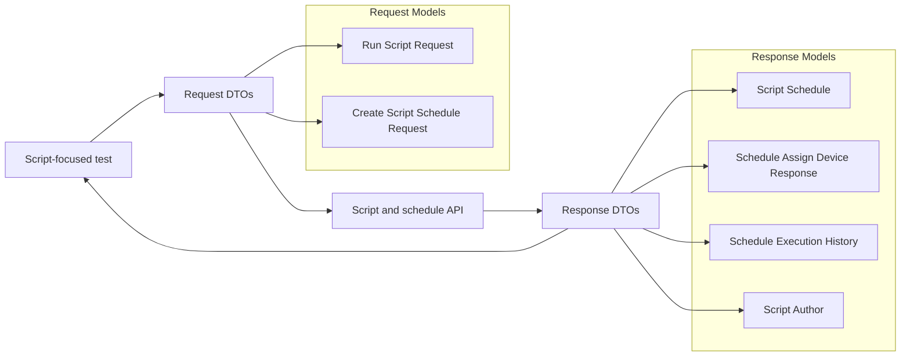
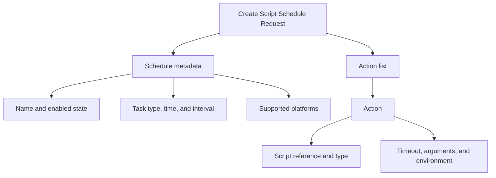
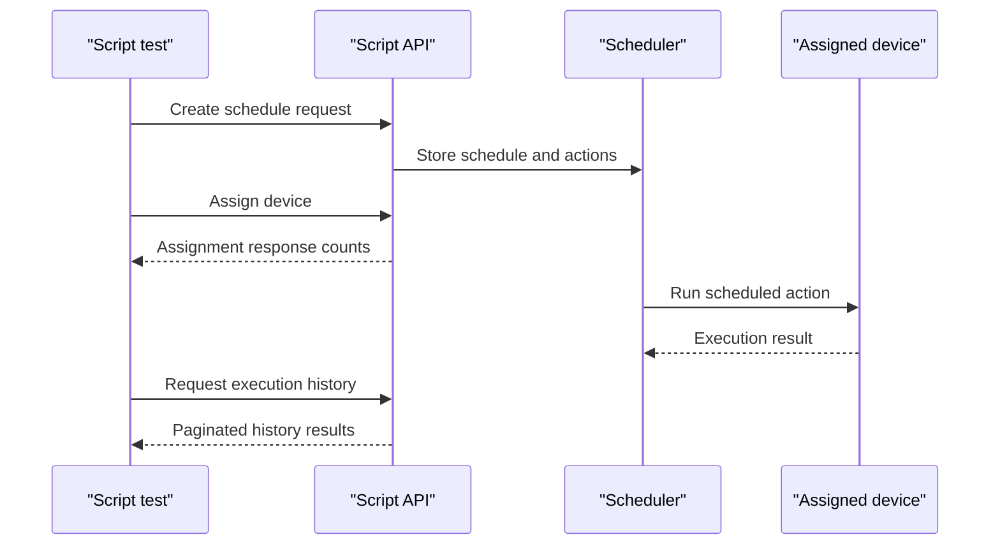

# Script Dto

## Purpose

Script Dto is the test-support data-transfer-object layer for script execution and scheduling scenarios. It is supplied by the OpenFrame OSS Library artifact `com.openframe.oss:openframe-test-service-core` and runs with this repository's OpenFrame test service. The module models request payloads, schedule summaries, assignment outcomes, execution-history pages, and the reduced author projection used by script-oriented tests.

These classes are intentionally transport-focused: Lombok supplies construction and accessors, while Jackson maps JSON payloads to Java fields. Every type ignores unrecognized JSON properties, which lets tests consume responses that include fields outside the assertions they need.

## Architecture Overview

The module separates **commands** from **observations**:

- `RunScriptRequest` represents an immediate script invocation, including targeting, shell, arguments, environment variables, timeout, and execution options.
- `CreateScriptScheduleRequest` represents a schedule definition and its action list.
- `ScriptSchedule`, `ScheduleAssignDeviceResponse`, and `ScheduleExecutionHistory` represent results returned while inspecting or managing scheduled work.
- `ScriptAuthor` represents the small user projection selected when a test verifies a script author.

## Component Responsibilities

| Component | Direction | Responsibility |
|---|---|---|
| [Create Script Schedule Request](https://github.com/flamingo-stack/openframe-oss-lib/blob/16e7c1cbd9664e7d10ec5ebca7d53c9bd314decf/openframe-test-service-core/src/main/java/com/openframe/test/data/dto/script/CreateScriptScheduleRequest.java) | Request | Describes a named, enabled or disabled schedule, its task type, time, supported platforms, daily interval, and ordered actions. |
| [Run Script Request](https://github.com/flamingo-stack/openframe-oss-lib/blob/16e7c1cbd9664e7d10ec5ebca7d53c9bd314decf/openframe-test-service-core/src/main/java/com/openframe/test/data/dto/script/RunScriptRequest.java) | Request | Describes a direct run, including target selection, script or command information, shell settings, arguments, environment variables, and user-context execution. |
| [Script Schedule](https://github.com/flamingo-stack/openframe-oss-lib/blob/16e7c1cbd9664e7d10ec5ebca7d53c9bd314decf/openframe-test-service-core/src/main/java/com/openframe/test/data/dto/script/ScriptSchedule.java) | Response | Captures the schedule list projection: identity, timing and platform metadata, enabled state, and action and agent counts. |
| [Schedule Assign Device Response](https://github.com/flamingo-stack/openframe-oss-lib/blob/16e7c1cbd9664e7d10ec5ebca7d53c9bd314decf/openframe-test-service-core/src/main/java/com/openframe/test/data/dto/script/ScheduleAssignDeviceResponse.java) | Response | Reports the number of addressed agents and task-result records created or deleted after device assignment changes. |
| [Schedule Execution History](https://github.com/flamingo-stack/openframe-oss-lib/blob/16e7c1cbd9664e7d10ec5ebca7d53c9bd314decf/openframe-test-service-core/src/main/java/com/openframe/test/data/dto/script/ScheduleExecutionHistory.java) | Response | Models a paginated execution result set with target identity, process outputs, return code, timing, status, and synchronization status. |
| [Script Author](https://github.com/flamingo-stack/openframe-oss-lib/blob/16e7c1cbd9664e7d10ec5ebca7d53c9bd314decf/openframe-test-service-core/src/main/java/com/openframe/test/data/dto/script/ScriptAuthor.java) | Response projection | Holds the author identifier, name, email, and optional image URL and hash needed by the scripts-table selection. |

## Request Models

### Direct Execution

`RunScriptRequest` supports both a stored script reference through `script` and command-oriented fields such as `cmd`, `shell`, and `customShell`. Targeting inputs include `target`, `client`, `site`, and explicit `agents`; `mode`, `monType`, and `osType` carry execution-selection context.

Runtime controls include `timeout`, `args`, `envVars`, `runAsUser`, `offlineAgents`, `patchMode`, `collectorAllOutput`, and `saveToAgentNote`. JSON wire names preserve the API contract for fields such as `custom_shell`, `collector_all_output`, `save_to_agent_note`, `env_vars`, and `run_as_user`.

### Schedule Creation

`CreateScriptScheduleRequest` holds schedule-wide values: `name`, `taskType`, `runTimeDate`, supported platforms, `enabled`, and `dailyInterval`. Each nested `Action` supplies an action `type`, referenced `script`, display `name`, `timeout`, `scriptArgs`, and `envVars`.

This nesting keeps schedule metadata separate from the individual executions the schedule should perform.

## Response Models and Test Assertions

`ScriptSchedule` is a compact schedule-list response rather than a complete request echo. Its `actionsCount` and `agentsCount` enable tests to verify resulting associations without reconstructing every action or agent.

`ScheduleAssignDeviceResponse` makes assignment side effects explicit. Tests can independently assert the addressed-agent count and the count of task results added or removed.

`ScheduleExecutionHistory` uses `total`, `limit`, and `offset` for pagination. Each nested `Result` includes the result identifier, agent identity and platform, organization, `retcode`, standard output and error, execution time, last-run timestamp, status, and synchronization status. This supports assertions about both pagination and per-device execution outcome.

`ScriptAuthor` includes the author details deliberately selected by script-listing tests. Its nested `Image` contains only `imageUrl` and `hash`, avoiding a dependency on a broader user representation.

## Schedule Lifecycle

The DTOs do not execute scripts or schedule jobs. They provide the stable request and response shapes through which tests drive and observe that lifecycle.

## Serialization Conventions

All module types use `@JsonIgnoreProperties(ignoreUnknown = true)`. This supports forward-compatible response parsing when the server introduces additional fields.

Several Java field names are mapped to snake-case JSON through `@JsonProperty`, including `task_type`, `run_time_date`, `task_supported_platforms`, `daily_interval`, `agents_count`, `task_results_created`, `task_results_deleted`, `agent_id`, `agent_hostname`, `agent_platform`, `execution_time`, `last_run`, and `sync_status`. Test authors should use the Java property names when constructing DTOs and rely on Jackson for wire-format mapping.

## System Context

Script Dto belongs to the OpenFrame test service contract layer, not the production script-execution implementation. In the broader system, script and schedule operations are served by the client-facing service, executed on managed clients, and recorded for later inspection. This module gives automated tests a narrow, tolerant representation of those API boundaries while keeping test code independent of raw JSON payload construction.
