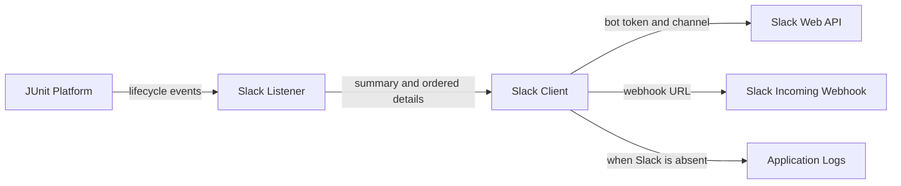
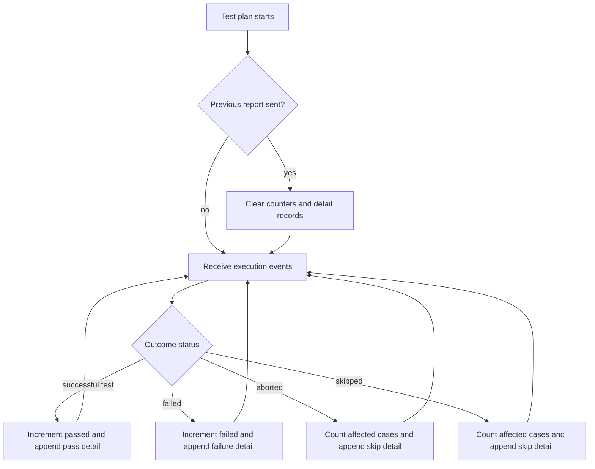
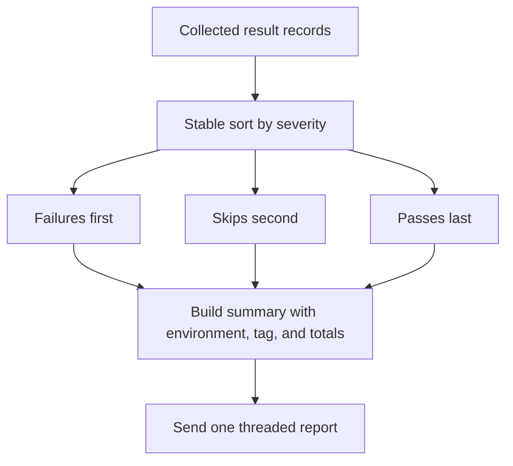
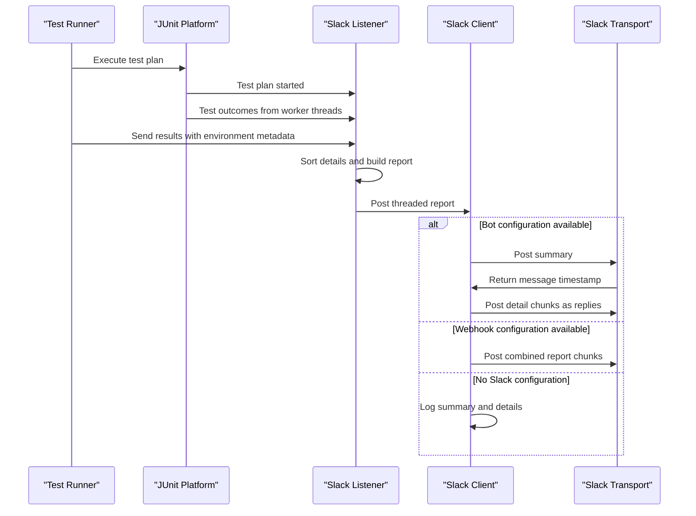

# Slack Listener

Slack Listener is the test-run reporting adapter supplied by the OpenFrame OSS Library artifact `com.openframe.oss:openframe-test-service-core`. It observes a JUnit Platform test plan, safely aggregates outcomes from parallel workers, formats a compact environment-aware report, and delegates delivery to SlackClient.

The module is run by the repository's OpenFrame test service according to the provided component metadata. Its implementation resides in the OpenFrame OSS Library rather than this repository:

- [SlackClient source](https://github.com/flamingo-stack/openframe-oss-lib/blob/16e7c1cbd9664e7d10ec5ebca7d53c9bd314decf/openframe-test-service-core/src/main/java/com/openframe/test/listener/SlackClient.java)
- [SlackListener source](https://github.com/flamingo-stack/openframe-oss-lib/blob/16e7c1cbd9664e7d10ec5ebca7d53c9bd314decf/openframe-test-service-core/src/main/java/com/openframe/test/listener/SlackListener.java)

## Purpose and Scope

The module provides an outbound notification boundary for automated test runs. It does not execute tests or decide pipeline status. Instead, it turns JUnit lifecycle events into a human-readable completion report with these properties:

- Counts passed, failed, and skipped test cases.
- Treats aborted tests as skips, preserving the meaningful assumption message where available.
- Accounts for skipped or aborted containers by counting their descendant test cases.
- Prioritizes failures, then skips, then passes in the detailed output.
- Supports Slack bot-token delivery, incoming-webhook delivery, and logging-only fallback.
- Keeps report aggregation safe when JUnit executes tests concurrently.

## Architecture Overview

### Component Responsibilities

| Component | Responsibility |
|---|---|
| `SlackListener` | Implements JUnit's `TestExecutionListener`, records outcomes, calculates totals, normalizes reasons, assigns display priority, and submits one report through `sendResults`. |
| `SlackClient` | Selects the configured transport, posts messages or reports, splits long content into line-oriented chunks, handles Slack API and I/O failures, and falls back to structured application logging. |

## Test-Result Collection

Slack Listener receives the test plan at the start of a run. If the preceding report has been sent, it clears counters and details before accepting new events. Atomic counters and a copy-on-write detail list prevent lost counts and unsafe iteration when multiple JUnit worker threads invoke the listener.

### Outcome Semantics

- **Successful containers are not counted.** Only successful identifiers that represent tests increment the passed total.
- **Failures are recorded directly.** The listener includes the test or container description and the first line of the throwable message. Missing messages become `Unknown error`.
- **Aborts are skips, not failures.** For JUnit assumptions, the `Assumption failed: ` prefix is removed so the report retains the test author's reason. A missing reason is shown as `Test aborted`.
- **Explicit skips are normalized.** An empty reason or JUnit's generated disabled-method reason becomes `Disabled`; custom reasons are retained.
- **Container-level skip and abort totals reconcile with the plan.** For a container, the listener counts descendant identifiers that represent tests. The description identifies the container and includes the affected case count when nonzero.
- **Messages are bounded.** Failure and skip reasons use only their first line and are truncated after 300 characters.

## Report Construction and Status

`sendResults(tag, domain, baseUrl)` reads a stable snapshot of the atomic counters and builds a report summary containing the target environment, tag, and totals. `localhost` is rendered as `https://localhost`; other environments are rendered as a host formed from the domain and base URL.

The visual status is deliberately three-state:

| Condition | Report indicator | Meaning |
|---|---|---|
| One or more failures, or no results at all | Red circle | The run failed or produced no observable outcomes. |
| No failures and one or more passes | Green circle | At least one test completed successfully. |
| No failures or passes, but one or more skips | Yellow circle | The run was not successful evidence; required tenant state may be absent. |

When details exist, the listener performs a stable sort at send time: failed entries first, skipped entries second, and passed entries last. Stable ordering retains execution order within each group while putting actionable results at the top of the Slack report. If no details exist, the summary explicitly records `No test results`.

## Delivery Behavior

Slack Client chooses transport in a fixed precedence order:

1. A nonblank bot token and channel ID enable the Slack Web API.
2. Otherwise, a nonblank webhook URL enables incoming-webhook delivery.
3. Otherwise, the report is emitted to application logs and no external Slack notification is sent.

Bot configuration therefore takes precedence when both mechanisms are available.

### Bot Delivery

For a simple message, Slack Client calls Slack's chat-post method with the configured channel. For a report, it posts the summary first, obtains the response timestamp, then posts each detail chunk as a reply in that thread. If the summary request is rejected, it logs the Slack error and does not attempt thread replies. A failure in an individual reply is logged but does not stop later replies.

### Webhook Delivery

Incoming webhooks cannot create the same thread structure used by the bot flow. Slack Client concatenates the summary and details, splits the combined text, and posts each chunk as a standalone webhook message. Each response is considered successful only when it returns HTTP status `200`.

### Chunking and Fallback

Details are split at line boundaries with a target maximum of 3,000 characters per chunk. This preserves readable test-detail lines under normal inputs. The implementation does not split an individual line that itself exceeds the limit, so unusually long unbroken lines can exceed the target size.

Transport exceptions are caught and logged:

- Bot delivery handles I/O and Slack API exceptions.
- Webhook delivery handles I/O exceptions.
- Missing configuration logs a warning for each attempted message and writes each content line at info level.

These delivery failures are observational: Slack Client logs them rather than rethrowing them into the JUnit callback path.

## End-to-End Flow

## Operational Considerations

- Configure both the bot token and channel ID to use threaded Slack reports. A partial bot configuration is ignored.
- Configure a webhook URL when standalone webhook posts are sufficient or bot credentials are unavailable.
- Treat a yellow report as an environment-readiness signal, not as a clean pass: it indicates that all observed cases were skipped.
- Inspect application logs whenever a notification is missing. They contain transport exceptions, API errors, and the complete report when no Slack transport is configured.
- The listener is designed for the normal test-suite scale described by its implementation: copy-on-write detail storage favors safe concurrent writes and lock-free report iteration over high-volume mutation efficiency.

## Relationship to the Test Service

Slack Listener belongs to the OpenFrame test-service core supplied by the OpenFrame OSS Library. The surrounding test runner owns test-plan execution and invokes `sendResults` once it has environment metadata. Slack Listener owns only aggregation and presentation, while Slack Client owns Slack-specific transport behavior. This separation permits the same test-reporting logic to operate with a bot, a webhook, or logs without changing the JUnit listener.