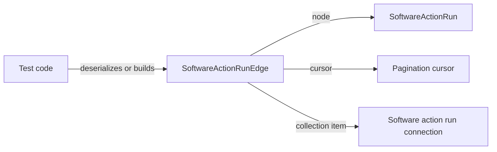
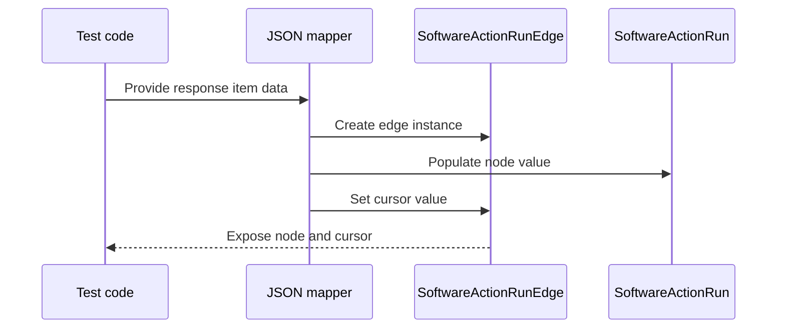
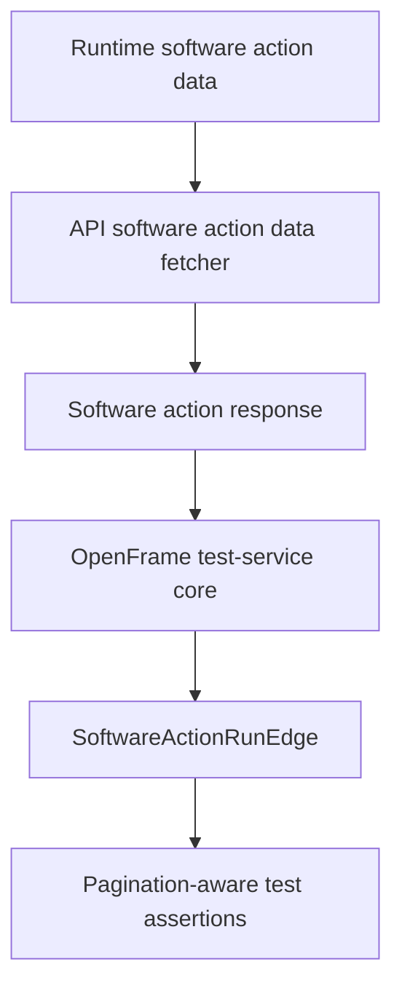

# Software Action Dto

Software Action Dto is a test-support data transfer object module for representing one item in a cursor-paginated collection of software-action runs. It is supplied by the **OpenFrame OSS Library** artifact `com.openframe.oss:openframe-test-service-core` at version `7.0.11`, which this repository consumes. The module contains one class, `SoftwareActionRunEdge`, and is used as a structural boundary between a run payload and its pagination position.

The implementation source is maintained in the [OpenFrame OSS Library](https://github.com/flamingo-stack/openframe-oss-lib/blob/16e7c1cbd9664e7d10ec5ebca7d53c9bd314decf/openframe-test-service-core/src/main/java/com/openframe/test/data/dto/softwareaction/SoftwareActionRunEdge.java).

## Purpose and Scope

`SoftwareActionRunEdge` models an edge in a connection-style response:

- `node` holds one `SoftwareActionRun` value.
- `cursor` holds the opaque position associated with that value.

The class does not execute software actions, retrieve records, validate pagination, or perform serialization manually. It is a mutable transport shape. Lombok generates accessors, mutators, equality, hash-code, string representation, a no-argument constructor, an all-argument constructor, and a builder. Jackson is configured to ignore unknown JSON properties, allowing a test client to tolerate additional fields in a received response.

## Component Architecture

`SoftwareActionRunEdge` is intentionally narrow: the run model conveys run-specific data, while the edge supplies the per-item cursor needed by a surrounding connection object. This separation lets collection metadata remain outside each individual run payload.

## Class Contract

| Element | Type | Responsibility |
|---|---|---|
| `node` | `SoftwareActionRun` | References the software-action run represented by this edge. |
| `cursor` | `String` | Preserves the cursor associated with this result position. |
| `@JsonIgnoreProperties(ignoreUnknown = true)` | Jackson annotation | Ignores fields not declared by the class during JSON deserialization. |
| `@Builder` | Lombok annotation | Provides fluent construction for fixtures and response models. |
| `@NoArgsConstructor` and `@AllArgsConstructor` | Lombok annotations | Support framework-style construction and direct complete construction. |
| `@Data` | Lombok annotation | Generates standard mutable DTO methods. |

## Data Flow

The module's role is limited to carrying one result and its cursor through test data handling. The sequence below describes the DTO-level flow rather than asserting a particular transport endpoint or cursor format.

For programmatic fixtures, callers can use the generated builder or constructors. The module does not enforce that `node` or `cursor` is present, unique, or consistent with a page boundary; those rules belong to the producer or consuming test logic.

## Integration Context

The broader module tree places this DTO in the OpenFrame test-service core alongside software inventory DTOs and software-action history tests. It complements, but does not replace, the runtime software-management pipeline:

The API data fetcher and persistence aggregation components listed in the module tree are separate library components. This module does not depend on their implementation directly; it provides a test-facing representation that can be populated from a software-action response.

## Serialization and Compatibility

The DTO relies on Jackson's default property mapping for `node` and `cursor`. Ignoring unknown properties is a forward-compatibility choice: when a response gains unrelated fields, existing tests can still deserialize this edge as long as its required values remain compatible.

Because the class is mutable and Lombok-generated equality includes both fields, maintainers should treat `node` and `cursor` as the complete identity of this transport object in assertions. Avoid adding behavior such as cursor encoding, request construction, or pagination traversal here; those concerns belong in a client, response mapper, or test helper.

## Maintenance Guidance

When changing Software Action Dto:

1. Preserve the `node` and `cursor` field names unless every JSON producer and test consumer is updated together.
2. Keep unknown-property tolerance if the DTO must remain compatible with evolving response payloads.
3. Update equality-sensitive fixtures when adding fields because Lombok's generated equality and hash code will incorporate them.
4. Keep pagination mechanics outside this DTO so it remains a simple, reusable response shape.
5. Validate changes against the software-action history test path in the test-service core, since that area is identified in the module tree as the relevant functional coverage.
