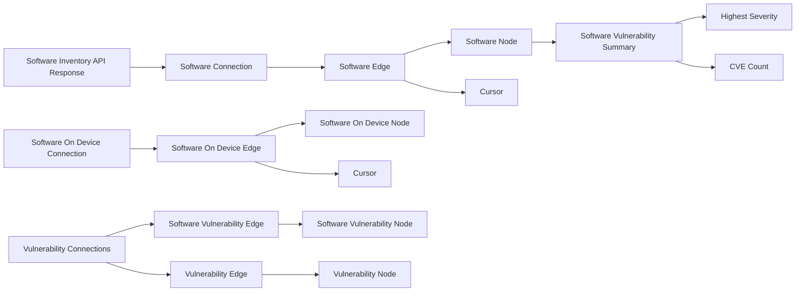
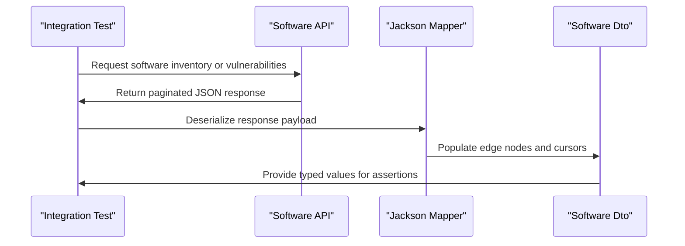

# Software Dto

Software Dto is a small group of Java data-transfer objects used by the OpenFrame test-service core to deserialize software-inventory and vulnerability responses. It is supplied at runtime by the `com.openframe.oss:openframe-test-service-core` library, version `7.0.11`, which OpenFrame OSS Tenant consumes. The classes are test-facing representations of cursor-paginated GraphQL connection edges plus a compact vulnerability roll-up.

All five types are deliberately permissive JSON models: `@JsonIgnoreProperties(ignoreUnknown = true)` allows tests to consume responses that contain fields outside the fixture contract. Lombok supplies accessors, a builder, and no-argument and all-argument construction, making the objects convenient both for Jackson deserialization and explicit test setup.

## Responsibilities

| Component | Responsibility |
| --- | --- |
| [Software Edge](https://github.com/flamingo-stack/openframe-oss-lib/blob/16e7c1cbd9664e7d10ec5ebca7d53c9bd314decf/openframe-test-service-core/src/main/java/com/openframe/test/data/dto/software/SoftwareEdge.java) | Represents one cursor-addressable software item in a software connection. |
| [Software On Device Edge](https://github.com/flamingo-stack/openframe-oss-lib/blob/16e7c1cbd9664e7d10ec5ebca7d53c9bd314decf/openframe-test-service-core/src/main/java/com/openframe/test/data/dto/software/SoftwareOnDeviceEdge.java) | Represents one installed-software record associated with a device. |
| [Software Vulnerability Edge](https://github.com/flamingo-stack/openframe-oss-lib/blob/16e7c1cbd9664e7d10ec5ebca7d53c9bd314decf/openframe-test-service-core/src/main/java/com/openframe/test/data/dto/software/SoftwareVulnerabilityEdge.java) | Represents one software-to-vulnerability association in a cursor-paginated connection. |
| [Vulnerability Edge](https://github.com/flamingo-stack/openframe-oss-lib/blob/16e7c1cbd9664e7d10ec5ebca7d53c9bd314decf/openframe-test-service-core/src/main/java/com/openframe/test/data/dto/software/VulnerabilityEdge.java) | Represents one vulnerability item in a cursor-paginated vulnerability connection. |
| [Software Vulnerability Summary](https://github.com/flamingo-stack/openframe-oss-lib/blob/16e7c1cbd9664e7d10ec5ebca7d53c9bd314decf/openframe-test-service-core/src/main/java/com/openframe/test/data/dto/software/SoftwareVulnerabilitySummary.java) | Carries the highest observed severity and the total CVE count for a software title. |

## Architecture

The edge classes implement the same response pattern: a domain-specific `node` preserves the returned entity while `cursor` preserves its pagination position. They do not fetch data, validate CVEs, or calculate severity; those responsibilities remain with the API and software-projection layers. Software Dto only provides stable shapes for test deserialization and assertions.

## Data Contracts

### Cursor Edges

`SoftwareEdge`, `SoftwareOnDeviceEdge`, `SoftwareVulnerabilityEdge`, and `VulnerabilityEdge` each expose two fields:

| Field | Type | Meaning |
| --- | --- | --- |
| `node` | Domain DTO | The entity for the current connection entry. The concrete types are `Software`, `SoftwareOnDevice`, `SoftwareVulnerability`, and `Vulnerability`, respectively. Their definitions are outside the supplied Software Dto sources. |
| `cursor` | `String` | Opaque pagination position returned for the current entry. Tests should pass it back only through the API pagination contract rather than derive semantics from it. |

The typed edge classes prevent mixing similar-looking connection entries in tests. For example, an installed-software result is modeled as `SoftwareOnDeviceEdge`, not as a generic software edge, even though both include a node and cursor.

### Vulnerability Summary

`SoftwareVulnerabilitySummary` is a roll-up rather than a connection entry.

| Field | Type | Meaning |
| --- | --- | --- |
| `highestSeverity` | `String` | Highest CVE severity associated with the software title, as supplied by the response. |
| `cveCount` | `Integer` | Count of associated CVEs. |

Because the DTO stores response values unchanged, callers should not assume an ordering or normalization scheme for `highestSeverity` beyond the API contract.

## Interaction Flow

## Design Notes

- Unknown JSON properties are ignored across the module. This improves fixture compatibility when the API adds fields, but it also means tests must explicitly assert fields that matter to their scenario.
- The summary uses boxed `Integer`, so a missing CVE count can remain distinguishable from a supplied zero count.
- Builders make compact expected-value fixtures possible without requiring every field to be populated.
- These classes are transport models only. They contain no business logic, persistence behavior, pagination traversal, or severity calculation.

## System Placement

Software Dto belongs to the test data model supplied by OpenFrame OSS Library. It supports software inventory and vulnerability assertions performed by the test-service core. At the application level, the tenant repository publishes the `com.openframe:openframe-test` artifact and consumes the library implementation at version `7.0.11`; this module is therefore assembled into the tenant's test runtime rather than implemented in the tenant repository itself.

The source-defined DTOs align with the broader software domain: API-side software queries expose inventory and vulnerability data, and data-layer software projection services maintain the underlying read models. Those systems are not duplicated here; Software Dto is the narrow boundary used by tests to represent their returned values.
