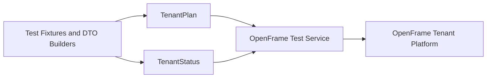
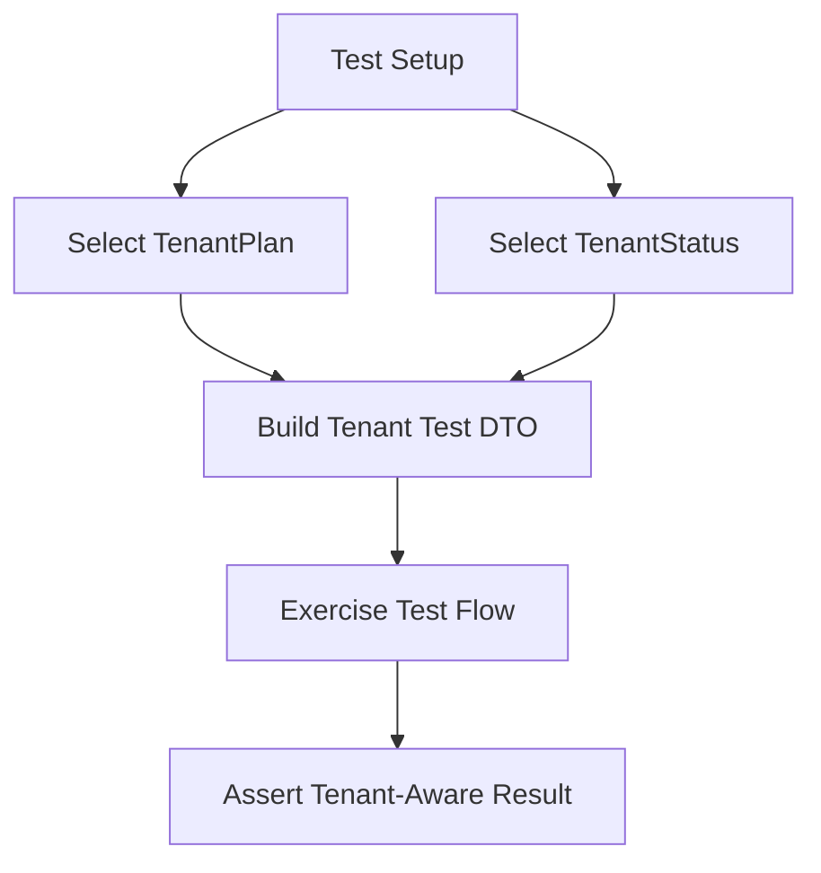

# Tenant Dto

Tenant Dto is a small contract module in the `openframe-test-service-core` library. It supplies the finite sets of values used by the test suite to describe a tenant's subscription tier and lifecycle state. The module is executed by this repository's OpenFrame test service; it does not implement tenant persistence, authorization, billing, or state transitions.

The implementation is supplied by [OpenFrame OSS Library](https://github.com/flamingo-stack/openframe-oss-lib/tree/16e7c1cbd9664e7d10ec5ebca7d53c9bd314decf/openframe-test-service-core) through the `com.openframe.oss:openframe-test-service-core` dependency. This repository assembles that library into its test-service runtime.

## Responsibilities

- Provide a strongly typed subscription-plan vocabulary through `TenantPlan`.
- Provide a strongly typed lifecycle-status vocabulary through `TenantStatus`.
- Keep tenant fixture and test DTO values constrained to known constants rather than arbitrary strings.

## Architecture Overview

Both enumerations are leaf contracts: callers choose one declared value, then the resulting tenant representation is consumed by higher-level test flows. Neither type owns validation rules beyond the Java enum constraint, nor does either communicate with external systems.

## Components

| Component | Source | Responsibility |
|---|---|---|
| `TenantPlan` | [TenantPlan.java](https://github.com/flamingo-stack/openframe-oss-lib/blob/16e7c1cbd9664e7d10ec5ebca7d53c9bd314decf/openframe-test-service-core/src/main/java/com/openframe/test/data/dto/tenant/TenantPlan.java) | Defines the tenant subscription tier used by test DTOs. |
| `TenantStatus` | [TenantStatus.java](https://github.com/flamingo-stack/openframe-oss-lib/blob/16e7c1cbd9664e7d10ec5ebca7d53c9bd314decf/openframe-test-service-core/src/main/java/com/openframe/test/data/dto/tenant/TenantStatus.java) | Defines whether a tenant is active or inactive in test data. |

## Tenant Plan Contract

`TenantPlan` models four subscription tiers:

| Value | Meaning in the contract |
|---|---|
| `FREE` | Free tier. |
| `BASIC` | Basic tier. |
| `PREMIUM` | Premium tier. |
| `ENTERPRISE` | Enterprise tier. |

The enum is a vocabulary, not an entitlement engine. Code that needs to determine a feature, limit, price, or service-level behavior must apply that policy elsewhere.

## Tenant Status Contract

`TenantStatus` models the two lifecycle states exposed by this test DTO contract:

| Value | Meaning in the contract |
|---|---|
| `ACTIVE` | The tenant is represented as active. |
| `INACTIVE` | The tenant is represented as inactive. |

No intermediate, pending, suspended, or deleted state is defined here. Tests requiring such behavior must use the appropriate platform model or explicitly define a separate contract rather than infer additional meanings from these values.

## Test Data Flow

This separation lets tests state the relevant tenant dimensions clearly while keeping plan-specific and status-specific platform behavior outside the transport vocabulary.

## Maintenance Notes

- Adding a plan or status is a compatibility change for tests that serialize, deserialize, compare, or branch on enum names.
- Renaming or removing a value can break fixtures and assertions, so search dependent test code before changing the enum.
- Keep values uppercase and stable to preserve the current Java enum convention and predictable serialized names.
- The source files belong to the OpenFrame OSS Library. Changes to their behavior or value set should be made in that library and then consumed through the pinned dependency version used by this repository.
