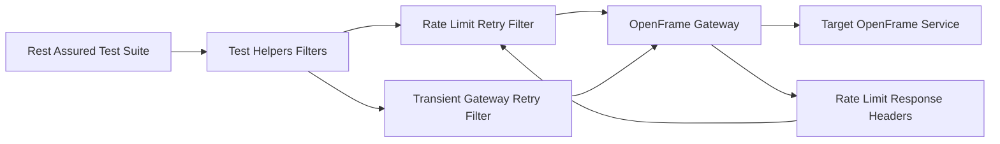
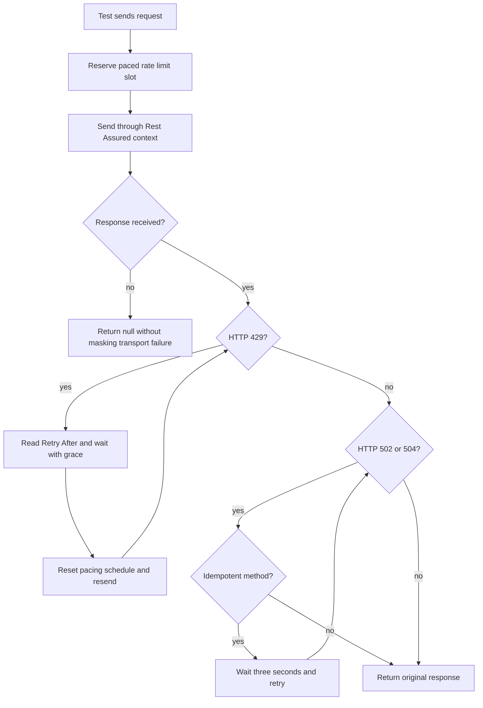
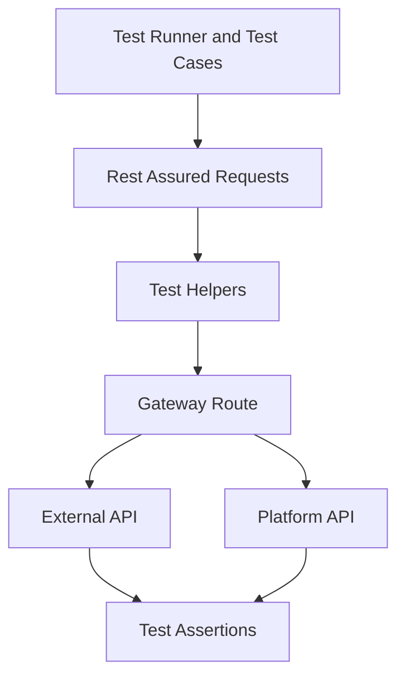

# Test Helpers

Test Helpers supplies two Rest Assured filters used by the OpenFrame test service to make integration and External API test runs resilient without concealing application failures. The implementation is provided by the `com.openframe.oss:openframe-test-service-core` library, version `7.0.11`, which this repository consumes. At runtime it is used by the OpenFrame test service.

The helpers address distinct gateway-level conditions:

- **RateLimitRetryFilter** keeps requests inside the API key's gateway rate budget, adapts to the advertised minute limit, and recovers from a rejected request when a minute window can reset.
- **TransientGatewayRetryFilter** retries narrowly-defined, temporary gateway failures for methods that are safe to repeat.

Neither helper is a general-purpose error suppressor. They preserve the original response for conditions outside their explicit retry policies, allowing tests to report genuine service, database, or contract failures.

## Architecture Overview

The filters operate at the Rest Assured request pipeline. A filter can issue the request through `FilterContext`, inspect its response, wait when its policy permits, and invoke the context again. They are complementary:

| Concern | Component | Retry scope | Safety boundary |
|---|---|---|---|
| Per-key gateway budget | `RateLimitRetryFilter` | HTTP `429` | A rate-limited request is rejected by the gateway before it reaches the service, so retrying any method does not repeat a service-side effect. |
| Intermittent gateway connectivity | `TransientGatewayRetryFilter` | HTTP `502` and `504` | Only idempotent methods are retried because a gateway error does not prove the request never reached the upstream service. |

## Request Processing

The exact composition order is established by the test configuration. Each filter independently protects a specific failure category; no assumption should be made that one filter handles the other's responses.

## Core Components

### Rate Limit Retry Filter

[`RateLimitRetryFilter`](https://github.com/flamingo-stack/openframe-oss-lib/blob/16e7c1cbd9664e7d10ec5ebca7d53c9bd314decf/openframe-test-service-core/src/main/java/com/openframe/test/helpers/RateLimitRetryFilter.java) protects suites that share a gateway API key from producing misleading `429 RATE_LIMIT_EXCEEDED` failures.

#### Pacing model

The filter maintains process-wide pacing state because the gateway limit applies to the API key rather than to an individual Rest Assured specification or test thread. Under a shared lock, each outgoing request reserves the next available time slot. The interval is calculated from the current minute limit, multiplied by a 1.10 headroom factor and clamped to a 10 ms minimum. This distributes calls across the minute window instead of waiting until a rejection occurs.

Until the gateway provides a value, it assumes a conservative five requests per minute. After each non-null response, it reads `X-RateLimit-Limit-Minute`. A positive changed value replaces the assumption, resets the stale schedule, and takes effect immediately. The filter also observes `X-RateLimit-Remaining-Minute` for diagnostic logging.

#### Rate-limit recovery

When a request returns `429`, the filter performs at most four recovery attempts:

1. Read `Retry-After` as seconds, or use a 60-second default if absent or malformed.
2. Add a two-second grace period to avoid clock skew and fixed-window boundary rounding.
3. Sleep unless the executing thread is interrupted. Interruption is restored and the current response is returned.
4. Reset the scheduled pacing window, resend the same request, and re-observe advertised rate headers.

A `429` retry may repeat non-idempotent requests because the gateway rejects such requests before they reach an OpenFrame service. This behavior is deliberately different from the transient-gateway retry policy.

If all attempts still receive `429`, the helper diagnoses the exhausted budget using the remaining day and hour headers. It distinguishes a minute budget that may need a higher configured limit from hourly or daily exhaustion, for which waiting one minute cannot help.

#### Null-response behavior

A missing Rest Assured response is passed through as `null`. This avoids replacing an underlying connection error, which is handled separately by the HTTP client's transport retry configuration, with a filter-originated null pointer failure.

### Transient Gateway Retry Filter

[`TransientGatewayRetryFilter`](https://github.com/flamingo-stack/openframe-oss-lib/blob/16e7c1cbd9664e7d10ec5ebca7d53c9bd314decf/openframe-test-service-core/src/main/java/com/openframe/test/helpers/TransientGatewayRetryFilter.java) absorbs brief gateway interruptions that appear as an HTTP response after request dispatch, rather than as a transport exception.

#### Retry eligibility

The filter returns immediately unless both conditions hold:

- The response status is `502` or `504`.
- The request method is `GET`, `HEAD`, `OPTIONS`, `PUT`, or `DELETE`.

It makes up to two retries with a fixed three-second delay. The current response is returned when retries are exhausted or the thread is interrupted; on interruption it restores the thread's interrupted status.

`POST` and `PATCH` are intentionally excluded. For these methods, a gateway error cannot establish whether the upstream service processed the request, so repeating it could duplicate an effect. HTTP `503` is also excluded: OpenFrame uses that status for meaningful backend conditions such as query or database errors, and automatically retrying it would hide an actual outage.

#### Null-response behavior

As with the rate-limit filter, a request that produces no response is returned as `null` rather than dereferenced. This preserves the original transport failure after the configured HTTP client has already attempted its own connection-level recovery.

## Operational Characteristics

### Shared state and concurrency

Only the rate-limit helper holds shared mutable state. Its static lock coordinates test threads within a JVM, and its static limit and next-slot timestamp represent the key-level pacing budget. The transient gateway helper has no shared scheduling state; each eligible request applies its own bounded retry loop.

### Failure visibility

Both filters are intentionally conservative:

- They do not convert failures into successes.
- They log when a retry is initiated and retain the final response for the test assertion.
- They stop retrying on interruption.
- They do not interpret a missing response as an HTTP status.

This keeps test outcomes useful: infrastructure noise is retried when safe, while semantic responses and persistent capacity failures remain observable.

## Relationship to the Test Service

Test Helpers belongs to the test-service-core library used by this repository's test workload. The helpers sit below functional test classes and above gateway-routed OpenFrame APIs. They complement, rather than replace, test runner orchestration, authentication flows, page objects, and API-specific assertions provided by the same library.

## Maintenance Guidance

- Keep retry conditions narrow. Extending them to application statuses can transform a valid regression signal into a slower, less diagnosable failure.
- Preserve the idempotency guard when changing transient gateway handling. A gateway error is ambiguous for mutating requests.
- Treat the rate-limit state as key-scoped. If tests use multiple API keys in one JVM, the current static pacing design is conservative across them rather than independently paced per key.
- Keep `Retry-After` parsing defensive. Gateway headers are operational metadata and malformed values must not fail an otherwise meaningful test.
- When modifying delays or retry counts, account for the suite's execution time as well as the relevant rate-limit window. Increasing retries cannot recover hourly or daily quota exhaustion.
