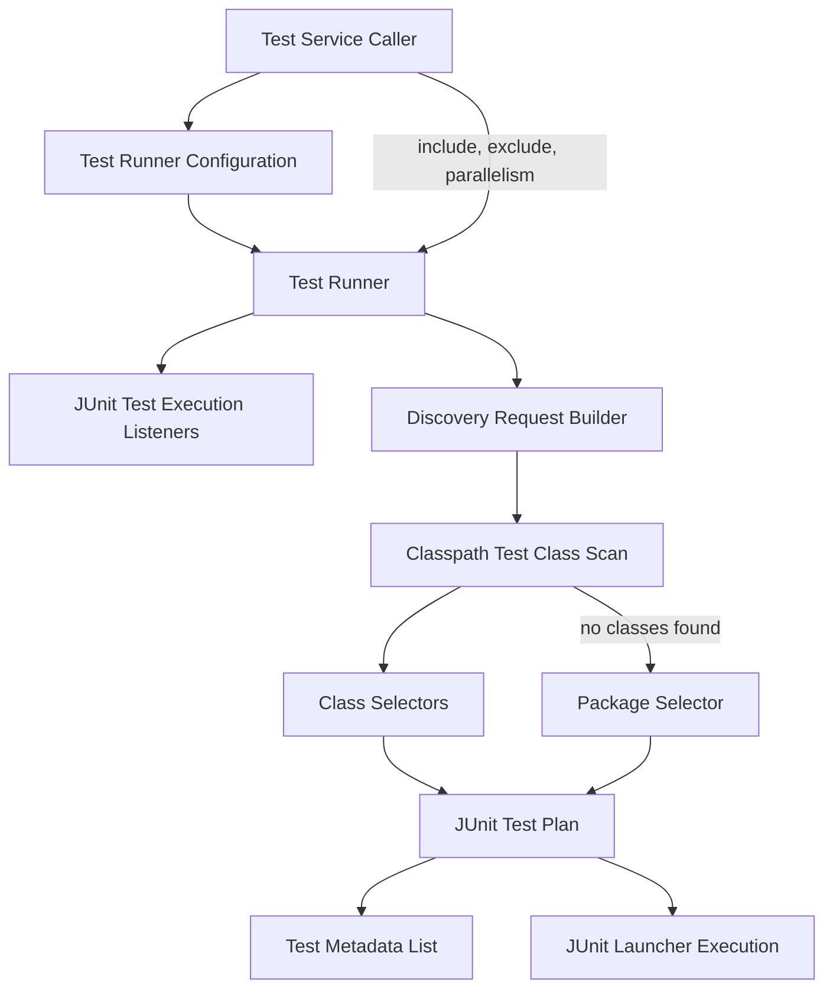
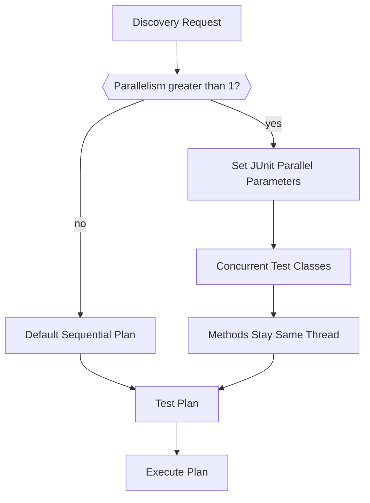
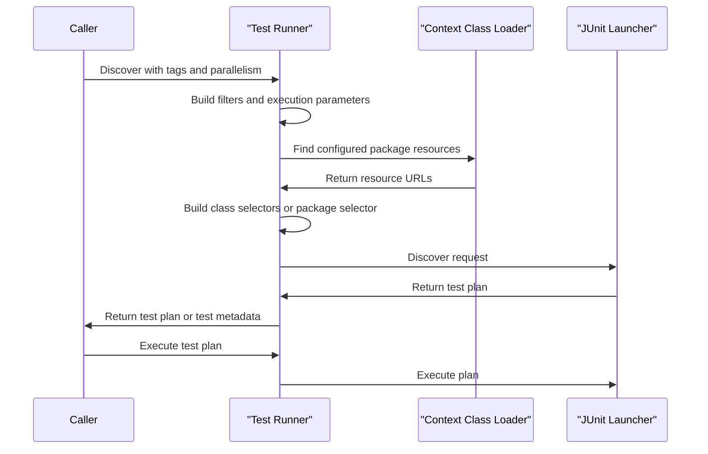

# Test Runner Core

Test Runner Core is the programmatic JUnit Platform adapter used by the OpenFrame test service. It builds a test-discovery request for a configured Java package, applies optional tag filters and class-level parallelism, discovers a `TestPlan`, executes that plan, and presents discovered leaf tests as small, serializable metadata records.

The implementation is supplied by the OpenFrame OSS Library artifact `com.openframe.oss:openframe-test-service-core` and is run by this repository's `openframe/services/openframe-test` service. Its source is maintained in the OpenFrame OSS Library:

- [Test](https://github.com/flamingo-stack/openframe-oss-lib/blob/16e7c1cbd9664e7d10ec5ebca7d53c9bd314decf/openframe-test-service-core/src/main/java/com/openframe/test/runner/Test.java)
- [Test Runner](https://github.com/flamingo-stack/openframe-oss-lib/blob/16e7c1cbd9664e7d10ec5ebca7d53c9bd314decf/openframe-test-service-core/src/main/java/com/openframe/test/runner/TestRunner.java)
- [Test Runner Configuration](https://github.com/flamingo-stack/openframe-oss-lib/blob/16e7c1cbd9664e7d10ec5ebca7d53c9bd314decf/openframe-test-service-core/src/main/java/com/openframe/test/runner/TestRunnerConfig.java)

## Responsibilities

- Construct JUnit Platform discovery requests from a target test package, requested tags, exclusions, and an optional class concurrency limit.
- Register caller-provided JUnit `TestExecutionListener` instances on one launcher instance.
- Prefer explicit test-class selectors found by classpath scanning; retain package selection as a fallback when scanning yields no classes.
- Preserve sequential execution as the default and enable parallelism only when a caller explicitly requests more than one concurrent class.
- Execute an already discovered plan, allowing callers to separate planning, listing, and execution.
- Convert JUnit leaf-test descriptors into `Test` records containing a display name and tag set.

## Architecture

`TestRunner` owns the JUnit `Launcher` and registers listeners during construction. `TestRunnerConfig` supplies the package to inspect and the listener array. Request construction may use class selectors discovered from JAR resources, or falls back to a package selector. The resulting `TestPlan` can be listed through `list` or executed through `run`.

## Core Components

### Test Runner Configuration

`TestRunnerConfig` is a small Lombok-backed configuration value with two inputs:

| Field | Purpose |
|---|---|
| `testPackage` | Java package used for classpath scanning and fallback package selection. |
| `testListeners` | JUnit Platform execution listeners registered on the launcher when the runner is created. |

The nested builder exposes `testPackage` and varargs `testListeners` methods. A caller must provide a meaningful package when it expects scanning or fallback selection to locate tests. Listeners are attached once to the runner's launcher, so they observe executions performed through that runner instance.

### Test Runner

`TestRunner` is the orchestration component. Its `SEQUENTIAL` constant is `1`, documenting and enforcing the historical default: one test class at a time.

#### Discovery and execution entry points

| Method family | Behavior |
|---|---|
| `run(String... tags)` | Builds a request with the supplied inclusion tags, discovers a plan, then executes it. |
| `run(LauncherDiscoveryRequest)` | Discovers a plan for a caller-supplied request, then executes it. |
| `run(TestPlan)` | Executes an existing plan directly. |
| `discover(String... tags)` | Discovers with inclusion tags and sequential execution. |
| `discover(String[] includeTags, String[] excludeTags)` | Discovers with explicit inclusion and exclusion filters, sequentially. |
| `discover(String[] includeTags, String[] excludeTags, int parallelism)` | Discovers with explicit filters and a maximum concurrent-class count. |
| `list(TestPlan)` | Projects test identifiers from a plan into `Test` records. |

This separation is important for a caller that needs to inspect a plan before execution. A plan created with the parallel settings retains those request configuration parameters for later execution through `run(TestPlan)`.

#### Selector construction and fallback

The runner converts the configured package from dotted Java notation to a resource path, obtains matching URLs from the thread context class loader, and examines JAR-backed resources. For each top-level `.class` entry directly under the package path, it attempts to load the class and adds a JUnit class selector. Inner classes are intentionally skipped because entries containing `$` are excluded.

A failed URL scan or an unloadable class is logged as a warning rather than aborting discovery. If no class selectors are collected, the request instead selects the configured package. This fallback keeps discovery usable in classpath layouts that do not expose a `JarURLConnection` to the scanner, including layouts where only the JUnit package selector can enumerate candidates.

### Test Metadata

`Test` is a Lombok data object returned by `TestRunner.list`. It includes:

| Field | Meaning |
|---|---|
| `displayName` | The JUnit display name reported by a leaf test identifier. |
| `tags` | Names of JUnit tags attached to that identifier. |

`list` begins at the first root in the plan, traverses its descendants, retains identifiers for which JUnit reports `isTest`, and converts their `TestTag` instances to string names. Container nodes are not included.

## Filtering and Concurrency

### Tag selection

An inclusion array adds a JUnit `includeTags` filter when it is nonempty. An exclusion array adds an `excludeTags` filter when it is nonempty and is logged before discovery. Null or empty arrays do not contribute a filter. Therefore, calling the tag-only overload filters by included tags, while the two-array overload can define both sides of the selection.

### Parallel execution policy

Parallelism is opt-in. A requested value less than or equal to `SEQUENTIAL` leaves JUnit's request settings unchanged, so execution remains sequential. A higher value writes these request parameters:

| JUnit parameter | Value | Effect |
|---|---|---|
| `junit.jupiter.execution.parallel.enabled` | `true` | Activates Jupiter parallel execution. |
| `junit.jupiter.execution.parallel.mode.default` | `same_thread` | Keeps methods within a class on the class thread. |
| `junit.jupiter.execution.parallel.mode.classes.default` | `concurrent` | Allows different test classes to execute concurrently. |
| `junit.jupiter.execution.parallel.config.strategy` | `fixed` | Uses a bounded fixed parallelism strategy. |
| `junit.jupiter.execution.parallel.config.fixed.parallelism` | Requested value | Limits concurrent test classes. |

The intended unit of concurrency is a test class, not individual test methods. This preserves ordering and shared setup assumptions within a class, including `BeforeAll` logic that relies on thread-local authentication state. Callers should select parallelism only for suites whose classes are isolated; shared fixtures or browser-driving suites should remain sequential.

## Runtime Flow

## Operational Considerations

- The scanner uses the current thread's context class loader. Launch environments that replace or constrain that loader can prevent class enumeration; the package-selector fallback is the recovery path built into the runner.
- The classpath scanner currently handles JAR connections explicitly. Other URL connection types are logged but do not contribute class selectors.
- Discovery tolerates missing optional dependencies while loading candidate classes by logging `ClassNotFoundException` and `NoClassDefFoundError` cases.
- `list` assumes the plan has at least one root because it takes the first root before traversing descendants. Callers should provide a valid JUnit-discovered plan.
- Listener registration occurs in the constructor. Reusing a runner preserves its launcher and registered listeners across its operations.

## Relationship to the Test Service

Test Runner Core is infrastructure within the OpenFrame test service rather than a suite of product assertions. The surrounding test-service library supplies authentication flows, data-transfer objects, page objects, retry helpers, and domain-specific test classes. Those test classes are discovered by the package configured in `TestRunnerConfig`; Test Runner Core then applies selection, planning, execution, and metadata extraction consistently for the service.
