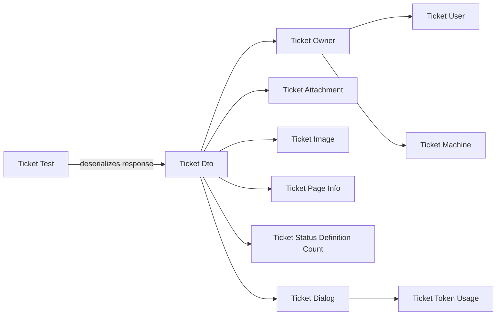
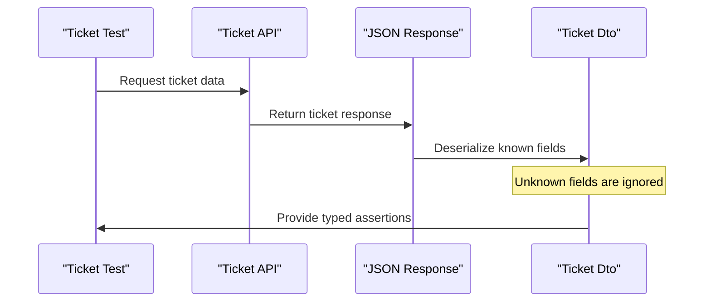

# Ticket Dto

## Purpose

Ticket Dto is a small, test-support data-transfer module from the OpenFrame OSS Library artifact `com.openframe.oss:openframe-test-service-core`. It supplies Jackson-deserializable Java models used by the OpenFrame test service when test code reads ticket-related API responses. The tenant repository runs that library through its OpenFrame test service; the DTO source itself is maintained in the library repository.

The module deliberately models only the ticket fields needed by tests: attachments and images, a ticket owner and its possible user or machine identities, cursor-pagination metadata, status totals, and AI dialog token consumption. All DTOs ignore unknown JSON properties so tests stay compatible when an upstream response adds fields.

## Architecture Overview

### Design Characteristics

- **Resilient response binding:** every class uses Jackson's unknown-property tolerance, which lets existing tests deserialize additive API responses.
- **Low-ceremony fixtures:** Lombok generates accessors, equality helpers, builders, and both no-argument and all-argument constructors. Tests can therefore construct expected objects with a builder or deserialize them from JSON.
- **Reference-oriented ownership:** `TicketOwner` carries a discriminator plus both identifier fields and optional expanded user or machine objects. Consumers should interpret the `type` field before relying on a nested object.
- **DTO boundary:** these types contain no API calls, persistence behavior, authorization policy, or ticket workflow logic. They model response data only.

## Component Groups

The following generated submodule documents partition all nine Ticket Dto components by their response concern:

- [Ticket References](ticket_dto/ticket_references/ticket_references.md) covers attachment, image, machine, user, and owner representations.
- [Ticket Conversation Metrics](ticket_dto/ticket_conversation_metrics/ticket_conversation_metrics.md) covers dialog identity, current mode, and per-chat token measurements.
- [Ticket Listing Metadata](ticket_dto/ticket_listing_metadata/ticket_listing_metadata.md) covers cursor navigation and per-status counts.

## Relationship to the Platform

Ticket Dto belongs to the test-service-core library rather than the ticket domain implementation. Production ticket operations are exposed through the external API ticket controller and request/response contracts, while ticket persistence and projections are provided by the data modules. Ticket Dto gives integration and end-to-end tests lightweight, tolerant representations of selected ticket response fragments.

## Typical Data Flow

## Maintenance Notes

When an API response changes, preserve field names and Java types that existing tests deserialize. Additive response fields normally require no DTO change because unknown fields are ignored. Add a field only when a test must assert it, and retain the Lombok and Jackson annotations so construction and deserialization conventions remain consistent.

The status count DTO depends on the library's `TicketStatusDefinition` test DTO, which is outside this module's component list. It pairs that status definition with an integer count rather than redefining the status schema.

## Source

The component source is in the OpenFrame OSS Library, pinned by this repository at version `7.0.11`. For example, see [Ticket Attachment](https://github.com/flamingo-stack/openframe-oss-lib/blob/16e7c1cbd9664e7d10ec5ebca7d53c9bd314decf/openframe-test-service-core/src/main/java/com/openframe/test/data/dto/ticket/TicketAttachment.java).