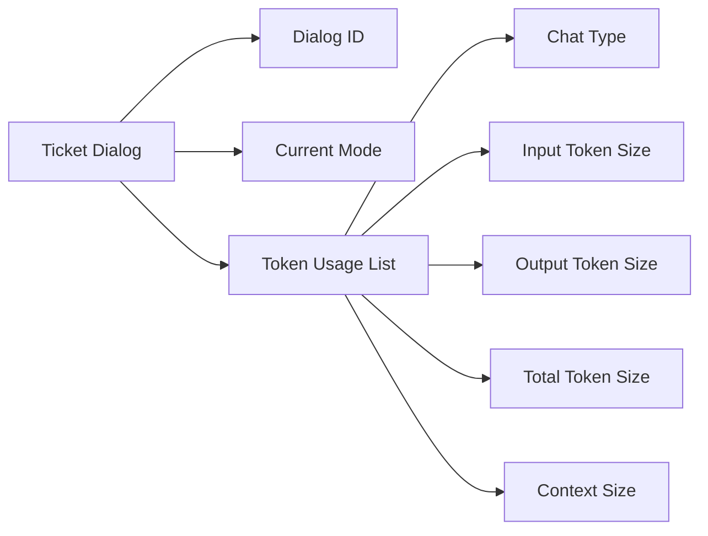

# Ticket Conversation Metrics

## Purpose

Ticket Conversation Metrics models the AI-dialog fragment of a ticket response. It is part of [Ticket Dto](../../ticket-dto.md), supplied by the OpenFrame OSS Library test-service-core artifact.

## Components

| Component | Fields | Responsibility |
| --- | --- | --- |
| `TicketDialog` | `id`, `currentMode`, `tokenUsage` | Identifies a dialog, records its current mode, and groups token measurements. |
| `TicketTokenUsage` | `chatType`, `inputTokensSize`, `outputTokensSize`, `totalTokensSize`, `contextSize` | Records token-volume and context measurements for a chat type. |

## Data Shape

`TicketDialog` contains a list rather than a single usage record, so a response can expose measurements for multiple chat types. The DTO does not calculate totals or validate relationships between the numeric values; it preserves the values delivered by the API for test assertions.

## Compatibility and Fixture Use

Both classes ignore unfamiliar JSON properties and include builders, no-argument constructors, and all-argument constructors. This supports JSON response binding alongside explicit test fixture construction. Token sizes are boxed `Long` values, allowing a response to omit a measurement without forcing a synthetic zero.

## Source Files

- [Ticket Dialog](https://github.com/flamingo-stack/openframe-oss-lib/blob/16e7c1cbd9664e7d10ec5ebca7d53c9bd314decf/openframe-test-service-core/src/main/java/com/openframe/test/data/dto/ticket/TicketDialog.java)
- [Ticket Token Usage](https://github.com/flamingo-stack/openframe-oss-lib/blob/16e7c1cbd9664e7d10ec5ebca7d53c9bd314decf/openframe-test-service-core/src/main/java/com/openframe/test/data/dto/ticket/TicketTokenUsage.java)