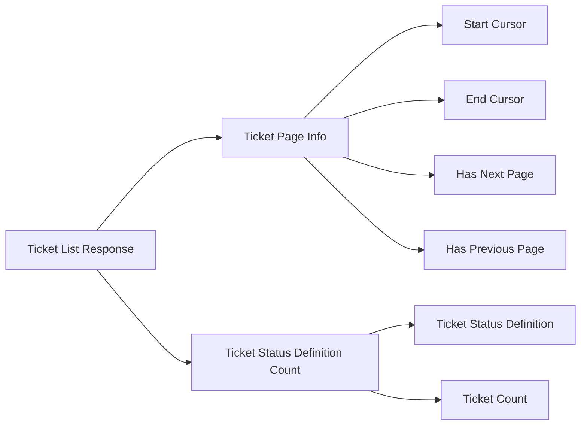

# Ticket Listing Metadata

## Purpose

Ticket Listing Metadata provides response fragments used when tests assert ticket list navigation and ticket totals grouped by status. It is part of [Ticket Dto](../../ticket-dto.md), from the OpenFrame OSS Library test-service-core artifact.

## Components

| Component | Responsibility |
| --- | --- |
| `TicketPageInfo` | Captures cursor-based navigation state through next and previous page flags plus start and end cursors. |
| `TicketStatusDefinitionCount` | Couples a `TicketStatusDefinition` with its ticket count. |

## Listing Flow

## Semantics

`TicketPageInfo` records navigation metadata only. It neither issues page requests nor decodes cursor values, so test code should treat the cursors as opaque strings.

`TicketStatusDefinitionCount` does not recreate the status schema. Its `status` property uses the adjacent library `TicketStatusDefinition` DTO, while `count` is an `Integer` expressing the number of tickets in that status. This keeps status assertions aligned with the library's shared test representation.

Both DTOs use builders and tolerate additional JSON properties, making them appropriate for forward-compatible API response assertions.

## Source Files

- [Ticket Page Info](https://github.com/flamingo-stack/openframe-oss-lib/blob/16e7c1cbd9664e7d10ec5ebca7d53c9bd314decf/openframe-test-service-core/src/main/java/com/openframe/test/data/dto/ticket/TicketPageInfo.java)
- [Ticket Status Definition Count](https://github.com/flamingo-stack/openframe-oss-lib/blob/16e7c1cbd9664e7d10ec5ebca7d53c9bd314decf/openframe-test-service-core/src/main/java/com/openframe/test/data/dto/ticket/TicketStatusDefinitionCount.java)