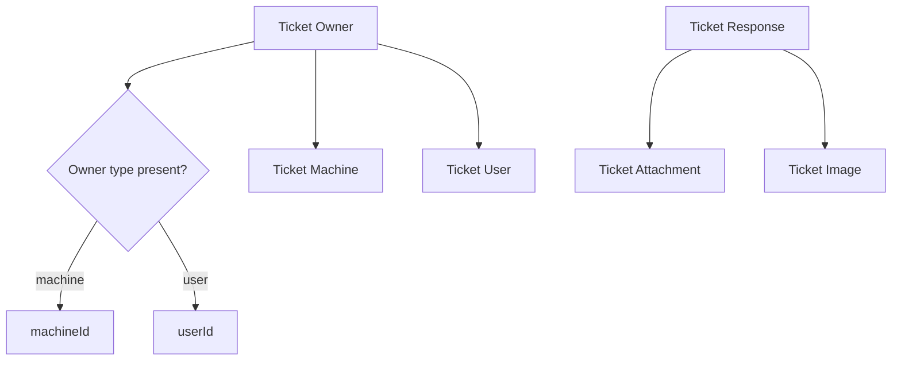

# Ticket References

## Purpose

Ticket References models the people, devices, and files associated with a ticket response. It is part of [Ticket Dto](../../ticket-dto.md) and is provided by the OpenFrame OSS Library test-service-core artifact.

## Components

| Component | Responsibility |
| --- | --- |
| `TicketAttachment` | Describes an uploaded file using its ID, ticket ID, name, media type, byte size, upload time, and uploader identifier. |
| `TicketImage` | Holds an image URL when a ticket response exposes an image reference. |
| `TicketMachine` | Identifies a related managed machine by document ID, machine ID, hostname, and organization ID. |
| `TicketUser` | Represents a person with an ID, first name, and last name. |
| `TicketOwner` | Represents an owner that may resolve to a machine or a user. It provides `type`, direct identifiers, and optional expanded machine and user objects. |

## Ownership Resolution

`TicketOwner` can carry both a compact ID and an expanded nested object. Tests should assert the representation returned by the API and avoid assuming that nested machine or user fields are always populated merely because an ID is present.

## Serialization Contract

All five DTOs accept unknown JSON properties, supporting additive response evolution. Lombok's builder and constructors allow concise fixture creation without custom mapping code. `uploadedAt` in `TicketAttachment` is an `Instant`, retaining a timezone-independent timestamp for upload assertions.

## Source Files

- [Ticket Attachment](https://github.com/flamingo-stack/openframe-oss-lib/blob/16e7c1cbd9664e7d10ec5ebca7d53c9bd314decf/openframe-test-service-core/src/main/java/com/openframe/test/data/dto/ticket/TicketAttachment.java)
- [Ticket Image](https://github.com/flamingo-stack/openframe-oss-lib/blob/16e7c1cbd9664e7d10ec5ebca7d53c9bd314decf/openframe-test-service-core/src/main/java/com/openframe/test/data/dto/ticket/TicketImage.java)
- [Ticket Machine](https://github.com/flamingo-stack/openframe-oss-lib/blob/16e7c1cbd9664e7d10ec5ebca7d53c9bd314decf/openframe-test-service-core/src/main/java/com/openframe/test/data/dto/ticket/TicketMachine.java)
- [Ticket Owner](https://github.com/flamingo-stack/openframe-oss-lib/blob/16e7c1cbd9664e7d10ec5ebca7d53c9bd314decf/openframe-test-service-core/src/main/java/com/openframe/test/data/dto/ticket/TicketOwner.java)
- [Ticket User](https://github.com/flamingo-stack/openframe-oss-lib/blob/16e7c1cbd9664e7d10ec5ebca7d53c9bd314decf/openframe-test-service-core/src/main/java/com/openframe/test/data/dto/ticket/TicketUser.java)