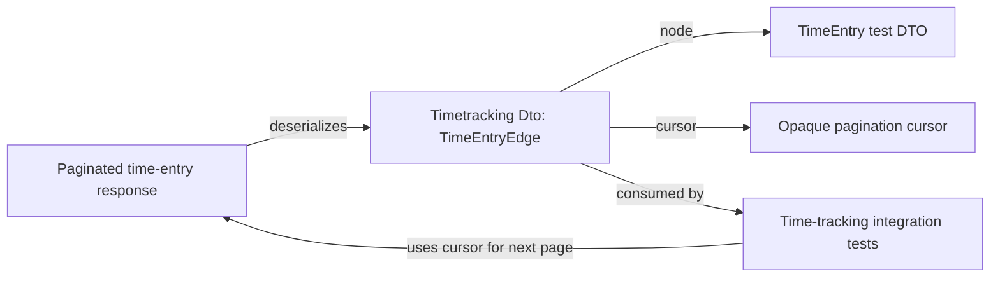
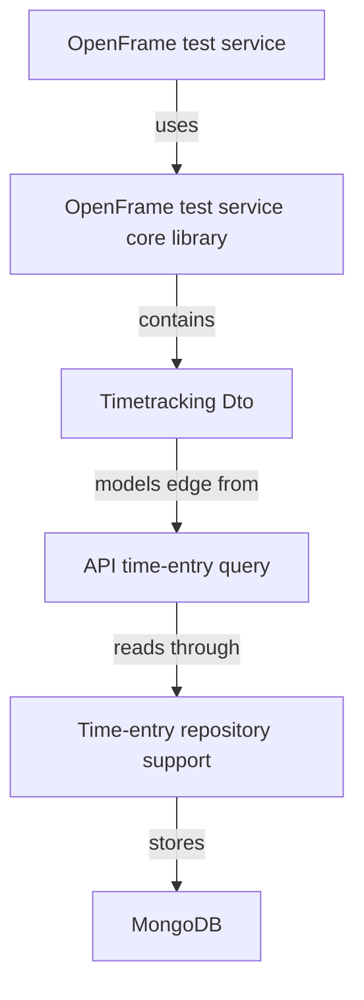
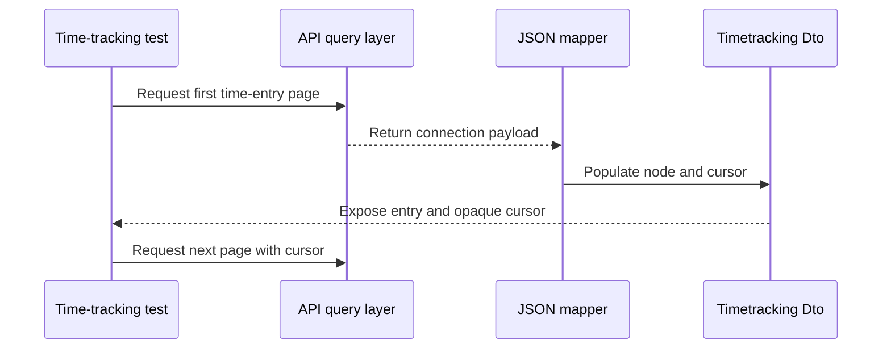
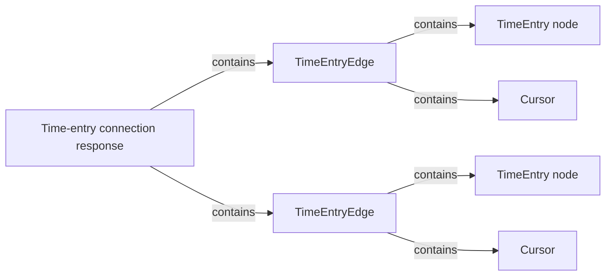

# Timetracking Dto

Timetracking Dto supplies the test-side cursor edge used to read time-entry results returned by the OpenFrame API. It is intentionally small: `TimeEntryEdge` pairs one time-entry test DTO with the opaque cursor needed to traverse a paginated connection. The module belongs to the `com.openframe.oss:openframe-test-service-core` library, version `7.0.11`, which this repository consumes when running its OpenFrame test service.

The implementation is provided by the OpenFrame OSS Library at [`TimeEntryEdge.java`](https://github.com/flamingo-stack/openframe-oss-lib/blob/16e7c1cbd9664e7d10ec5ebca7d53c9bd314decf/openframe-test-service-core/src/main/java/com/openframe/test/data/dto/timetracking/TimeEntryEdge.java).

## Purpose and Scope

The Timetracking Dto module models one **edge** in a connection-style time-entry response. It does not query, persist, validate, or mutate time entries. Instead, it gives integration tests a JSON-deserializable shape that preserves both:

- the `node`, represented by the neighboring `TimeEntry` test DTO; and
- the `cursor`, represented as a `String` and treated as an opaque pagination token.

This boundary model lets tests assert time-entry content and request the next result page without coupling the test code to the server's internal persistence representation.

## Component Contract

`TimeEntryEdge` is a Lombok-backed Java data class with two fields.

| Field | Type | Responsibility |
|---|---|---|
| `node` | `TimeEntry` | Carries the time-entry DTO for this position in the result set. |
| `cursor` | `String` | Carries the server-provided continuation position for cursor pagination. |

The class is annotated with the following behavior:

| Annotation | Effect |
|---|---|
| `@Data` | Generates accessors and standard data-class methods used by test assertions and JSON-oriented handling. |
| `@Builder` | Supports explicit fixture construction when a test needs to compose an edge. |
| `@NoArgsConstructor` | Supports frameworks that instantiate the object before populating fields. |
| `@AllArgsConstructor` | Supports direct construction with a node and cursor. |
| `@JsonIgnoreProperties(ignoreUnknown = true)` | Makes response parsing forward-compatible when the API adds fields that this DTO does not model. |

### JSON Shape

The conceptual payload accepted by the module is:

```json
{
  "node": {
    "...": "time-entry fields are represented by TimeEntry"
  },
  "cursor": "opaque-pagination-token"
}
```

The cursor must be passed back unchanged when a query requests subsequent results. Tests should not parse, synthesize, sort, or otherwise derive meaning from it.

## Architecture and Dependencies

Timetracking Dto is a leaf DTO within the OpenFrame test library. Its direct code-level dependencies are Lombok, Jackson, and the adjacent `TimeEntry` DTO. At runtime, it acts between a paginated API payload and test assertions.



### System Placement

The platform's API layer includes a time-entry data fetcher, while Mongo persistence exposes time-entry repository support. Timetracking Dto does not depend on either implementation directly. It consumes the API-facing connection result in the test layer, keeping test fixtures isolated from production document classes.



The API and repository layers are shown to explain data ownership, not as direct Java dependencies of `TimeEntryEdge`.

## Pagination Data Flow

A connection response can contain multiple Timetracking Dto instances. Each instance retains the entry at one result position and the cursor associated with that position.



### Processing Rules

1. Deserialize the `node` and `cursor` from the same edge object.
2. Assert business-relevant values through the `node` object.
3. Preserve the cursor exactly as supplied by the response.
4. Use the preserved cursor only as pagination input for a subsequent API request.
5. Tolerate unrecognized response fields, because the JSON annotation ignores them.

## Component Interaction

The following diagram distinguishes the responsibilities of the connection model from the edge model. `TimeEntryEdge` owns neither the surrounding collection nor page metadata; it contributes one navigable item to that higher-level response.



## Maintenance Guidance

- Keep `node` aligned with the neighboring `TimeEntry` test DTO rather than duplicating time-entry fields in the edge.
- Preserve the field names `node` and `cursor` unless the API contract changes in lockstep; they represent the serialized boundary expected by tests.
- Retain the no-argument constructor and unknown-field tolerance when changing annotations, because these support resilient JSON deserialization.
- Add a field only when tests need a stable API contract value. Unknown payload fields already deserialize safely without requiring an immediate DTO change.
- Treat cursor values as opaque data. Any semantic interpretation belongs to the API pagination implementation, not to Timetracking Dto.

## Verification Focus

Tests that exercise this module should cover the following outcomes:

- an edge deserializes when both `node` and `cursor` are present;
- a response carrying additional fields still deserializes successfully;
- the deserialized cursor can be reused unchanged in a next-page request; and
- fixture construction works through both the generated builder and the all-arguments constructor.

The `TimeTrackingTest` integration test in the same OpenFrame test service core library is the relevant end-to-end test area for time-entry behavior. Timetracking Dto itself remains a passive transport model: its correctness is primarily the fidelity of deserialization and cursor preservation.
