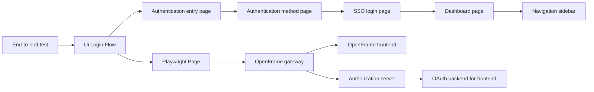
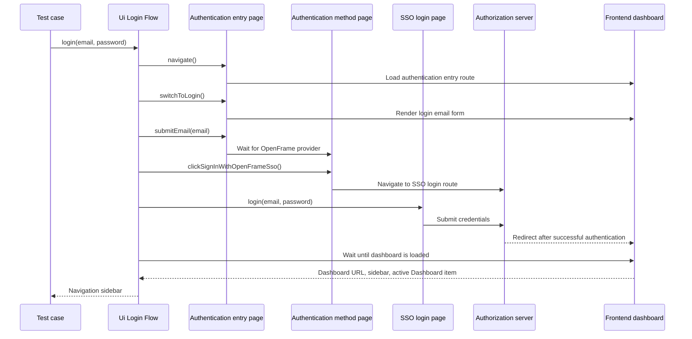
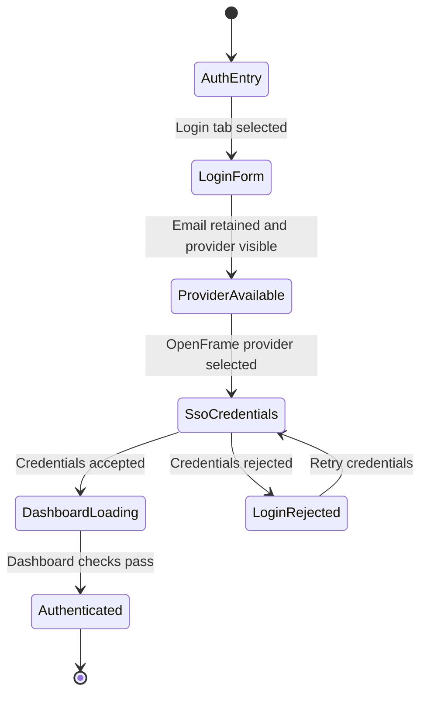
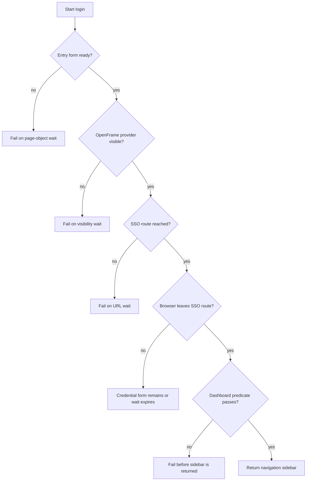

# Ui Login Flow

Ui Login Flow is a Playwright page-object workflow that signs an end-to-end test user into the OpenFrame web application through the built-in OpenFrame single sign-on path. It packages the navigation, form interaction, redirect, and ready-state assertion into one `login` operation and returns a `NavigationSidebar` only after the dashboard is usable.

The implementation belongs to the `openframe-test-service-core` library from OpenFrame OSS Library. This tenant repository runs that library as part of its OpenFrame test service. The authoritative implementation is [`UILoginFlow.java`](https://github.com/flamingo-stack/openframe-oss-lib/blob/16e7c1cbd9664e7d10ec5ebca7d53c9bd314decf/openframe-test-service-core/src/main/java/com/openframe/test/pages/flow/UILoginFlow.java).

## Purpose and Contract

`UILoginFlow` accepts an existing Playwright `Page` and provides:

- A repeatable route from the authentication entry screen to the OpenFrame SSO credential form.
- Submission of the same email to the application login screen and the SSO credential form.
- A dashboard readiness wait that verifies more than a redirect.
- A `NavigationSidebar` page object for test steps that follow successful authentication.

The flow is deliberately an orchestration layer. It does not own selectors or authentication protocol logic. Those concerns remain in the page objects and authorization services that it coordinates.

| Input or result | Meaning |
| --- | --- |
| `Page` | Browser tab or page supplied when the flow is constructed. |
| `email` | Identifier entered in the application login form and again in the SSO form. |
| `password` | Credential entered only in the SSO password field. |
| `NavigationSidebar` | Postcondition object returned after the dashboard is confirmed ready. |

## Architecture

Ui Login Flow runs in the test process, while the browser communicates with the tenant deployment through the gateway. The gateway routes the application request and the authorization request to different services. The page-object workflow observes the rendered application; it does not call authorization APIs directly.

### Component Responsibilities

| Component | Responsibility in Ui Login Flow |
| --- | --- |
| `UILoginFlow` | Chains page-object actions, waits for `DashboardPage.isLoaded`, and returns the sidebar abstraction. |
| `AuthEntryPage` | Navigates to the authentication entry route, selects Login, fills the email field, and waits for the OpenFrame SSO provider control. Its email entry routine re-fills until the client-side controlled input retains the expected value. |
| `AuthMethodPage` | Clicks **Continue with OpenFrame** and waits for a URL containing `/sas/login`. |
| `SsoLoginPage` | Fills `#username` and `#password`, submits `#submitBtn`, and waits until the browser leaves the SSO login route. |
| `DashboardPage` | Defines the stronger ready check: a dashboard URL, a visible main navigation sidebar, and an active Dashboard navigation item. |
| `NavigationSidebar` | Provides stable navigation actions for subsequent test steps after authentication. |
| Authorization server | Renders the credential login endpoint and validates local or configured identity-provider authentication flows. |
| OAuth backend for frontend | Starts authorization redirects, handles callback token exchange, writes authentication cookies, refreshes tokens, and processes logout. |

## Login Process

The `login(email, password)` method executes the following ordered interaction. Each page object supplies its own navigation or visibility synchronization, and Ui Login Flow adds the final application-readiness condition.

### State and Synchronization

The workflow has two distinct success checks:

1. `SsoLoginPage` waits until the browser URL no longer contains `/sas/login` after submission.
2. Ui Login Flow then polls `DashboardPage.isLoaded`. That predicate requires a dashboard URL, a visible main navigation sidebar, and the Dashboard navigation item marked as the current page.

This second check prevents a test from proceeding after a redirect that has occurred before the single-page application has rendered its usable shell.

## Authorization Interaction

The visible credential form is served by the authorization service `LoginController` at `/login`. An `error` query parameter causes the server to expose an **Invalid credentials** message, and an optional password-reset page configuration exposes a reset link.

For external identity-provider callbacks, `SsoFlowSuccessHandler` identifies the activated SSO flow by state and delegates it to the appropriate handler. `LoginSsoHandler` is the regular login finalizer. It:

- Validates the SSO flow cookie and returned identity.
- Prefers an existing provider-subject link over email matching.
- Requires a trusted email signal before using an identity-provider email to locate an account.
- Checks tenant activity and prevents generic-provider sign-in where tenant-specific provider configuration is required.
- Binds the authenticated user to the session and redirects only after the login is fully allowed.

The OAuth backend for frontend creates the authorization redirect, stores temporary state in a cookie, handles the callback, writes access and refresh authentication cookies, and clears the temporary state. It also offers refresh and logout endpoints. Ui Login Flow does not inspect cookies or tokens; its observable contract is the dashboard-ready browser state.

## Failure Behavior

Important diagnostic boundaries:

- A provider control that never appears indicates that the login screen did not accept or retain the submitted email, or that its expected SSO option is unavailable.
- A timeout waiting for `/sas/login` isolates the failure to provider selection or the redirect into the authorization server.
- Remaining on the SSO route after submission represents an unsuccessful login from the browser's perspective. `SsoLoginPage` retains helpers that let a caller inspect the email value and whether the browser is still on that route.
- A dashboard readiness failure after leaving the SSO route points to a post-authentication redirect or frontend rendering problem rather than merely an invalid credential.

## Maintenance Notes

- Keep the public `login` method focused on orchestration. Update selectors, URL waits, and rendering-specific synchronization in the dedicated page objects.
- Preserve the final `DashboardPage.isLoaded` condition when changing redirects or frontend routing. URL-only waiting is insufficient because the dashboard must render the main navigation and mark Dashboard as active.
- The flow currently selects the OpenFrame SSO option. Google, Microsoft, Apple, invitation, registration, password-reset, and native-mobile paths require their own explicit workflow and assertions.
- Treat provider labels and route fragments as externally visible test contracts. The supporting page objects deliberately use resilient selectors because frontend markup may render navigation entries as either links or buttons.
- Keep browser-level tests separate from token-level tests. The authorization service and OAuth backend for frontend enforce session, provider, tenant, redirect, and cookie policy; Ui Login Flow verifies the user-facing result of those policies.
