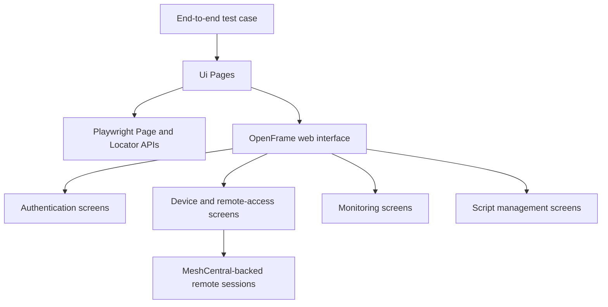
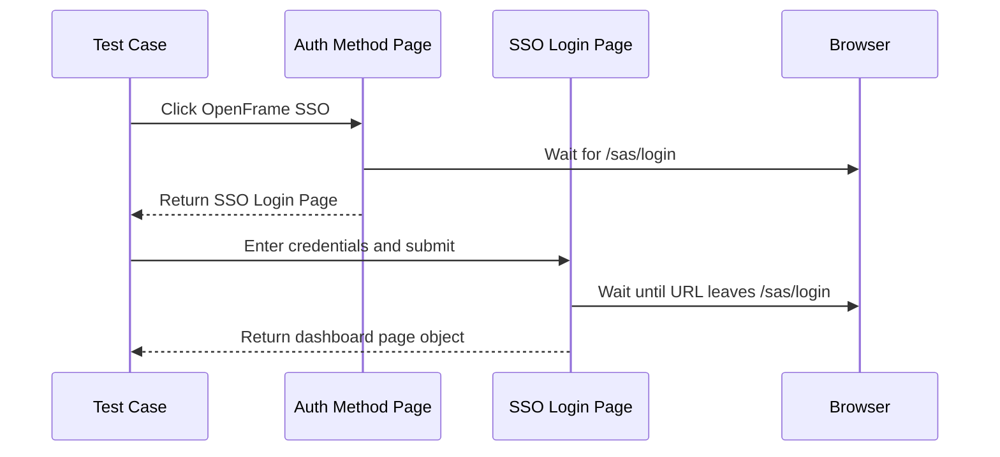
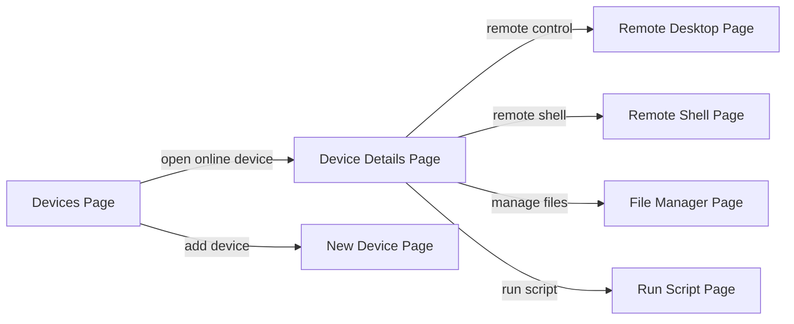
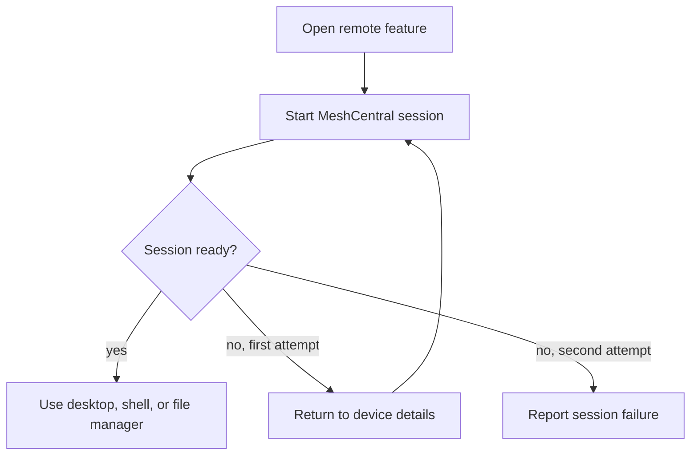

# Ui Pages

Ui Pages is the Playwright page-object layer used by the OpenFrame end-to-end test suite. It provides typed, reusable interactions with authentication, devices, remote-access sessions, monitoring, scripts, and device installation screens. Rather than exposing test cases to transient DOM structure, each page object centralizes selectors, navigation waits, state readers, and actions for one user-facing area.

The implementation belongs to the `com.openframe.oss:openframe-test-service-core` library from [OpenFrame OSS Library](https://github.com/flamingo-stack/openframe-oss-lib/blob/16e7c1cbd9664e7d10ec5ebca7d53c9bd314decf/openframe-test-service-core/src/main/java/com/openframe/test/pages). This repository consumes that library at version `7.0.11`; the page objects run in the tenant test service.

## Responsibilities

- Model supported UI surfaces as Java classes around a shared Playwright `Page`.
- Encapsulate selectors and interaction sequencing, returning the next relevant page object after navigation.
- Provide assertion-ready readers for headings, statuses, counts, selections, terminal output, and rendered remote-desktop state.
- Synchronize with asynchronous SPA changes, remote-access relays, and dynamic list rendering.
- Produce diagnostics that distinguish a missing record from an unavailable or stale device.

## Architecture

The module follows the page-object pattern: callers express an intent such as opening an online device, applying a tag filter, or executing a terminal command. The page object owns the locator details and the appropriate readiness condition. This keeps test flows readable while localizing UI changes to one class.

## Component Map

| Area | Core components | Role |
|---|---|---|
| Authentication | `AuthMethodPage`, `SsoLoginPage` | Select an identity provider and complete the OpenFrame SSO credential form. |
| Device inventory and onboarding | `DevicesPage`, `NewDevicePage`, `DeviceDetailsPage` | Search, filter, inspect, onboard, and manage devices. |
| Remote access | `RemoteDesktopPage`, `RemoteShellPage`, `FileManagerPage` | Validate MeshCentral desktop sessions, interactive shells, and remote file operations. |
| Monitoring | `MonitoringPage` | Navigate policy and query tabs, read policy metrics, and inspect policy rows. |
| Script execution | `ScriptsPage`, `RunScriptPage` | Find scripts and schedules, configure execution inputs, select target devices, and submit a run. |

## Authentication Flow

`AuthMethodPage` represents the provider chooser at `/auth/login`. It locates provider buttons by their visible button text, avoiding a dependency on an accessible name that the current UI does not expose. The OpenFrame path waits for the `/sas/login` transition before yielding `SsoLoginPage`.

`SsoLoginPage` uses stable form identifiers for the username, password, submit, password-toggle, and forgotten-password controls. Its fluent entry methods allow a test to fill credentials and submit them as one operation. A successful submission waits until the browser leaves `/sas/login`; callers can inspect `isLoginFailed()` and the retained email field when testing failure behavior.

## Device Inventory and Lifecycle

### Devices Page

`DevicesPage` covers the device list at `/devices`. It supports table and grid views, text search, tag filtering, filter reset, active-filter chips, and row context menus. Device rows are selected through their stable detail-link route rather than their layout classes.

Hostnames may not be unique after a machine is re-registered. `openOnlineDevice` consequently narrows matches to an exact `ONLINE` status before opening a row. If a match cannot be found, the page object reports whether the hostname is absent or which statuses were found, avoiding misleading remote-session failures caused by selecting an older record.

### Device Details and Onboarding

`DeviceDetailsPage` reads header metadata, connectivity state, detail tabs, and agent statuses. It also opens remote desktop, file manager, and PowerShell sessions, plus actions such as script execution, archiving, and deletion.

`NewDevicePage` models the device-installation screen. It selects an organization and available platform, reads the generated installation command, adds command arguments, and exposes antivirus exclusion paths and their copy controls. The class treats Linux as unavailable when its rendered option is marked disabled; the implemented selectable platforms are Windows and macOS.

## Remote Access

Remote access is treated as an asynchronous integration boundary rather than a simple route change.

- `DeviceDetailsPage` gives MeshCentral-backed sessions a 60-second readiness budget and retries an opening operation once after returning to the original device URL. The retry covers session establishment only; it does not weaken assertions made after a session is ready.
- `RemoteDesktopPage` waits for the noVNC canvas to become visible and can require a non-blank pixel before reporting a painted desktop. It detects remote-access approval states, uses the mock approval control when it is present, and surfaces explicit failure states such as disabled, declined, no response, or request failure.
- `RemoteShellPage` drives the xterm input proxy, executes commands, and snapshots all terminal rows in one operation. The snapshot approach avoids per-row auto-waits while xterm recycles DOM rows during repaint or reconnect.
- `FileManagerPage` waits for a real file listing rather than assuming the route is ready. It supports breadcrumbs, search, multi-selection, clipboard actions, upload through the hidden file input, folder entry, and row actions.

## Monitoring

`MonitoringPage` represents `/monitoring` and its `Policies` and `Queries` tabs. It provides navigation by URL or tab click, policy and query search, add actions, policy summary-card readers, row navigation, and empty-state checks.

Policy rows are read through direct child columns, mapping name, severity, status, actions, and detail link. A named status lookup waits for the matching row before reading it because policy rows can arrive later than summary cards. In contrast, count and visibility methods intentionally return the current DOM state so callers can use them in their own polling conditions.

## Script Management and Execution

`ScriptsPage` covers the scripts list and schedules tab. It supplies list search, filter-drawer controls for shell type, operating system, and category, row-scoped action menus, direct script execution, schedule search, and schedule editing. Tab changes wait for the expected query-string state.

`RunScriptPage` configures a selected script before dispatch. It reads script metadata, changes the timeout, creates or removes script arguments and environment variables, filters devices by name or organization, manages selection, and enables execution only after targets are selected. It accounts for the shared `Key` input placeholder by offsetting environment-variable key inputs after the script-argument inputs.

## Synchronization and Selector Practices

Ui Pages deliberately separates immediate state predicates from methods that wait:

- Methods used by `waitForCondition` avoid Playwright auto-waiting operations where an element may not yet exist. Examples include device-detail and file-manager readiness checks.
- Navigation and dynamic filtering wait for route changes, a visible dialog, hidden filter drawer, network idle, or a domain-specific rendered signal.
- Radix menus are targeted as `div[role='menu']`, not a generic role selector. This avoids collisions with permanently mounted media-player menu elements.
- Selectors prefer routes, semantic roles, visible labels, stable form identifiers, and scoped cards. Utility-class selectors are used only where the UI offers no stronger stable hook.

## Maintenance Guidance

When the frontend changes, update the narrowest owning page object and preserve its readiness contract. In particular:

1. Keep device selection status-aware for workflows that require a live machine.
2. Preserve the remote-session retry limit so transient relay delays are tolerated without concealing persistent defects.
3. Keep terminal output reads atomic because xterm row nodes are volatile.
4. Treat page text and class-based locator changes as compatibility updates that should be validated against the rendered UI.
5. Do not replace explicit route and visual readiness checks with fixed delays.

## Source Files

The module consists of the following library sources:

- [Auth Method Page](https://github.com/flamingo-stack/openframe-oss-lib/blob/16e7c1cbd9664e7d10ec5ebca7d53c9bd314decf/openframe-test-service-core/src/main/java/com/openframe/test/pages/AuthMethodPage.java)
- [SSO Login Page](https://github.com/flamingo-stack/openframe-oss-lib/blob/16e7c1cbd9664e7d10ec5ebca7d53c9bd314decf/openframe-test-service-core/src/main/java/com/openframe/test/pages/SsoLoginPage.java)
- [Devices Page](https://github.com/flamingo-stack/openframe-oss-lib/blob/16e7c1cbd9664e7d10ec5ebca7d53c9bd314decf/openframe-test-service-core/src/main/java/com/openframe/test/pages/DevicesPage.java)
- [Device Details Page](https://github.com/flamingo-stack/openframe-oss-lib/blob/16e7c1cbd9664e7d10ec5ebca7d53c9bd314decf/openframe-test-service-core/src/main/java/com/openframe/test/pages/DeviceDetailsPage.java)
- [New Device Page](https://github.com/flamingo-stack/openframe-oss-lib/blob/16e7c1cbd9664e7d10ec5ebca7d53c9bd314decf/openframe-test-service-core/src/main/java/com/openframe/test/pages/NewDevicePage.java)
- [Remote Desktop Page](https://github.com/flamingo-stack/openframe-oss-lib/blob/16e7c1cbd9664e7d10ec5ebca7d53c9bd314decf/openframe-test-service-core/src/main/java/com/openframe/test/pages/RemoteDesktopPage.java)
- [Remote Shell Page](https://github.com/flamingo-stack/openframe-oss-lib/blob/16e7c1cbd9664e7d10ec5ebca7d53c9bd314decf/openframe-test-service-core/src/main/java/com/openframe/test/pages/RemoteShellPage.java)
- [File Manager Page](https://github.com/flamingo-stack/openframe-oss-lib/blob/16e7c1cbd9664e7d10ec5ebca7d53c9bd314decf/openframe-test-service-core/src/main/java/com/openframe/test/pages/FileManagerPage.java)
- [Monitoring Page](https://github.com/flamingo-stack/openframe-oss-lib/blob/16e7c1cbd9664e7d10ec5ebca7d53c9bd314decf/openframe-test-service-core/src/main/java/com/openframe/test/pages/MonitoringPage.java)
- [Scripts Page](https://github.com/flamingo-stack/openframe-oss-lib/blob/16e7c1cbd9664e7d10ec5ebca7d53c9bd314decf/openframe-test-service-core/src/main/java/com/openframe/test/pages/ScriptsPage.java)
- [Run Script Page](https://github.com/flamingo-stack/openframe-oss-lib/blob/16e7c1cbd9664e7d10ec5ebca7d53c9bd314decf/openframe-test-service-core/src/main/java/com/openframe/test/pages/RunScriptPage.java)
