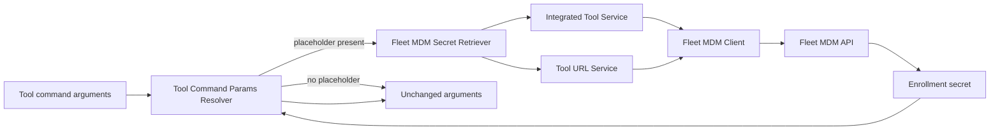
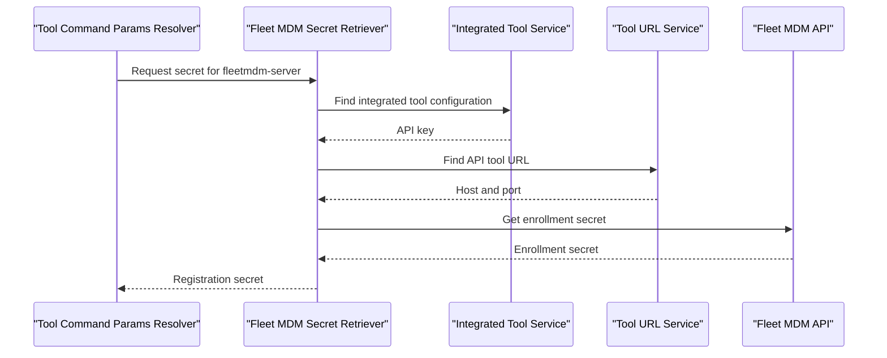

# Openframe Tool Agent Nats Installation

Openframe Tool Agent Nats Installation is a small Spring component library used when the OpenFrame integrated-tool feature is enabled. It prepares tool command arguments by resolving a registration-secret placeholder at execution time. Its Fleet MDM implementation obtains the current Fleet enrollment secret from the configured integrated-tool API rather than storing that secret in command definitions.

The module is supplied by the OpenFrame OSS Library artifact `com.openframe.oss:openframe-tool-agent-nats-installation` at version `7.0.11`. It runs as part of this tenant deployment when included by an application. Although its artifact name identifies the tool-agent NATS installation path, these two classes do not create NATS connections or subscriptions; they provide command-parameter resolution used by that wider workflow.

## Scope and activation

Both Spring components are conditional on `openframe.integration.tool.enabled=true`. When the property is absent or false, neither the resolver nor the Fleet MDM retriever is registered.

The Fleet MDM retriever additionally reads:

| Setting | Purpose | Default |
| --- | --- | --- |
| `TENANT_ID` | Tenant identifier forwarded to Fleet MDM when configured | Empty value |
| `openframe.fleet.multi-tenancy.enabled` | Declares whether a tenant identifier is mandatory | `false` |

At bean initialization, `FleetTenantHeader.validate` rejects a multi-tenant configuration with a blank `TENANT_ID`. This prevents the module from making an unscoped Fleet MDM request in a deployment that requires tenant isolation.

## Architecture

The components have distinct responsibilities:

- **Tool Command Params Resolver** selects a secret retriever by tool identifier and replaces the literal placeholder `${server.registrationSecret}` in each supplied argument.
- **Tool Agent Registration Secret Retriever** is the extension contract. Implementations declare the tool identifier they support and supply its secret.
- **Fleet MDM Agent Registration Secret Retriever** is the provided implementation for `fleetmdm-server`. It discovers Fleet's API endpoint and API key from integrated-tool configuration, then calls Fleet MDM for an enrollment secret.

## Command parameter resolution

[`ToolCommandParamsResolver`](https://github.com/flamingo-stack/openframe-oss-lib/blob/16e7c1cbd9664e7d10ec5ebca7d53c9bd314decf/openframe-tool-agent-nats-installation/src/main/java/com/openframe/data/service/ToolCommandParamsResolver.java) exposes `process(toolId, commandArgs)`.

1. A null argument list produces null.
2. Each non-null argument is examined independently.
3. An argument without `${server.registrationSecret}` is returned unchanged.
4. For an argument containing the placeholder, the resolver finds the first registered retriever whose `getToolId()` exactly matches `toolId`.
5. The resolved secret replaces every occurrence of the placeholder in that argument.
6. If no matching retriever exists, processing fails with `IllegalStateException`.

This design keeps command templates declarative while resolving sensitive enrollment data as late as possible. It also means a command definition for a tool without a registered retriever must not use the registration-secret placeholder.

## Fleet MDM secret retrieval

[`FleetMdmAgentRegistrationSecretRetriever`](https://github.com/flamingo-stack/openframe-oss-lib/blob/16e7c1cbd9664e7d10ec5ebca7d53c9bd314decf/openframe-tool-agent-nats-installation/src/main/java/com/openframe/data/service/secretretriver/FleetMdmAgentRegistrationSecretRetriever.java) implements the retrieval contract for the fixed tool identifier `fleetmdm-server`.

The retriever performs the following operation for each secret request:

1. Looks up the `fleetmdm-server` integrated-tool record.
2. Locates that tool's API URL and combines its URL and port into the Fleet MDM base address.
3. Reads the configured API key from the integrated-tool credentials.
4. Constructs the OpenFrame OSS Library `FleetMdmClient`, passing the tenant identifier when one is configured.
5. Requests Fleet MDM's enrollment secret and returns it to the resolver.

Any missing tool record, missing API URL, invalid response, or Fleet MDM client failure is wrapped as an `IllegalStateException`. The success log confirms retrieval only; it does not log the enrollment secret.

## Operational behavior and failure boundaries

| Boundary | Behavior | Maintainer consideration |
| --- | --- | --- |
| Integrated-tool feature disabled | Neither component exists in the Spring context. | Enable the feature before configuring command templates that require secret substitution. |
| Null command argument list | The resolver returns null. | Callers must decide whether a null list is valid for their command model. |
| Null individual argument | The resolver preserves the null entry. | Preserve list position without attempting substitution. |
| Placeholder is absent | The argument passes through unchanged. | Secret lookup is avoided for ordinary arguments. |
| Unknown tool identifier with placeholder | Resolution fails. | Register an implementation of the retriever contract for that tool before using the placeholder. |
| Multi-tenant Fleet setup without tenant ID | Application initialization fails. | Supply `TENANT_ID` whenever Fleet multi-tenancy is enabled. |
| Fleet configuration or API failure | Retrieval fails and command processing cannot complete. | Verify the tool record, API URL, API key, tenant context, and Fleet API availability. |

## Relationship to the tenant system

This repository deploys NATS as a datasource and provides the OpenFrame client service with NATS configuration. The broader tenant platform uses the OpenFrame client and management services for agent lifecycle and integrated-tool operations. Openframe Tool Agent Nats Installation contributes the secret-resolution capability needed where that workflow builds Fleet MDM agent command arguments; it does not own the NATS transport configuration, persistence, or tool-installation orchestration itself.

The module relies on OpenFrame data services for integrated-tool metadata and on the OpenFrame Fleet MDM SDK for the enrollment-secret API call. Those services and SDK types are supplied by the OpenFrame OSS Library dependency set, while this tenant repository supplies the runtime configuration and service deployment.

## Extension guidance

To add registration-secret substitution for another integrated tool, provide a Spring implementation of the `ToolAgentRegistrationSecretRetriever` contract that:

1. Returns the exact integrated-tool identifier from `getToolId()`.
2. Retrieves the secret required by that tool in `getSecret()`.
3. Handles its configuration and upstream API failures without exposing secret material in logs or exception messages.
4. Is available only under the same feature conditions expected by its command-processing path.

The resolver will select the first registered implementation whose tool identifier exactly matches the command's tool identifier. Keep identifiers unique among retrievers to make selection deterministic.
