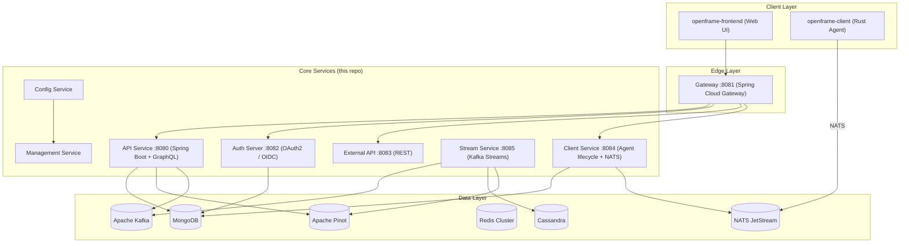
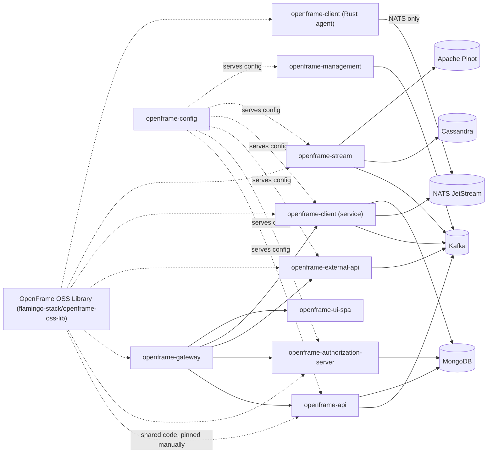
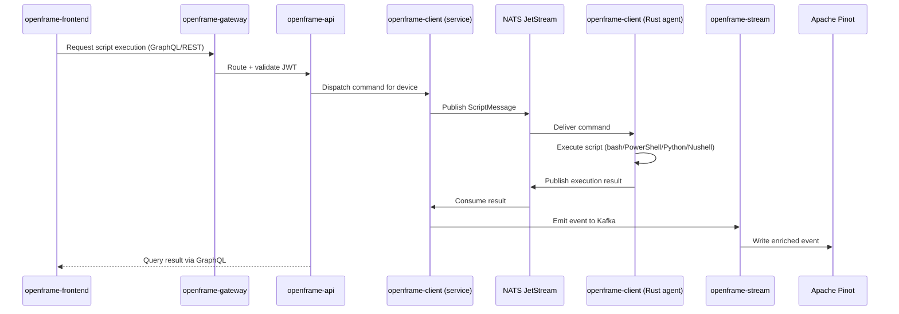

# openframe-oss-tenant Module Documentation

# OpenFrame OSS Tenant

## Overview

OpenFrame OSS Tenant is the multi-service, multi-tenant open-source foundation of the OpenFrame platform — an AI-powered MSP (Managed Service Provider) platform built by [Flamingo](https://flamingo.run) that replaces expensive proprietary software with intelligent automation. It integrates device management, real-time messaging, AI-assisted support (Mingo AI for technicians, Fae for clients), and event-driven automation across a polyglot microservice architecture built on Spring Boot (Java) and Rust.

The repository bundles the Spring Boot backend services (API, Gateway, Authorization Server, External API, Client, Stream, Management, Config) alongside the cross-platform `openframe-client` Rust agent, plus the Kubernetes manifests that deploy and wire them together.

## Architecture

All client traffic enters through the Spring Cloud Gateway. Backend services communicate synchronously via HTTP/GraphQL and asynchronously via Apache Kafka and NATS JetStream. The Rust agent (`openframe-client`) talks to the platform exclusively over NATS, with a lifecycle/orchestration counterpart service of the same name running in the Java backend.

### Architecture Diagram



## Core Components

| Component | Language | Port | Responsibility |
|---|---|---|---|
| `openframe-api` | Java / Spring Boot 4.1 | 8080 | REST + GraphQL APIs; tickets, dialogs, AI settings, tenant management |
| `openframe-authorization-server` | Java / Spring Authorization Server | 8082 | Multi-tenant OAuth2/OIDC; RSA-signed JWT issuance; SSO (Google, Microsoft) |
| `openframe-gateway` | Java / Spring Cloud Gateway | 8081 | Security enforcement, JWT validation, routing, WebSocket proxy |
| `openframe-external-api` | Java / Spring Boot | 8083 | Rate-limited public API endpoints with API key management |
| `openframe-client` (service) | Java / Spring Boot + NATS | 8084 | Agent lifecycle management, tool orchestration (MeshCentral, FleetMDM) |
| `openframe-stream` | Java / Kafka Streams | 8085 | Real-time event normalization, enrichment, Cassandra/Pinot writes |
| `openframe-management` | Java / Spring Boot | — | Platform/tenant management operations |
| `openframe-config` | Java / Spring Cloud Config | — | Centralized configuration serving to every other service |
| `openframe-client` (agent) | Rust | — | Cross-platform system agent; device registration, script execution, self-update via Velopack |
| `openframe-test` | Java | — | Shared test support module |

## Component Relationships



## Data Flow

The sequence below traces a device script execution: a technician triggers a script from the API/GraphQL layer, the Gateway routes it, the Client service hands it to the agent over NATS, and the result flows back through Kafka Streams into analytics storage.

### Script Execution Sequence



## Key Files

| File | Purpose |
|---|---|
| `pom.xml` | Parent Maven POM coordinating all Java services |
| `openframe/services/openframe-api/` | Core REST + GraphQL API service source |
| `openframe/services/openframe-gateway/` | Spring Cloud Gateway service source |
| `openframe/services/openframe-authorization-server/` | OAuth2/OIDC authorization server source |
| `openframe/services/openframe-external-api/` | Public, rate-limited API service source |
| `openframe/services/openframe-client/` | Java agent-lifecycle/orchestration service source |
| `openframe/services/openframe-stream/` | Kafka Streams event-processing service source |
| `openframe/services/openframe-management/` | Management service source |
| `openframe/services/openframe-config/` | Spring Cloud Config service source |
| `clients/openframe-client/src/main.rs` | Thin entry point for the Rust agent; delegates to the `openframe` library crate (`openframe::run()`) |
| `manifests/` | Kubernetes manifests: Argo CD app-of-apps, datasources (MongoDB, Cassandra, Kafka, NATS, Pinot, Redis Cluster, ZooKeeper), platform charts, and the tenant chart that wires every service's image together |
| `configs/base/application.yml` | Shared Spring config: MongoDB, Redis Cluster, Cassandra, Pinot connection endpoints |
| `configs/base/openframe-gateway.yml` | Gateway route table (`/sas/**`, `/api-docs/**`, `/api/**`, `/clients/**`, `/**`) |
| `.github/workflows/release.yml` | CI/CD: builds and publishes every service container image and the Helm app-of-apps chart |
| `README.md` | Project overview, quick start, and technology stack |

## Dependencies

This repository is registered as a **service** publishing nine Maven artifacts under the `com.openframe` group (`openframe-api`, `openframe-authorization-server`, `openframe-client`, `openframe-config`, `openframe-external-api`, `openframe-gateway`, `openframe-management`, `openframe-stream`, `openframe-test`, all `1.0.0-SNAPSHOT`) and one Cargo crate, `openframe_client` (`0.1.0`), for the Rust agent.

### Upstream: OpenFrame OSS Library

The one upstream dependency recorded in the code graph is **[OpenFrame OSS Library](https://github.com/flamingo-stack/openframe-oss-lib)**, pinned manually (not via a version-manager edge). The material under `../deps/openframe-oss-lib/` confirms this is a shared-code checkout consumed by this repository:

- **`clients/openframe-client/src/main.rs`** states it directly: *"All logic lives in the `openframe-agent-lib` library (crate name `openframe`), shared from `https://github.com/flamingo-stack/openframe-oss-lib`."* The Rust binary in this repo is a thin wrapper that calls `openframe::run()`.
- **`clients/openframe-client/build.rs`** (in the lib checkout) forwards build-time environment variables (`OPENFRAME_VERSION`, and feature-gated `OPENFRAME_CHAT_VERSION`, `MESHCENTRAL_AGENT_VERSION`, `FLEETMDM_AGENT_VERSION`, `OSQUERY_VERSION`) that this repo's build must supply, as the README's Quick Start shows: `OPENFRAME_VERSION=0.0.0-dev cargo build`.
- The lib also ships `openframe-frontend-core` (an npm package, `@flamingo-stack/openframe-frontend-core`) and `openframe-test-service-core`, a Java test-support module used by a coverage-matrix tool (`test-coverage-analyser/coverage_matrix.py`) that cross-references this repository's (and its sibling SaaS repositories') GraphQL schemas and REST controllers against frontend and test usage — evidence that shared test tooling in the lib targets this repo's API surface.

No downstream consumer of this repository's artifacts is recorded in the code graph (coverage is `full`, meaning this absence is conclusive, not a gap): nothing else in the organization currently depends on `com.openframe:*` or `openframe_client`.

### Delivery chain

Per the ecosystem facts, the release workflow (`.github/workflows/release.yml`) builds and publishes a container image per service to `ghcr.io/flamingo-stack/openframe-oss-tenant/<service>` (api, authorization-server, external-api, client, config, gateway, management, stream) plus an `app-of-apps` Helm chart (`oci://ghcr.io/flamingo-stack/openframe-oss-tenant/app-of-apps`). The `manifests/tenant` chart assembles these images together with the `openframe-oss-frontend` UI image and the third-party FleetMDM and MeshCentral charts into one deployable tenant. The `manifests/apps` Argo CD app-of-apps then layers in the `platform` wave (ingress-nginx, dev-tools, openframe-config) and the `datasources` wave (Cassandra, Kafka, MongoDB, MySQL for FleetMDM, NATS, Pinot, Redis Cluster, ZooKeeper, Debezium Connect) ahead of the tenant services.

## CLI Commands

### Build

```bash
# Clone the repository
git clone https://github.com/flamingo-stack/openframe-oss-tenant.git
cd openframe-oss-tenant

# Build all backend services (Java / Spring Boot)
mvn clean install -DskipTests

# Build the Rust agent
cd clients/openframe-client
OPENFRAME_VERSION=0.0.0-dev cargo build

cd ../..
```

### Run

```bash
# Start the API service
mvn spring-boot:run -pl openframe/services/openframe-api
```

### Rust Agent

```bash
# Verify the agent binary
./clients/openframe-client/target/debug/openframe-client --help

# Run environment diagnostics
./clients/openframe-client/target/debug/openframe-client doctor

# Install as a system service
sudo ./target/release/openframe-client install \
  --serverUrl https://your-openframe-instance.example.com \
  --initialKey YOUR_INITIAL_KEY \
  --orgId YOUR_ORG_ID
```

The agent's CLI (defined in `clients/openframe-client/src/cli.rs`, via the lib's shared `openframe` crate) also exposes `auth` (second-step authentication for a parameterless install), `uninstall`, `doctor`, and a hidden `restart-service` subcommand, each accepting an optional `--remote-access-mode` flag (`approval-required`, `notify-only`, `silent-access`, `deny-access`).

## Community

This project does not use GitHub Issues or GitHub Discussions. All support, feature requests, bug reports, and development discussion happen in the OpenMSP Slack community:

- OpenMSP Community: [https://www.openmsp.ai/](https://www.openmsp.ai/)
- Join Slack: [Invite Link](https://join.slack.com/t/openmsp/shared_invite/zt-36bl7mx0h-3~U2nFH6nqHqoTPXMaHEHA)
- OpenFrame Website: [https://openframe.ai](https://openframe.ai)
- Flamingo Platform: [https://flamingo.run](https://flamingo.run)
- Releases: [github.com/flamingo-stack/openframe-oss-tenant/releases](https://github.com/flamingo-stack/openframe-oss-tenant/releases)
