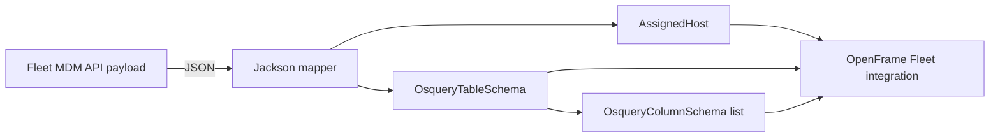
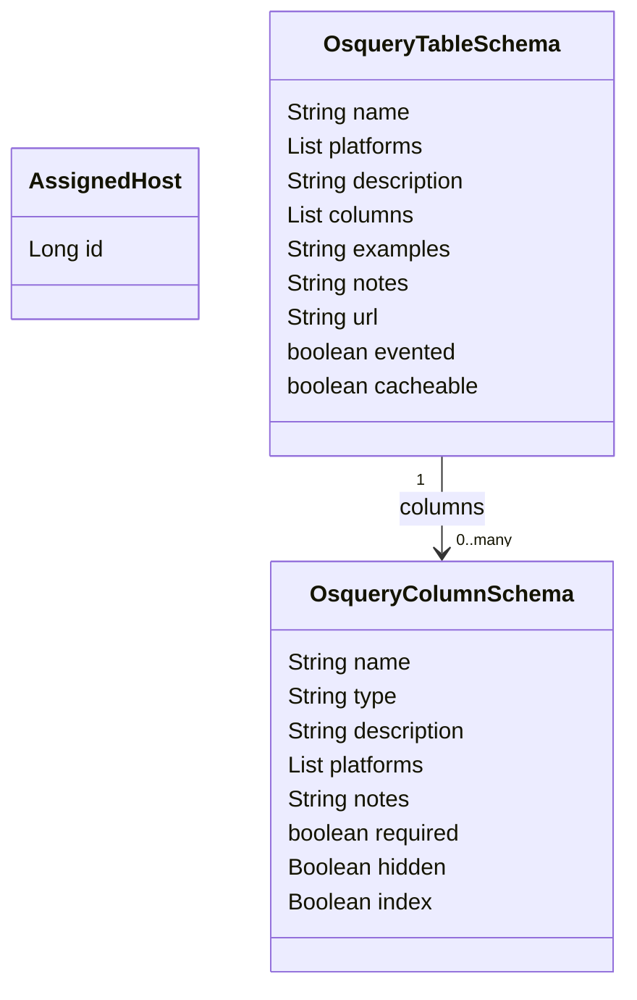
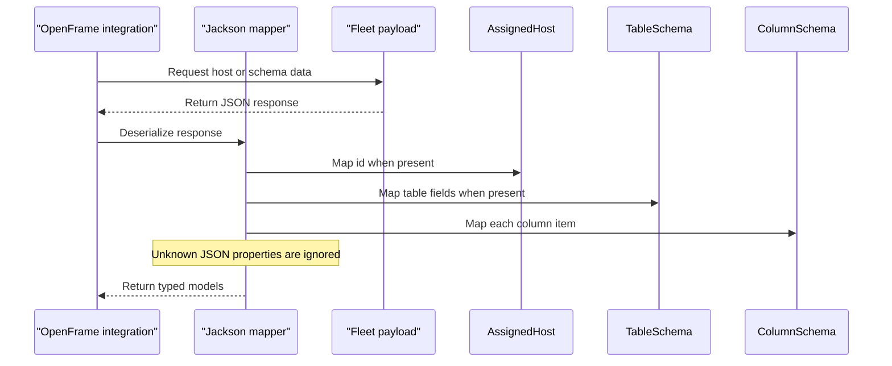

# Sdk Fleetmdm Model

Sdk Fleetmdm Model is a small set of Java data-transfer models used when OpenFrame integrates with Fleet MDM and osquery metadata. The models are supplied by the **Fleet MDM SDK** library, published as `com.openframe.oss:fleetmdm` and consumed by this repository at version `7.0.11`.

The module is intentionally declarative: it defines the JSON shape of an assigned Fleet host and an osquery table schema, rather than performing transport, persistence, or query execution. Jackson deserializes Fleet payloads into these models, while Lombok generates their accessors and standard data methods.

## Scope and Responsibilities

| Model | Responsibility | Key fields |
|---|---|---|
| `AssignedHost` | Represents the host assignment returned by Fleet. | `id` |
| `OsqueryColumnSchema` | Describes one column available in an osquery table. | name, type, description, platforms, required, hidden, index |
| `OsqueryTableSchema` | Describes an osquery table and its collection of column schemas. | name, platforms, columns, examples, URL, evented, cacheable |

## Architecture Overview

The module provides a boundary between Fleet's response data and OpenFrame application code:

1. Jackson maps known JSON properties onto Java fields.
2. Unknown properties are ignored to tolerate Fleet payloads that contain additional fields.
3. Consumers use the resulting in-memory models for host assignment handling or osquery metadata interpretation.

## Data Model Relationships

`OsqueryTableSchema` owns the table-level metadata and contains zero or more `OsqueryColumnSchema` entries. Each column expresses its own type, platform applicability, documentation, and query constraints. `AssignedHost` is independent of the osquery schema types and contains only the Fleet host identifier.

## Core Components

### Assigned Host

[`AssignedHost`](https://github.com/flamingo-stack/openframe-oss-lib/blob/7a766f00e4f58b5d89db007b878ac8d6e0c344f4/sdk/fleetmdm/src/main/java/com/openframe/sdk/fleetmdm/model/AssignedHost.java) is a minimal Fleet assignment projection. Its `id` property is explicitly bound to the JSON `id` field with `@JsonProperty`, preserving the contract even if Java naming conventions change. Lombok generates getters and setters.

The class has `@JsonIgnoreProperties(ignoreUnknown = true)`. This means response expansion by Fleet does not prevent OpenFrame from reading the host identifier it needs.

### Osquery Column Schema

[`OsqueryColumnSchema`](https://github.com/flamingo-stack/openframe-oss-lib/blob/7a766f00e4f58b5d89db007b878ac8d6e0c344f4/sdk/fleetmdm/src/main/java/com/openframe/sdk/fleetmdm/model/OsqueryColumnSchema.java) models a single osquery column definition.

- `name`, `type`, and `description` identify and document the column.
- `platforms` limits applicability to supported operating systems.
- `notes` carries supplementary schema guidance.
- `required` indicates whether the column is required for use.
- `hidden` and `index` are nullable `Boolean` values, allowing the payload to distinguish an absent setting from an explicit `false`.

`@Data` generates getters, setters, and standard value-oriented methods such as `equals`, `hashCode`, and `toString`. Unknown JSON fields are ignored for forward compatibility.

### Osquery Table Schema

[`OsqueryTableSchema`](https://github.com/flamingo-stack/openframe-oss-lib/blob/7a766f00e4f58b5d89db007b878ac8d6e0c344f4/sdk/fleetmdm/src/main/java/com/openframe/sdk/fleetmdm/model/OsqueryTableSchema.java) represents table-level osquery metadata. Alongside its name, platforms, and description, it contains the `columns` collection that connects table metadata to individual column definitions.

The remaining fields preserve operational and documentation metadata:

- `examples`, `notes`, and `url` describe usage and provide a documentation reference supplied by the upstream payload.
- `evented` states whether the table supports event-based behavior.
- `cacheable` states whether results may be cached.

Like the column model, this class uses `@Data` and ignores unknown JSON fields.

## Deserialization and Compatibility

The module does not validate whether a schema is semantically complete, execute osquery, or issue Fleet requests. Callers are responsible for selecting the appropriate endpoint, enforcing any application-specific requirements, and deciding how to handle null or absent optional values.

## Integration Boundaries

This repository assembles the Fleet MDM SDK as a library dependency. Sdk Fleetmdm Model therefore belongs to the integration contract layer, not to the OpenFrame service entry points or the persistence layer. It can be used by Fleet-facing code wherever a typed representation of assignment or osquery schema JSON is required.

When evolving the models, retain the JSON property contract and the unknown-property behavior unless the upstream Fleet API contract is deliberately changed. Adding a field is generally backward compatible; changing a field type or removing a mapped field can break deserialization consumers.
