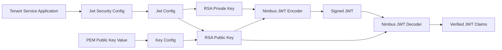
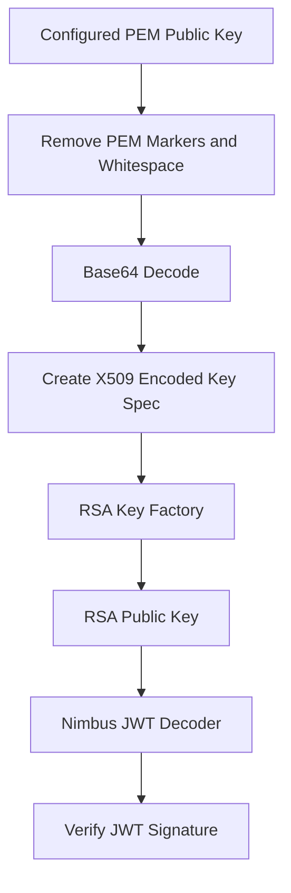

# Security Core Oauth

Security Core Oauth supplies the shared RSA-backed JWT infrastructure used by OpenFrame services. It is provided to this repository by the `com.openframe.oss:openframe-security-core` library at version `7.0.11`; the tenant deployment assembles the library into its service applications. The module creates Spring Security `JwtEncoder` and `JwtDecoder` beans from configured key material, so token issuance and verification use the same public key while keeping private-key use limited to signing.

The implementation is maintained in OpenFrame OSS Library:

- [Jwt Security Config](https://github.com/flamingo-stack/openframe-oss-lib/blob/7a766f00e4f58b5d89db007b878ac8d6e0c344f4/openframe-security-core/src/main/java/com/openframe/security/config/JwtSecurityConfig.java) configures the encoder and decoder beans.
- [Key Config](https://github.com/flamingo-stack/openframe-oss-lib/blob/7a766f00e4f58b5d89db007b878ac8d6e0c344f4/openframe-security-core/src/main/java/com/openframe/security/jwt/KeyConfig.java) converts a PEM-formatted public-key value into an RSA public key.

## Responsibilities

| Component | Responsibility |
| --- | --- |
| `JwtSecurityConfig` | Builds `NimbusJwtEncoder` and `NimbusJwtDecoder` beans for the Spring application context. |
| `JwtConfig` | Supplies the configured RSA public and private keys to the security configuration. This supporting library type is consumed by `JwtSecurityConfig`. |
| `KeyConfig` | Normalizes a PEM public-key value, Base64-decodes its body, and constructs an `RSAPublicKey` using the JCA RSA key factory. |

## Architecture

`JwtSecurityConfig` is a Spring `@Configuration` class. At application startup, its encoder factory loads both keys from `JwtConfig`, combines them into a Nimbus `RSAKey`, places that key in an immutable JWK set, and exposes a `NimbusJwtEncoder`. Its decoder factory independently loads the public key and exposes a `NimbusJwtDecoder` configured to validate JWT signatures against it.

The encoder is therefore the signing boundary: it requires the RSA private key in addition to the public key. The decoder has only the public key and verifies tokens without requiring the private key.

## Key Material Handling

`KeyConfig.toRSAPublicKey()` accepts a PEM-style public-key value. It removes the standard public-key delimiters and whitespace, decodes the remaining Base64 text, then passes the X.509 SubjectPublicKeyInfo bytes to `KeyFactory` for RSA. Invalid PEM content, malformed Base64, unsupported RSA configuration, or an invalid key specification propagates as an exception to the caller.

The following flow summarizes public-key conversion and decoder creation:

## Runtime Behavior

1. Spring discovers `JwtSecurityConfig` during component configuration.
2. The JWT encoder bean loads the public and private RSA keys, then creates an immutable JWK-backed Nimbus encoder.
3. The JWT decoder bean loads the public RSA key and creates a Nimbus decoder.
4. Application components can use the encoder to produce signed JWTs and the decoder to validate JWTs and read verified claims.

## Integration Boundaries

Security Core Oauth is infrastructure rather than an HTTP endpoint module: it does not declare controllers, token routes, or grant handlers. Authorization-server behavior, gateway authentication, and OAuth boundary handling are provided by other platform modules. This module supplies the common signing and verification primitives those layers can inject through Spring Security interfaces.

The OpenFrame OSS Tenant repository consumes the library artifact as part of its shared runtime dependencies. Its services include an authorization server and gateway that route authentication-related traffic, while this module remains focused on reusable JWT cryptographic wiring.

## Operational Considerations

- The configured public key must correspond to the private key used by the encoder; otherwise issued tokens cannot be verified.
- Treat private-key configuration as sensitive signing material and restrict its access to the services that must issue tokens.
- A malformed public-key PEM prevents construction of the dependent encoder or decoder bean during initialization.
- Key rotation requires coordinated replacement of signing and verification material so deployed decoders recognize tokens signed by active encoders.
