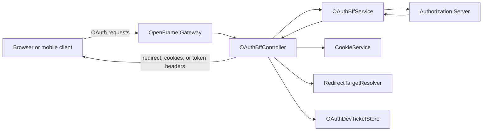
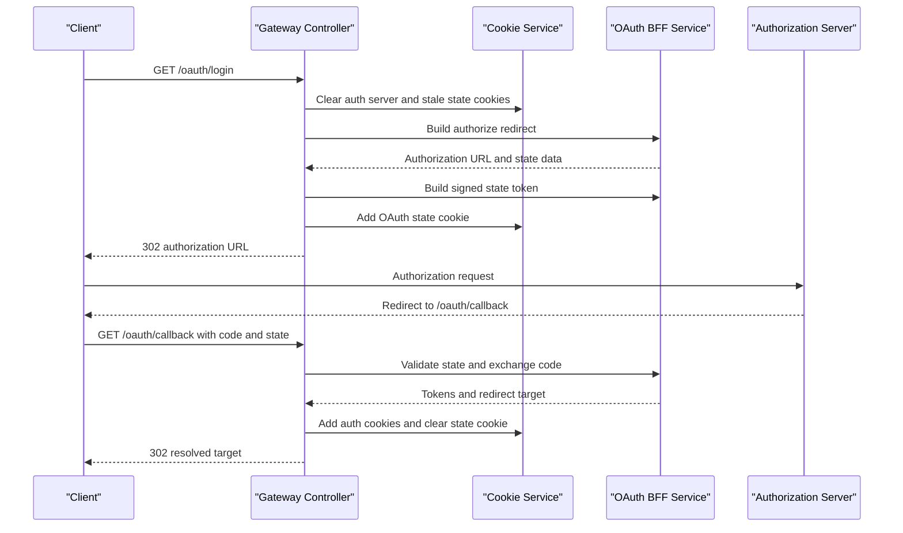
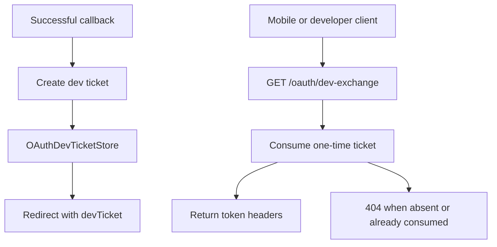

# Security Oauth

Security Oauth supplies the gateway-facing backend-for-frontend (BFF) endpoints that coordinate browser and mobile OAuth authentication. It is supplied by the `com.openframe.oss:openframe-security-oauth` library at version `7.0.11` and runs in this repository's OpenFrame Gateway service. The module starts authorization redirects, completes code callbacks, maintains authentication cookies, refreshes and revokes sessions, and supports native Apple and mobile handoff flows.

The module is conditionally active only when `openframe.gateway.oauth.enable=true`. It delegates authorization-server interactions to the `OAuthBffService` contract and does not issue tokens itself.

## Architecture

At the platform boundary, the gateway exposes the `/oauth` route family while the authorization server owns authorization, token exchange, tenant discovery, and revocation operations. Security Oauth is deliberately a mediator: it binds browser state and cookie handling at the gateway to the authorization-server protocol handled by `OAuthBffService`.

## Runtime Responsibilities

| Component | Responsibility |
|---|---|
| [OAuthBffController](https://github.com/flamingo-stack/openframe-oss-lib/blob/7a766f00e4f58b5d89db007b878ac8d6e0c344f4/openframe-security-oauth/src/main/java/com/openframe/security/oauth/controller/OAuthBffController.java) | Reactive `/oauth` controller that drives authorization redirects, callbacks, refresh, logout, mobile handoffs, and Apple-native flows. |
| [DefaultRedirectTargetResolver](https://github.com/flamingo-stack/openframe-oss-lib/blob/7a766f00e4f58b5d89db007b878ac8d6e0c344f4/openframe-security-oauth/src/main/java/com/openframe/security/oauth/service/redirect/DefaultRedirectTargetResolver.java) | Default redirect selection: requested target, then `Referer`, then `/`. It can be replaced with a custom resolver. |
| [InMemoryOAuthDevTicketStore](https://github.com/flamingo-stack/openframe-oss-lib/blob/7a766f00e4f58b5d89db007b878ac8d6e0c344f4/openframe-security-oauth/src/main/java/com/openframe/security/oauth/service/InMemoryOAuthDevTicketStore.java) | Fallback, one-time token handoff store backed by a concurrent in-memory map. It can be replaced with a shared implementation. |
| [NoopForwardedHeadersContributor](https://github.com/flamingo-stack/openframe-oss-lib/blob/7a766f00e4f58b5d89db007b878ac8d6e0c344f4/openframe-security-oauth/src/main/java/com/openframe/security/oauth/headers/NoopForwardedHeadersContributor.java) | Default no-op implementation for optional forwarded-header contribution. A deployment may provide a concrete contributor. |

All three supporting components use conditional bean registration. A deployment-provided `RedirectTargetResolver`, `OAuthDevTicketStore`, or `ForwardedHeadersContributor` takes precedence over the respective default.

## Browser Authorization Flow

`OAuthBffController` exposes two entry points for initiating authorization:

- `GET /oauth/login` clears existing authorization-server cookies and stale OAuth state cookies before it starts a fresh flow.
- `GET /oauth/continue` preserves the established session and auth cookies, but removes stale state cookies. It is intended for continuation after SSO finalization.

Both endpoints ask `OAuthBffService` to construct an authorization URL, including its state and PKCE information. The controller signs the resulting state data through the service, stores it in an OAuth-state cookie, and redirects the client to the authorization server.

### Callback Behavior

`GET /oauth/callback` validates and exchanges the authorization code through `OAuthBffService`. On success, the controller writes access and refresh-token cookies, removes the state cookie identified by the callback state, and redirects to the target returned by the service. A blank target becomes `/`.

If developer-ticket output is enabled, or if the completed flow is mobile, the callback additionally creates a one-time development ticket and appends it as `devTicket` to the redirect target. Failure redirects to the configured `openframe.auth.error-url` with an error-code reference. The controller maps `AuthFlowException` instances to their contained authentication error code and otherwise uses `SSO_LOGIN_FAILED`.

## Token Lifecycle

### Refresh

`POST /oauth/refresh` accepts a refresh token from the refresh-token cookie or, when the cookie is absent, from the configured refresh-token header. When a tenant identifier is present, the refresh request is routed using that tenant; otherwise the BFF service resolves the tenant from the token.

A successful refresh updates auth cookies. Token headers are included for developer-ticket flows and for header-based mobile refresh flows when mobile authentication is enabled.

A missing refresh token is the exceptional refresh case that clears auth cookies and returns `401`. In contrast, an invalid or unknown refresh token returns `401` **without clearing cookies**. This protects a newer session when concurrent refresh requests race during token rotation: a late response carrying an older token must not delete cookies written by the successful request. Upstream refresh failures retain cookies and return the upstream status; unexpected errors return `502`.

### Logout

`GET /oauth/logout` clears auth cookies first and then asks the BFF service to revoke the available refresh token. It supports the same optional tenant selection and header fallback as refresh, then responds with `204 No Content`.

## Mobile and Native Apple Flows

Mobile endpoints are available only when `openframe.gateway.oauth.mobile-auth-enabled=true`.

| Endpoint | Purpose |
|---|---|
| `POST /oauth/apple/native-exchange` | Exchanges a native Apple identity token and authorization code for OpenFrame tokens. If tenant ID is absent, the BFF service discovers it from the verified identity. A registration-required identity receives `409` with `registration_required`. |
| `POST /oauth/apple/native-register` | Creates a tenant using the verified Apple identity and then exchanges the same authorization code. Invalid registration input is returned as `400`; other failures are `401`. |
| `GET /oauth/signup-continue` | Applies redirect allow-listing before appending an encoded signup ticket. A disallowed target falls back to the configured continuation page. |
| `GET /oauth/join-return` | Returns a mobile consent flow to an exact allow-listed URI. An optional cancellation or expiry reason becomes an encoded `error` query parameter; a disallowed URI falls back to the configured login page. |
| `POST /oauth/login/sso/complete` | Completes a mobile signup ticket, creates a one-time development ticket for the resulting tokens, and returns that ticket in a JSON response. |
| `GET /oauth/dev-exchange` | Consumes a one-time ticket and returns access and refresh tokens in response headers. It is enabled when developer tickets or mobile authentication are enabled. |

The explicit allow-list checks in `signup-continue` and `join-return` are security boundaries. The authorization server may carry a requested destination through a flow, but Security Oauth decides whether a native URI is permitted before redirecting the client.

## One-Time Development Tickets

The default `InMemoryOAuthDevTicketStore` creates UUID ticket IDs and stores the associated `TokenResponse` in a `ConcurrentHashMap`. `consumeTicket` removes the entry, so the ticket can be used only once. The implementation intentionally has no persistence, expiry, or cross-instance sharing. Deployments that run more than one gateway instance, need expiry guarantees, or require durable handoffs should supply their own `OAuthDevTicketStore` bean.

## Redirect Resolution and Forwarded Headers

The default redirect resolver accepts the requested redirect target when supplied. Without one, it uses the incoming `Referer`; when neither is available it resolves `/`. It is a selection fallback, not an allow-listing policy. The controller separately calls `isAllowedRedirectUri` for mobile signup and join return destinations, which must be restricted by the concrete redirect resolver configuration or implementation.

The default forwarded-header contributor does nothing. It is marked primary only while no other `ForwardedHeadersContributor` exists, allowing deployments behind proxies to contribute the forwarded context required by their OAuth upstream integration without modifying this module.

## Configuration

| Property | Default | Effect |
|---|---:|---|
| `openframe.gateway.oauth.enable` | Disabled unless set to `true` | Enables `OAuthBffController`. |
| `openframe.gateway.oauth.state-cookie-ttl-seconds` | `180` | Lifetime of the signed OAuth state cookie. |
| `openframe.gateway.oauth.dev-ticket-enabled` | `true` | Enables development-ticket generation and the ticket exchange endpoint. |
| `openframe.gateway.oauth.mobile-auth-enabled` | `true` | Enables mobile and native Apple endpoints and mobile token-header behavior. |
| `openframe.auth.error-url` | No controller default | Base URL for failed callback redirects. |
| `openframe.gateway.oauth.signup-continue-page` | `/auth/sso-continue` | Fallback page for a disallowed mobile signup target. |
| `openframe.gateway.oauth.join-cancel-page` | `/auth/login` | Fallback page for a disallowed mobile join-return target. |

## Operational Considerations

- Treat access and refresh token headers emitted by developer and mobile paths as sensitive credentials. Ensure intermediary logging and browser tooling do not persist them.
- Preserve the state-cookie lifecycle: login clears old authentication state, continuation keeps an existing session, and callbacks clear the state associated with the completed attempt.
- Use a distributed `OAuthDevTicketStore` for horizontally scaled gateways, and ensure its consume operation remains atomic.
- Configure strict redirect allow-listing for native application URIs. The controller appends tickets and error information only after the resolver approves the target.
- Monitor callback, refresh, and Apple-native failures through gateway logs. Callback failures are redirected to the configured error page, while refresh errors are intentionally status-only to avoid disrupting a potentially newer browser session.

## Relationship to the Platform

Security Oauth is consumed by the OpenFrame Gateway application, which routes `/sas/**` to the OpenFrame Authorization Server and exposes gateway routes to clients. The authorization-server module owns provider configuration, tenant-aware authorization, registered clients, SSO, and token minting. The Security Oauth module is the gateway-side integration layer that turns those server-side capabilities into cookie-managed browser and native-client flows.
