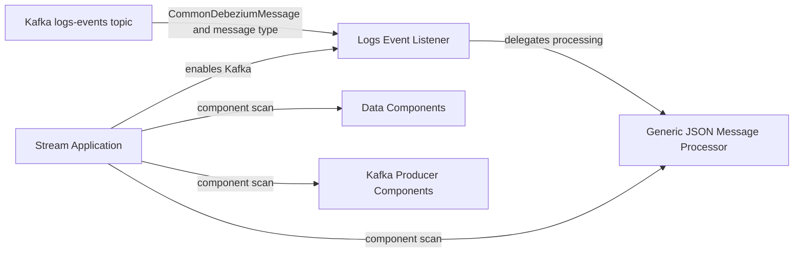
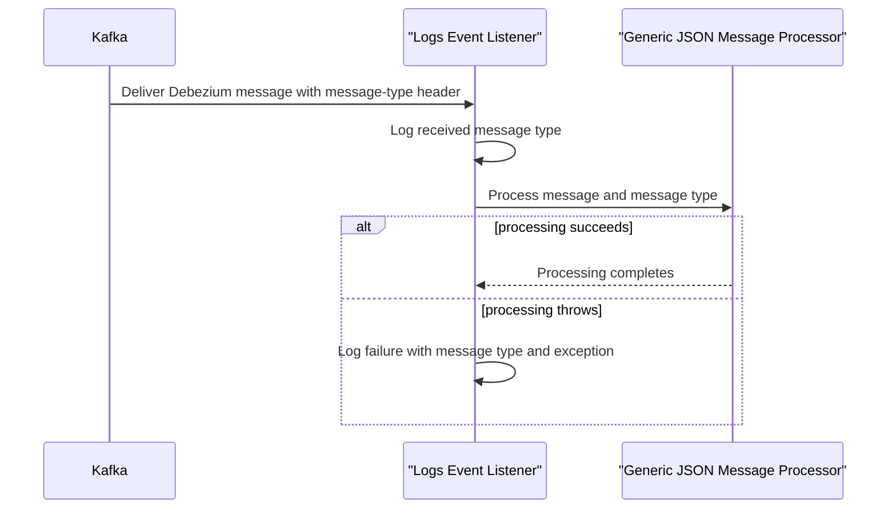

# Stream Service Core

Stream Service Core is the Spring Boot service that consumes inbound log events from Kafka. It starts Kafka support, discovers the stream, data, and Kafka producer component packages, and delegates each received event to a JSON-message processor selected by the event's message type.

## Scope

The module has two responsibilities:

- bootstrap the stream-service runtime and Kafka integration;
- consume the configured shared log-event topic and hand typed Debezium messages to processing logic.

The module is part of the OpenFrame OSS Tenant service suite. The gateway, API, client, management, authorization, configuration, and external API services are separate modules in that suite. Stream Service Core does not expose an HTTP route in the supplied components; its supplied integration boundary is Kafka.

## Architecture

`StreamApplication` is the application entry point. `LogsEventListener` is created only when the inbound log-topic name property is present. Its listener method is attached to that configured topic and to the fixed consumer group `openframe-oss-logs-events-group`.

## Event Processing Flow

A single configured topic can carry multiple event kinds. The listener reads the `message-type` Kafka header as `MessageType` rather than selecting a topic per event type. The listener catches and logs processing exceptions, so failures are recorded at the consumer boundary. The supplied implementation does not rethrow them from this method.

## Configuration Contract

The listener is enabled only when `openframe.oss-tenant.kafka.topics.inbound.logs-events.name` is defined. The same property supplies the subscribed topic name. Kafka listener infrastructure is activated by `@EnableKafka`, and the listener uses the `ossTenantKafkaListenerContainerFactory` container factory.

The event payload is `CommonDebeziumMessage`; the event classification comes from the `KafkaHeader.MESSAGE_TYPE_HEADER` header. Producers must therefore supply a payload compatible with that model and a header that Spring can bind to `MessageType`.

## Components

- [Application Bootstrap](stream-service-core/application_bootstrap/application_bootstrap.md) documents `StreamApplication`, its Spring Boot startup path, Kafka activation, and scan boundaries.
- [Log Event Consumption](stream-service-core/log_event_consumption/log_event_consumption.md) documents `LogsEventListener`, its configuration condition, Kafka contract, delegation behavior, and failure handling.
