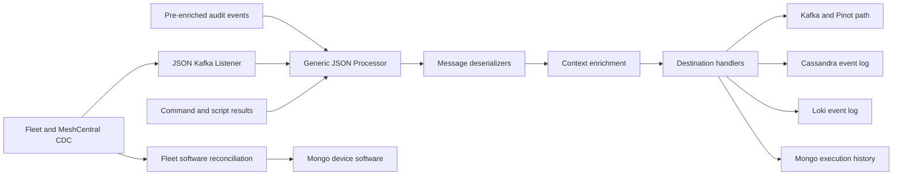
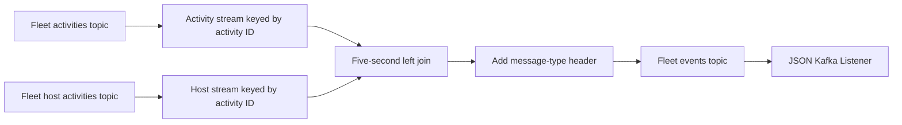
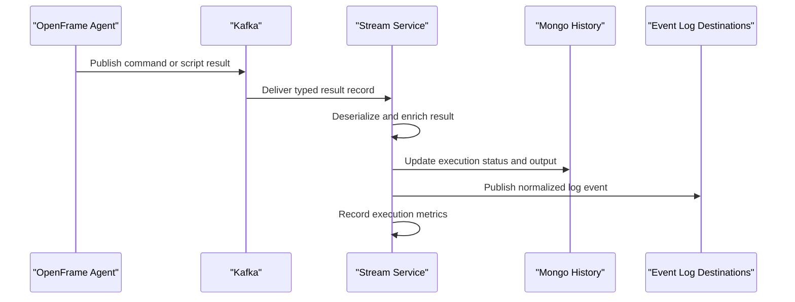

# Stream Service Core

Stream Service Core is the event-processing foundation used by the OpenFrame Stream application. It consumes change-data-capture and pre-enriched audit records, turns source-specific payloads into a common event representation, enriches them with tenant and device context, and routes the result to operational-log and RMM-history destinations.

The implementation is supplied by the OpenFrame OSS Library artifact `com.openframe.oss:openframe-stream-service-core` version `7.0.11` and is run here by the `openframe-stream` service. It connects to the tenant Kafka cluster configured for that service and participates in the platform’s Kafka, MongoDB, Cassandra, Loki, and Pinot-oriented event flow.

## Responsibilities

- Consume integrated-tool Debezium records and classify them by `MessageType`.
- Normalize Fleet, MeshCentral, Microsoft 365, Google Workspace, remote-session, script, and command payloads into a shared event shape.
- Produce deterministic event identifiers so replayed source records remain idempotent.
- Enrich records with machine, organization, user, and tenant context.
- Publish visible events for the Kafka-to-Pinot path and persist event logs to Cassandra and/or Loki when enabled.
- Update command and script execution history from agent result messages.
- Reconcile Fleet software inventory into per-device software records.
- Join Fleet activity and host-activity topics with Kafka Streams so activity events can be associated with hosts.

## Architecture

The event pipeline is implemented in the OpenFrame OSS Library. The local Stream application provides the runnable Spring Boot service and adds a logs listener; Stream Service Core supplies the configuration, Kafka Streams topology, listeners, deserializers, enrichment services, and handlers that perform the processing.

## Processing Stages

1. **Ingress and classification.** `JsonKafkaListener` subscribes to tenant-cluster integrated-tool topics and passes each `CommonDebeziumMessage` plus its message-type header to the generic processor. The listener is active in tenant mode; shared deployments use a different listener supplied outside this module.
2. **Deserialization.** A type-specific deserializer extracts source fields and emits a `DeserializedDebeziumMessage`. The shared integrated-tool base class builds a stable name-based UUID from tool type, source table, and event identifier, with a content-hash fallback if the source has no identifier.
3. **Enrichment.** The selected enrichment service resolves tenant, machine, organization, user, and execution-origin information. Audit producers that already stamp organizational context use passthrough enrichment.
4. **Destination routing.** Handlers map the normalized message and enrichment data into destination records. Create, read, and update Debezium operations are handled as writes; deletes intentionally have no output action in the general log handlers.
5. **Specialized projections.** RMM handlers update execution rows and command-result storage. Fleet software CDC triggers a full host software reconciliation and downstream projection notifications.

## Kafka Streams Activity Join

Fleet activity rows do not necessarily contain a host reference. `ActivityEnrichmentService` creates a Kafka Streams left join between Fleet activity and host-activity records by activity identifier, using a five-second window. When a matching host activity is present, it copies the host identifier into the activity as both host and agent information. The output is marked with the message-type header needed by downstream deserialization. Policy activity types are emitted with their policy-specific message type.

`KafkaStreamsConfig` enables this topology by default through `kafka.stream.enabled`. Its application ID uses the Spring application name and, when present, appends `openframe.cluster-id` to keep state and consumer identity isolated across clusters. The topology uses at-least-once processing, one stream thread, an earliest offset reset, and a local state directory at `/tmp/kafka-streams`.

## Module Areas

### Configuration and Ingress

Kafka configuration converts the message-type header from UTF-8 bytes to `MessageType`, logging unknown values rather than failing conversion. `ExecutionOutcomeConfig` selects an `ExecutionOutcomeClassifier` based on `openframe.rmm.execution.script-error-status.enabled`; absence of the property preserves the legacy classifier behavior.

The tenant listener consumes MeshCentral and Fleet event, query-result, and policy-membership topics. Kafka Streams handles Fleet activity enrichment separately before it reaches the shared event flow.

### Event Normalization

The shared `IntegratedToolEventDeserializer` establishes the normalization contract: source timestamp with broker-time fallback, a UTC ingest day, mapped unified event type, deterministic event ID, raw source payload, and structured details containing result, error, and additional information.

Key source-specific behavior includes:

- **Fleet events** map activity types to readable messages. Policy and query-result deserializers use cached Fleet metadata to include policy names, definitions, or query text.
- **MeshCentral events** support either JSON objects or JSON serialized as strings and derive event type from `etype` and `action`.
- **Microsoft 365 and Google Workspace audits** are already enriched by their producers. Their identifiers include organization identity so the same audit fanned out to multiple organizations does not collide.
- **Remote-session audits** preserve technician and session information and derive their unified event type directly from the event-type field.
- **RMM results** capture output, error, exit code, duration, timeout, and failure reason. Script results additionally include a safe script-input representation with secret environment-variable values removed; command results include the original command configuration when it can be found.

### Enrichment and Tenant Safety

`PreEnrichedDataEnrichmentService` retains organization and user values from pre-enriched audit payloads and supplies a tenant from the payload or current tenant provider. `RmmEnrichmentService` resolves native OpenFrame machine identifiers directly, supplements execution origin and script-creation source, and omits selected log destinations for test runs.

`TenantIdRequiredDebeziumEventValidator` is the primary validator and drops any event with no resolved tenant. This protects shared-cluster processing from cross-tenant or unassigned writes. Cassandra, Loki, and Kafka/Pinot handlers all apply tenant validation; the Kafka/Pinot handler also requires the event to be visible.

### Log Destinations

`DebeziumMessageHandler` translates Debezium operation codes into create, read, update, and delete actions. `CassandraLogEventHandler` writes mapped log records when Cassandra support and the appropriate store mode are enabled. In `both` mode, a Cassandra failure is logged but does not prevent the event from continuing to Loki.

`LokiLogEventHandler` writes when Loki or dual-store mode is configured. It retries transient push and query failures up to six times with exponential backoff. If Loki rejects a record, it checks whether the record already exists to distinguish idempotent rejection from data loss. `TenantDebeziumKafkaMessageHandler` publishes mapped integrated-tool events to the configured outbound topic for the Kafka-to-Pinot pipeline.

### RMM Result Handling

The command and script execution handlers correlate agent result fields with persisted execution records, only transition rows that are still open, classify their terminal outcome, truncate stdout and stderr to model byte limits, save the row, and record execution metrics.

Script handling correlates on machine, execution, and script identity because one schedule execution can run multiple scripts. It aggregates schedule execution state after a matching result and marks applicable device-online dispatches processed. Command handling writes batch-command completion state and separately writes a compact result document to Cassandra when Cassandra is enabled.

### Fleet Software Reconciliation

`DeviceSoftwareHandler` responds to Fleet host-software CDC only when `openframe.fleet.software-cdc.enabled` is true. It resolves a Fleet host to an OpenFrame machine through the latest Fleet tool connection, fetches paginated host software from Fleet, and reconciles MongoDB device-software records: current titles are inserted or updated, missing titles are deleted, and affected software-title and CVE projections are triggered.

Caches prevent repeated fetches for rows from the same source commit and suppress repeated snapshot reconciliation. Unresolvable hosts are skipped without caching a permanent miss, allowing a later tool connection to make them resolvable.

## RMM Result Flow

## Storage and Delivery Semantics

- Stable tool-event identifiers make normal source replays safe for idempotent destination writes.
- The Kafka Streams topology is explicitly configured for at-least-once processing, so handlers must tolerate duplicate delivery.
- General log handlers write for Debezium create, read, and update operations. Delete events do not remove historical log entries.
- Command and script handlers refuse to overwrite final execution state, protecting against duplicate or delayed result records.
- Result output is bounded before Mongo persistence, while log details preserve structured metadata appropriate to the destination mapper.

## Configuration Notes

| Setting | Effect |
| --- | --- |
| `kafka.stream.enabled` | Enables Kafka Streams configuration and the Fleet activity join; defaults to enabled. |
| `openframe.stream.kafka-streams.bootstrap-servers` | Overrides the tenant or SaaS Kafka bootstrap server selection for the Streams topology. |
| `openframe.cluster-id` | Adds a cluster suffix to the Kafka Streams application ID when nonblank. |
| `openframe.rmm.execution.script-error-status.enabled` | Selects the classifier behavior for script error status. |
| `openframe.tool-events.store` | Selects Cassandra, Loki, or both for general tool-event persistence. |
| `spring.data.cassandra.enabled` | Enables the command-result Cassandra handler when true. |
| `openframe.fleet.software-cdc.enabled` | Enables Fleet host-software reconciliation when true. |
| `openframe.cluster.mode` | Enables the tenant JSON Kafka listener in tenant mode, which is the default. |

## Source Components

The following source files are provided by the OpenFrame OSS Library and run within this repository’s Stream service:

- [Kafka configuration](https://github.com/flamingo-stack/openframe-oss-lib/blob/7a766f00e4f58b5d89db007b878ac8d6e0c344f4/openframe-stream-service-core/src/main/java/com/openframe/stream/config/KafkaStreamsConfig.java)
- [Integrated-tool deserialization base](https://github.com/flamingo-stack/openframe-oss-lib/blob/7a766f00e4f58b5d89db007b878ac8d6e0c344f4/openframe-stream-service-core/src/main/java/com/openframe/stream/deserializer/IntegratedToolEventDeserializer.java)
- [Kafka listener](https://github.com/flamingo-stack/openframe-oss-lib/blob/7a766f00e4f58b5d89db007b878ac8d6e0c344f4/openframe-stream-service-core/src/main/java/com/openframe/stream/listener/JsonKafkaListener.java)
- [Fleet activity topology](https://github.com/flamingo-stack/openframe-oss-lib/blob/7a766f00e4f58b5d89db007b878ac8d6e0c344f4/openframe-stream-service-core/src/main/java/com/openframe/stream/service/ActivityEnrichmentService.java)
- [General log handler base](https://github.com/flamingo-stack/openframe-oss-lib/blob/7a766f00e4f58b5d89db007b878ac8d6e0c344f4/openframe-stream-service-core/src/main/java/com/openframe/stream/handler/DebeziumKafkaMessageHandler.java)
- [RMM result enrichment](https://github.com/flamingo-stack/openframe-oss-lib/blob/7a766f00e4f58b5d89db007b878ac8d6e0c344f4/openframe-stream-service-core/src/main/java/com/openframe/stream/service/rmm/RmmEnrichmentService.java)
