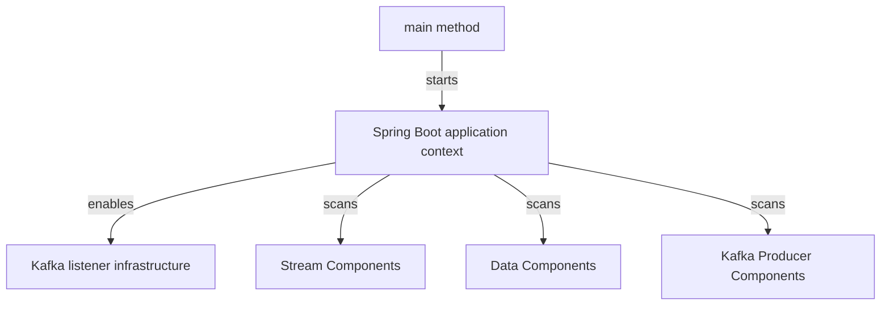

# Application Bootstrap

Application Bootstrap contains `StreamApplication`, the executable entry point for Stream Service Core. Its `main` method invokes Spring Boot with `StreamApplication` as the primary source, creating the application context and beginning normal service startup.

## Runtime Assembly

`@SpringBootApplication` supplies the standard Spring Boot application configuration. `@EnableKafka` activates the infrastructure needed to detect and run Kafka listeners, including the inbound log consumer documented alongside this module.

## Component Scan Boundaries

The explicit component scan includes these packages:

| Package | Purpose in this module |
| --- | --- |
| `com.openframe.stream` | Stream Service Core components, including its listeners and processors. |
| `com.openframe.data` | Data-layer components required by stream processing. |
| `com.openframe.kafka.producer` | Kafka producer components available to the service. |

The application class itself contains no business or event-processing logic. It defines the runtime composition boundary that makes those components available as Spring beans.
