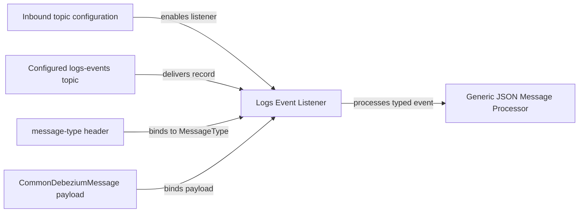
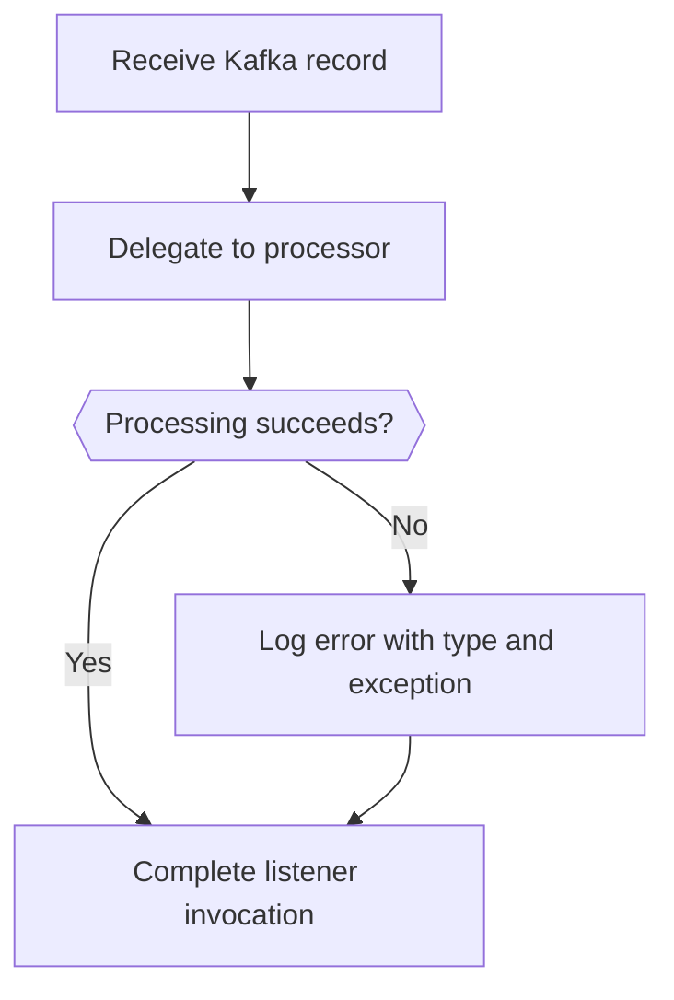

# Log Event Consumption

Log Event Consumption contains `LogsEventListener`, the Kafka-facing consumer for the inbound log-event stream. It accepts multiple logical event types on one topic and uses a Kafka header to identify the type associated with each payload.

## Activation and Subscription

The listener bean is conditional on the presence of `openframe.oss-tenant.kafka.topics.inbound.logs-events.name`. When that property is available, it also names the subscribed Kafka topic. The consumer joins the fixed `openframe-oss-logs-events-group` group and is run by the `ossTenantKafkaListenerContainerFactory` listener container.

## Listener Contract

The `listenLogsEvents` method receives:

| Input | Source | Role |
| --- | --- | --- |
| `CommonDebeziumMessage` | Kafka record payload | Provides the generic Debezium-compatible event body. |
| `MessageType` | `KafkaHeader.MESSAGE_TYPE_HEADER` | Identifies how the generic payload must be processed. |

The listener first logs the received message type and then calls `GenericJsonMessageProcessor.process(message, messageType)`. This keeps topic transport and type-based processing separate: topic selection identifies the log-event stream, while the header carries the logical event kind.

## Failure Behavior

Exceptions raised while processing are caught inside the listener and logged with the message type. The listener does not rethrow the exception in the supplied implementation. Any retry, offset, or dead-letter behavior is therefore dependent on the configured Kafka container factory and processing components, which are outside the supplied source.
