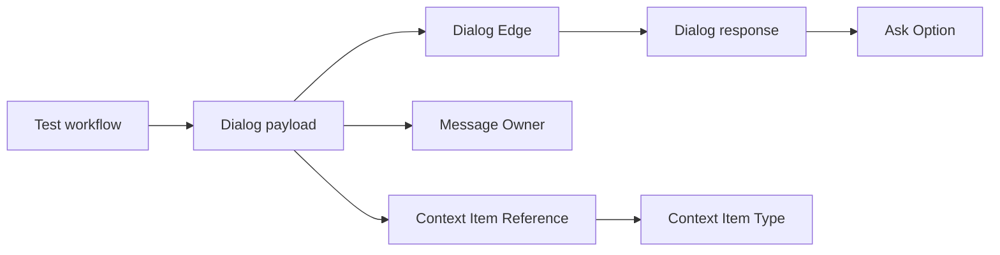
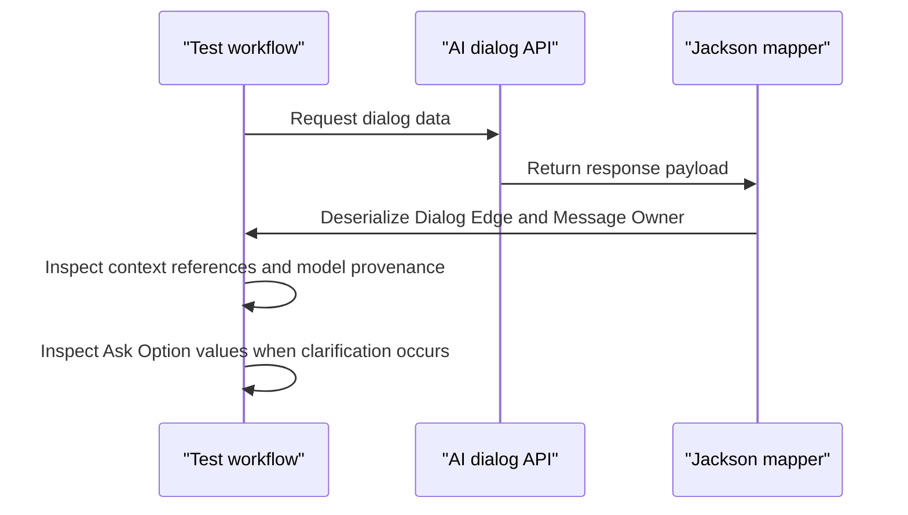

# Ai Dto

## Purpose

Ai Dto is a small group of Java data-transfer objects used by the OpenFrame test service when it reads AI dialog responses and constructs AI-oriented test inputs. The types are supplied by the `com.openframe.oss:openframe-test-service-core` library, version `7.0.11`, which this repository consumes at run time.

The module deliberately models only transport-facing data:

- an option presented when the AI asks for clarification;
- a typed reference to contextual business data;
- a cursor-bearing edge around a dialog response; and
- provenance for an AI-produced message.

It does not choose a model, resolve context, select an execution target, or execute an AI action. Those responsibilities belong to the surrounding AI service and test workflows.

## Scope and Boundaries

All five supplied classes are mutable Lombok DTOs. Lombok provides accessors, mutators, builders, no-argument constructors, and all-argument constructors. Jackson annotations control their JSON compatibility.

| Component | Responsibility | JSON compatibility behavior |
| --- | --- | --- |
| [Ask Option](https://github.com/flamingo-stack/openframe-oss-lib/blob/7a766f00e4f58b5d89db007b878ac8d6e0c344f4/openframe-test-service-core/src/main/java/com/openframe/test/data/dto/ai/AskOption.java) | Describes one answer offered by an AI clarification request. | Ignores unknown incoming fields. |
| [Context Item Reference](https://github.com/flamingo-stack/openframe-oss-lib/blob/7a766f00e4f58b5d89db007b878ac8d6e0c344f4/openframe-test-service-core/src/main/java/com/openframe/test/data/dto/ai/ContextItemReference.java) | Identifies supplemental prompt context with a type and identifier. | Omits fields whose values are null. |
| [Context Item Type](https://github.com/flamingo-stack/openframe-oss-lib/blob/7a766f00e4f58b5d89db007b878ac8d6e0c344f4/openframe-test-service-core/src/main/java/com/openframe/test/data/dto/ai/ContextItemType.java) | Constrains the kinds of contextual objects that can be referenced. | Serialized as an enum value under the application's Jackson configuration. |
| [Dialog Edge](https://github.com/flamingo-stack/openframe-oss-lib/blob/7a766f00e4f58b5d89db007b878ac8d6e0c344f4/openframe-test-service-core/src/main/java/com/openframe/test/data/dto/ai/DialogEdge.java) | Pairs a pagination cursor with one dialog response node. | Ignores unknown incoming fields. |
| [Message Owner](https://github.com/flamingo-stack/openframe-oss-lib/blob/7a766f00e4f58b5d89db007b878ac8d6e0c344f4/openframe-test-service-core/src/main/java/com/openframe/test/data/dto/ai/MessageOwner.java) | Captures the owner type and, for assistant messages, resolved model provenance. | Ignores unknown incoming fields. |

## Architecture

`DialogEdge` refers to `DialogResponse`, and `MessageOwner` refers to `MessageOwnerType`. The supplied source identifies those types but does not include their definitions. Likewise, `AskOption` is documented as the option payload associated with an ASK message data type. This documentation therefore records the relationships without inferring fields or wire formats for those unprovided types.

## Component Details

### Ask Option

`AskOption` contains a human-readable `label` and `description`. It represents an individual alternative in an AI clarification response. The class documentation explains that the option list helps diagnose ambiguous prompts: it shows the alternatives the router could not select between. Tests can use that evidence to refine prompt wording so execution continues rather than pausing for a choice.

Because it uses `JsonIgnoreProperties(ignoreUnknown = true)`, a test client can deserialize a response that includes future option fields without failing solely due to those additions.

### Context Item Reference and Context Item Type

`ContextItemReference` is a two-field pointer:

- `type` identifies the domain category;
- `id` identifies one item within that category.

`ContextItemType` supports `DEVICE`, `SCRIPT`, `TICKET`, `ORGANIZATION`, `USER`, `KB_ARTICLE`, `POLICY`, `QUERY`, and `SCHEDULED_SCRIPT`.

The type is explicitly prompt enrichment, not device targeting. In particular, adding a device reference provides context to the AI but does not change the machine selected for execution; the dialog's ticket remains responsible for resolving that target.

The `NON_NULL` inclusion policy makes the wire representation compact when either field has not been populated. Callers should normally set both fields, since an identifier without its domain type is ambiguous and a type without an identifier does not select a particular context item.

### Dialog Edge

`DialogEdge` implements the common cursor-and-node pagination shape:

- `cursor` is the opaque position associated with the item; and
- `node` is the corresponding `DialogResponse`.

The DTO does not implement paging traversal or cursor validation. It simply preserves the server-provided pairing for test assertions and subsequent request construction. Unknown JSON properties are tolerated for forward compatibility.

### Message Owner

`MessageOwner` separates the owner category from assistant-model provenance:

- `type` is a `MessageOwnerType` value that identifies the owner class;
- `model`, `modelName`, and `providerName` apply only when the owner is an assistant.

For an assistant response, these fields capture the resolved model identifier plus its display and provider names when the message is saved. This lets tests distinguish the configured intent from the model that actually produced a particular reply. Consumers should avoid treating the assistant-only fields as required for every owner type.

## Data Flow

The DTOs participate in dialog inspection rather than performing business operations themselves.

## Design Considerations for Maintainers

- Preserve the existing Jackson annotations when evolving fields. `AskOption`, `DialogEdge`, and `MessageOwner` are tolerant readers; `ContextItemReference` intentionally suppresses null fields.
- Treat `ContextItemType` additions as a contract change. New enum values may require test fixtures and consumers to recognize another context category.
- Keep provenance fields semantically limited to assistant-owned messages. Filling them for another owner type would weaken the DTO's documented contract.
- Do not assign execution semantics to context references. The supplied contract specifically separates prompt context from the ticket-derived execution target.
- Avoid adding validation or remote calls to these classes. Their role is serialization, deserialization, and test-readable representation.

## Runtime Position

Ai Dto is library code from OpenFrame OSS Library, not a standalone service in this repository. The tenant repository consumes the library through the `openframe-test-service-core` artifact. In the broader platform, the test-service types support AI-related test scenarios while the tenant deployment supplies the application services and infrastructure they exercise.
