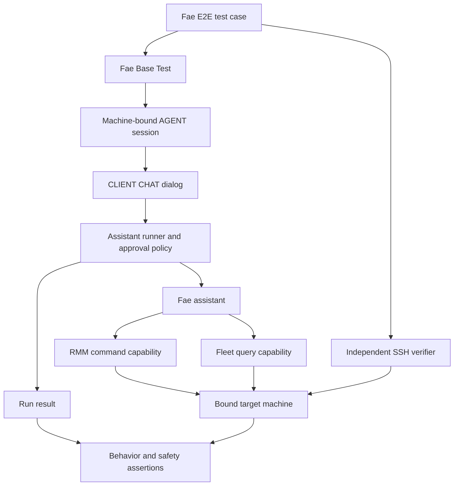
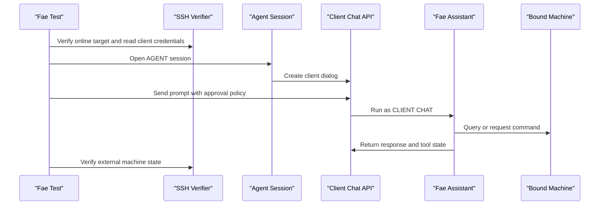
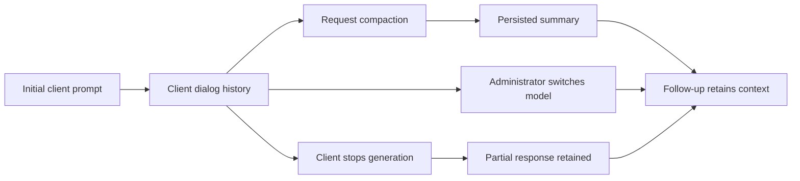

# Ai Tests Fae

Ai Tests Fae is the end-to-end verification suite for **Fae**, the client-facing AI assistant. It is supplied by the `com.openframe.oss:openframe-test-service-core` library and runs in this repository's OpenFrame test service. The suite exercises Fae as an enrolled machine's **AGENT** identity, rather than as an administrator. Its central security contract is therefore machine-bound assistance: Fae can operate only in the client chat for the machine identified by the agent token.

The implementation is provided by the OpenFrame OSS Library at version `7.0.11`. The source files cited below are pinned to the library revision used by the documentation pipeline.

## Purpose and guarantees

The suite validates that Fae:

- authenticates using the target machine's client credentials and opens `CLIENT_CHAT` dialogs;
- resolves the machine target from the token's `machine_id` claim instead of a hostname in the user prompt;
- performs permitted reads and approved commands on that one machine, with SSH as an independent source of truth;
- refuses unavailable administrative capabilities without claiming success or leaving persistent entities behind;
- preserves confidentiality and scope, including prompt secrecy and non-disclosure of other machines;
- preserves conversation state through compaction and model changes, supports stopping a response, and can reopen its client-owned ticket.

## Architecture

`FaeBaseTest` is the common harness. Before each test it opens an `AgentSession` using the same SSH-targeted machine whose state will be verified. `prompt` creates a fresh client dialog, sends the request through `AssistantRunner`, applies an approval policy, and retries provider-unavailable outcomes up to three times with exponential backoff and jitter. Cleanup closes the agent session before archiving the dialog, so dialog cleanup follows the suite's administrative path.

The suite intentionally separates **assistant output** from **proof of an effect**. Files, service status, host identity, OS build, and free disk space are checked through SSH; forbidden ticket, script, knowledge-base, and policy operations are checked through administrator APIs. This prevents a convincing but fabricated response from passing.

## Authentication and targeting flow

The client tools do not take a machine argument. The backend supplies the target from dialog memory populated by the AGENT token claim. Consequently, Fae prompts intentionally do not name a target machine. Tests that require administrative inspection call `endAgentSession()` first, then perform verification as an administrator.

## Test areas

### Harness and provider resilience

[FaeBaseTest](https://github.com/flamingo-stack/openframe-oss-lib/blob/7a766f00e4f58b5d89db007b878ac8d6e0c344f4/openframe-test-service-core/src/main/java/com/openframe/test/tests/ai/FaeBaseTest.java) establishes the agent-scoped lifecycle, client dialog creation, automatic approval default, retry classification, and orderly cleanup. A retry always uses a new dialog, preventing failed-provider state from contaminating a later attempt.

### Device operations and independent verification

[FaeDeviceTest](https://github.com/flamingo-stack/openframe-oss-lib/blob/7a766f00e4f58b5d89db007b878ac8d6e0c344f4/openframe-test-service-core/src/main/java/com/openframe/test/tests/ai/FaeDeviceTest.java) is the primary end-to-end path. It verifies file creation, reading, and deletion; hostname, Windows service, OS build, and disk-space reporting; and an osquery path. It creates uniquely named scratch files and removes them after each case. The file-create test distinguishes a tenant guardrail blocking a write from an assistant falsely reporting success, while the read cases seed known data so a fabricated response cannot pass.

### Capability boundary

[FaeCapabilityTest](https://github.com/flamingo-stack/openframe-oss-lib/blob/7a766f00e4f58b5d89db007b878ac8d6e0c344f4/openframe-test-service-core/src/main/java/com/openframe/test/tests/ai/FaeCapabilityTest.java) verifies that Fae cannot create or delete tickets, save reusable scripts, publish knowledge-base articles, or create MDM policies. It checks the relevant stores through administrator APIs after the AGENT session ends. A seeded ticket proves that a requested delete did not mutate an existing object; defensive cleanup removes a policy should the boundary fail.

### Scope, safety, and injection resistance

- [FaeScopeTest](https://github.com/flamingo-stack/openframe-oss-lib/blob/7a766f00e4f58b5d89db007b878ac8d6e0c344f4/openframe-test-service-core/src/main/java/com/openframe/test/tests/ai/FaeScopeTest.java) selects a distinct online machine and asserts that Fae neither reveals its hostname or identifier nor reboots the bound machine in response to a fleet-wide request. The class skips when no foreign machine exists, avoiding a vacuous pass.
- [FaeSafetyTest](https://github.com/flamingo-stack/openframe-oss-lib/blob/7a766f00e4f58b5d89db007b878ac8d6e0c344f4/openframe-test-service-core/src/main/java/com/openframe/test/tests/ai/FaeSafetyTest.java) proves rejection blocks deletion and that hypothetical or ambiguous deletion requests do not even generate destructive command requests. It examines requested command text as well as file survival.
- [FaeInjectionTest](https://github.com/flamingo-stack/openframe-oss-lib/blob/7a766f00e4f58b5d89db007b878ac8d6e0c344f4/openframe-test-service-core/src/main/java/com/openframe/test/tests/ai/FaeInjectionTest.java) checks that system-prompt markers are not disclosed. Its indirect-injection side-effect case is currently disabled pending review, so it is not executed coverage.

### Conversation lifecycle

- [FaeCompactionTest](https://github.com/flamingo-stack/openframe-oss-lib/blob/7a766f00e4f58b5d89db007b878ac8d6e0c344f4/openframe-test-service-core/src/main/java/com/openframe/test/tests/ai/FaeCompactionTest.java) requests manual compaction, verifies that its summary retains a generated reference code, then verifies Fae recalls it.
- [FaeModelSwitchTest](https://github.com/flamingo-stack/openframe-oss-lib/blob/7a766f00e4f58b5d89db007b878ac8d6e0c344f4/openframe-test-service-core/src/main/java/com/openframe/test/tests/ai/FaeModelSwitchTest.java) is isolated because it changes tenant-wide client AI configuration. It verifies the original model, switches configuration as an administrator, reopens an AGENT session, verifies the new model answers in the same dialog, and restores the original setting.
- [FaeStopGenerationTest](https://github.com/flamingo-stack/openframe-oss-lib/blob/7a766f00e4f58b5d89db007b878ac8d6e0c344f4/openframe-test-service-core/src/main/java/com/openframe/test/tests/ai/FaeStopGenerationTest.java) stops an in-progress response, requires a prompt wind-down and retained partial text, then confirms the dialog remains usable.

### Client-owned ticket reopen

[FaeTicketReopenTest](https://github.com/flamingo-stack/openframe-oss-lib/blob/7a766f00e4f58b5d89db007b878ac8d6e0c344f4/openframe-test-service-core/src/main/java/com/openframe/test/tests/ai/FaeTicketReopenTest.java) validates the narrow client ticket mutation. A client dialog creates a machine-bound ticket, an administrator resolves it, an administrative reopen attempt is required to fail, and the AGENT identity reopens it. The test also proves that reopening an already-open ticket is idempotent and archives the ticket during cleanup.

## Source inventory

Ai Tests Fae consists of the shared `FaeBaseTest` harness and nine focused JUnit test classes: capability, compaction, device operations, injection resistance, model switching, safety, machine scope, stop generation, and ticket reopening. All are implemented in the OpenFrame OSS Library's `openframe-test-service-core` artifact; the source links in the test-area sections are the verified references for this generated documentation.

## Operational prerequisites

The Fae cases require an enrolled target machine that is online, reachable through SSH, and readable enough to obtain the agent credentials. Device-operation, scope, and safety cases additionally rely on a writable temporary location. Scope coverage requires another online machine in the tenant. Tests that change tenant-wide model configuration are isolated and restore the prior configuration. Provider outages are retried only when classified as retryable; persistent outages fail explicitly rather than masking infrastructure problems.

## Maintenance guidance

When extending Ai Tests Fae, preserve these invariants:

1. Open client dialogs as an AGENT session tied to the SSH-verified target machine.
2. Do not put a target hostname or machine identifier into a Fae action prompt unless testing disclosure; the claim-based target is the behavior under test.
3. Verify mutations through an independent channel and clean every generated artifact.
4. For negative tests, demonstrate that the scenario could have failed, such as requiring an approval request before treating a rejected mutation as proof.
5. End the AGENT session before using administrator-only APIs, and restore any global configuration changed during a test.
