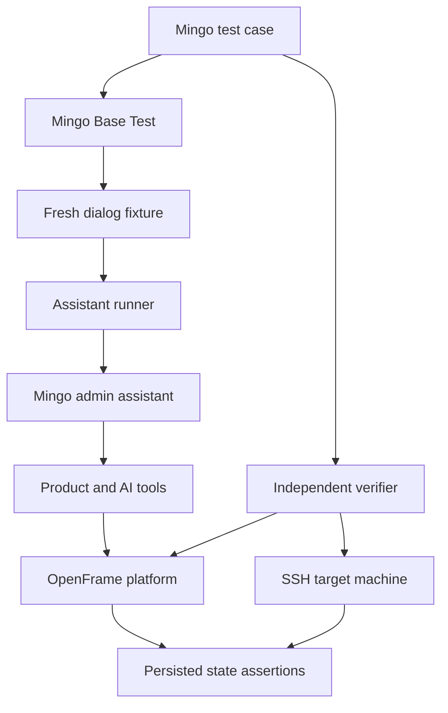

# Ai Tests Mingo

Ai Tests Mingo is the end-to-end verification suite for Mingo, OpenFrame's administrative AI assistant. It is implemented by the `openframe-test-service-core` library from the OpenFrame OSS Library (`com.openframe.oss:openframe-test-service-core`) and is run by this repository's OpenFrame test service. The suite drives real assistant conversations through product APIs, applies approval policies, and verifies outcomes through independent product APIs or SSH rather than trusting assistant prose.

## Purpose

The suite protects the behavioral contracts that matter when an administrator delegates work to Mingo:

- assistant conversations retain the intended context and recover cleanly from provider outages;
- device operations change only the intended remote machines and produce observable results;
- platform entities, Fleet MDM resources, and workspace tickets are changed through authorized workflows;
- current information and directory results come from assistant tools rather than model memory;
- a rejected approval, hypothetical request, or untrusted ticket content cannot cause an unintended action; and
- compaction, cancellation, and tenant-wide model switching preserve usable conversation behavior.

## Architecture

`MingoBaseTest` is the common control point. It opens a new dialog per prompt attempt, sends the prompt with an approval policy, retries only classified provider outages up to three times with exponential backoff and jitter, and archives the dialog after each test. A retry always uses a new dialog so duplicate prompt history and conversation-wide errors cannot contaminate a successful retry.

## Test Design Principles

### Independent verification

Mutation tests establish setup data directly through product APIs, invoke Mingo, and retrieve the resulting state independently. Device and fleet tests use SSH as a separate observation channel. This distinguishes an assistant statement from a completed action.

### Deterministic targeting and cleanup

Run-specific identifiers prevent collisions. Tests name an online Windows machine where Mingo must validate scripts, policies, or scheduled queries before saving. Each class tracks files, directories, policies, scripts, tickets, queries, or articles it creates and removes or archives them during teardown on a best-effort basis.

### Approval and failure semantics

Most mutation cases use automatic approval; safety cases deliberately use rejection or allow approval to demonstrate that a hypothetical request still causes no action. Provider exhaustion is treated as `ProviderUnavailableException`; unreachable or offline SSH targets are infrastructure failures, not product behavior failures.

## Functional Areas

The suite is organized into the following documentation areas:

- [Conversation Lifecycle](ai_tests_mingo/conversation_lifecycle/conversation_lifecycle.md) — shared dialog ownership, provider retry, compaction, stop behavior, and model switching.
- [Device and Fleet Operations](ai_tests_mingo/device_and_fleet_operations/device_and_fleet_operations.md) — remote filesystem and system-state work, saved-script execution, multi-host scoping, and osquery coverage.
- [Platform Entities and MDM](ai_tests_mingo/platform_entities_and_mdm/platform_entities_and_mdm.md) — organization and user lookup, web research delegation, scripts, knowledge-base articles, Fleet policies, scheduled queries, and ticket workflows.
- [Safety Controls](ai_tests_mingo/safety_controls/safety_controls.md) — rejected approvals, hypothetical requests, absent data, and prompt-injection resistance.

## System Fit

Ai Tests Mingo is part of the OpenFrame test-service library rather than a production request path. It exercises the tenant deployment end to end: the test runner reaches the administrative assistant through the platform APIs, Mingo invokes platform tools, and the suite checks persisted data or remote machine state. The tests therefore span the API, client, management, gateway, and connected Fleet MDM capabilities without reimplementing their behavior.

## Operational Constraints

- Device-oriented tests require an enrolled, online, SSH-reachable target and a writable scratch directory.
- Multi-host cases additionally require a configured control machine; they skip when that prerequisite is absent.
- Model-switch tests are isolated because the selected Mingo model is tenant-wide. They restore the original choice after execution.
- A small number of cases are intentionally disabled pending review, including script creation, one web-research scenario, and knowledge-base injection coverage.
