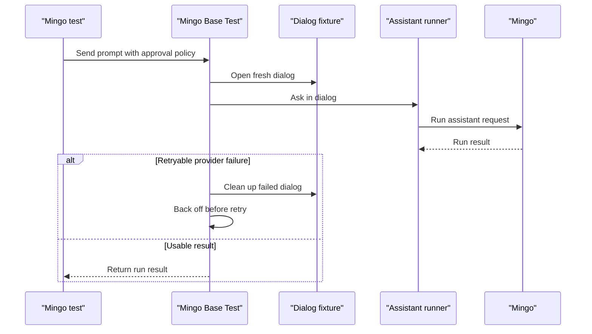

# Conversation Lifecycle

Conversation Lifecycle verifies the infrastructure around an administrative assistant chat. It covers the shared `MingoBaseTest`, `MingoCompactionTest`, `MingoModelSwitchTest`, and `MingoStopGenerationTest` classes supplied by the OpenFrame OSS Library test-service artifact.

## Responsibilities

- Open and clean up a dialog for each test while ensuring a provider retry starts with a new dialog.
- Retry only provider outages, up to three total attempts, using exponential backoff plus random jitter.
- Verify manual memory compaction preserves a seeded reference and rejects empty, duplicate, or in-progress requests with the expected status.
- Verify a stopped generation preserves partial output, completes promptly, and leaves the dialog able to process a subsequent message.
- Verify changing the tenant-wide model between messages preserves the existing conversation and takes effect for the next response.

## Interaction Flow

## Important Guarantees

A retry cannot reuse a dialog: repeating the prompt on the same conversation would add duplicate user context, and older conversation-wide errors could make a successful run appear failed. The model-switch test is isolated from concurrent tests and restores the original configuration after its class completes. Compaction cases intentionally test explicit compaction rather than threshold-triggered behavior, whose token threshold is unsuitable for routine end-to-end runs.
