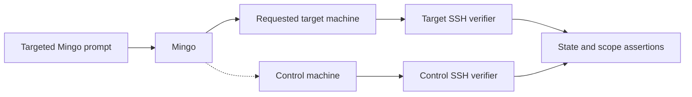

# Device and Fleet Operations

Device and Fleet Operations covers `MingoDeviceTest` and `MingoFleetTest`. These cases prove that Mingo's remote actions affect the intended machines by using SSH as an independent verification channel.

## Device Coverage

`MingoDeviceTest` verifies file creation, reading, deletion, appending, nested-directory creation, and handling of protected locations. It also checks hostname, service state, Windows build, and available disk space against SSH-derived ground truth. Multi-step cases create content in a new directory, read it back, run a saved script, and create then execute a script.

The target is validated as enrolled, online, and SSH-reachable before the class runs. Files, directories, and seeded scripts are registered for teardown. A missing result after a tool reports success is treated as a false-success failure.

## Fleet Scope Coverage

`MingoFleetTest` adds a second, independently reachable control machine. It asserts both sides of scope:

- a request for one machine creates the artifact on the target and not the control machine;
- a request for both machines creates the artifact on both; and
- an operating-system live query uses the osquery tool and reports each requested host.

The class skips when control-machine configuration is unavailable, rather than treating absent optional infrastructure as a product regression.

## Test Invariant

The assistant reply is supporting diagnostic information, not the action proof. An SSH observation of the exact expected file content, service state, or absence on the control host is the behavioral oracle.
